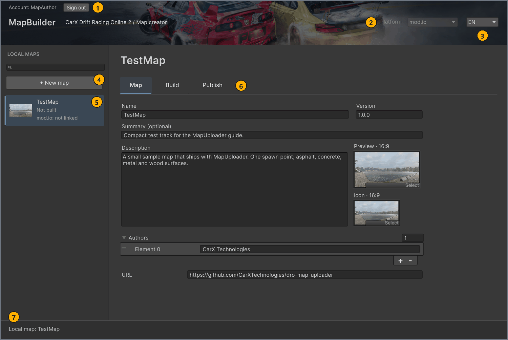
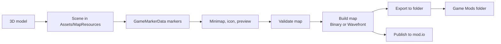

# MapUploader for CarX Drift Racing Online 2

**English** · [Русский](README.ru.md)

Applies to: MapUploader `feature/2.0/3.0` · Unity 6000.3.19f1 · screenshots 2026-10-26

Build maps for CarX Drift Racing Online 2 in Unity, test them in the game, and publish them to mod.io.

You fill in the map settings, build, export and publish the map in the **MapBuilder** window, which you open from **Tools** > **MapBuilder**:



| # | Element | What it does |
| --- | --- | --- |
| 1 | Account state, **Sign in** / **Sign out** | Shows your mod.io account state: `Not signed in` with **Sign in**, or `Account: <name>` with **Sign out**, as in the screenshot. You need to sign in only to publish; validation and building work without it. |
| 2 | **Platform** field in the header | Shows where publications go. It is fixed to `mod.io`. |
| 3 | Language dropdown (**EN** / **RU**) | Switches the interface language. The choice is saved in the Unity editor preferences on this computer. <!-- src: Assets/Editor/MapBuilderEditorWindow.Workspace.cs:14,58 --> |
| 4 | **LOCAL MAPS** | Lists every map config in the project, with a search box. **+ New map** creates a new map config. |
| 5 | Map row | Shows the map name, its build status (`Not built`, `Ready to export` or `Rebuild needed`) and the state of its mod.io publication, such as `mod.io: not linked`. <!-- src: Assets/Editor/MapBuilderEditorWindow.Workspace.cs:198,209 --> |
| 6 | **Map**, **Build** and **Publish** tabs | Open the map settings, the validation and build controls, and the export and publishing controls. |
| 7 | Footer | Shows the status line: the selected map, such as `Local map: TestMap`, or the result of the last operation. While an operation runs, it shows a progress bar and **Cancel**. <!-- src: Assets/Editor/MapBuilderEditorWindow.Workspace.cs:220 --> |

[Open MapBuilder](docs/en/getting-started.md#window) describes the window in more detail.

## Before you start

- Windows 10 or 11, 64-bit. The build optimizer ships only for the Windows x64 Editor; on another system, clear **Optimize build** in each map's **Optimization** settings on the **Build** tab. <!-- src: Assets/Plugins/CarX.Modding.Creator/Editor/SceneExportOptimization.cs:127-130 -->
- Git, to clone the project with its submodule.
- Unity Editor 6000.3.19f1, exactly this version, because another version upgrades the project in place. No extra platform modules are needed.
- A PC copy of CarX Drift Racing Online 2 with mod support, to test the map locally.
- A mod.io account, only for publishing.

> [!WARNING]
> **Code** > **Download ZIP** leaves the submodule folder `Assets/Plugins/CarX.Modding.Creator` empty, so the project doesn't compile. Clone the repository with git instead.

Next: [Get started](docs/en/getting-started.md)

## Quick start

To make, test and publish your first map:

1. In a terminal, clone the repository with its submodule. The `-b feature/2.0/3.0` option checks out the branch that these docs describe.

   ```bash
   git clone --recurse-submodules -b feature/2.0/3.0 https://github.com/CarXTechnologies/dro-map-uploader
   ```

   If git stops at the submodule with `Permission denied (publickey)`, fetch the submodule over HTTPS as described in [Get the project](docs/en/getting-started.md#clone). <!-- src: .gitmodules:3 -->

1. Open the cloned folder in Unity 6000.3.19f1 and wait for the first import to finish. See [Get started](docs/en/getting-started.md).
1. In the **Project** window, create the folder `Assets/MapResources/<MapName>/`, where `<MapName>` is a short folder name such as `MyTrack`, and create a scene with the same name in it. The scene name must start with a letter and use only letters, digits and `_`. See [Create the map folder and scene](docs/en/scene-setup.md#scene). <!-- src: Assets/Scripts/Rules/MapMetaRules.cs:32-40 -->
1. In the **Project** window, import your model into the same folder and drag it into the **Hierarchy**. In the **Inspector**, give every drivable surface a collider. See [Import models](docs/en/scene-setup.md#import) and [Add colliders](docs/en/scene-setup.md#colliders).
1. In the **Hierarchy**, select each object that has a collider. In the **Inspector**, add the GameMarkerData component, and in its type menu, select a surface under **Road**, such as **Road** > **asphalt**. See [Mark road surfaces](docs/en/markers.md#road).
1. Create an empty GameObject and place it where the car starts. In the **Inspector**, add the GameMarkerData component to it; its type is already `SpawnPoint`. See [Add spawn points](docs/en/markers.md#spawn).
1. Create another empty GameObject at the root of the scene. In the **Inspector**, add the Minimap component, set its bounds and assign the minimap image. See [Add the minimap](docs/en/minimap-and-images.md#minimap).
1. In the Unity menu bar, select **Tools** > **MapBuilder**. Under **LOCAL MAPS**, select **+ New map**, and save the map config in `Assets/MapResources/<MapName>/`. See [Create or select a map](docs/en/map-settings.md#new-map).
1. On the **Map** tab, in **Name**, enter the name that players see; it doesn't have to match `<MapName>`. Drag your icon onto the **Icon · 16:9** box: a PNG with Read/Write turned on. See [Fill in the map settings](docs/en/map-settings.md#map-tab).
1. On the **Build** tab, select **Validate map** and fix every error. Then select the **Build map** button. The map row changes to `Ready to export`. See [Build the map](docs/en/build.md) and [Fix validation problems](docs/en/validation.md). <!-- src: Assets/Editor/MapBuilderEditorWindow.Workspace.cs:198 -->
1. On the **Publish** tab, under **Build destination**, select the **Export to folder** option. In **Folder**, enter the absolute path `<game folder>/Mods/<MapName>`, where `<game folder>` is the folder with the game executable. Select the **Export to folder** button, then load the map in the game. See [Test the map in the game](docs/en/test-in-game.md). <!-- src: DR3PC1:Assets/Modules/CarX.Modding/Runtime/Providers/DefaultCollectionProvider.cs:28 -->
1. In the **MapBuilder** header, select **Sign in** and complete the mod.io sign-in. See [Sign in to mod.io](docs/en/publish.md#sign-in).
1. On the **Publish** tab, under **Build destination**, select the **Platform** option. Under **Publications**, select **Create publication**.

Result: the footer shows `Publication created.`, and the map is on mod.io as a hidden publication. To finish the publication and make it public, follow the remaining steps in [Create a publication](docs/en/publish.md#create). <!-- src: Assets/Editor/MapBuilderEditorWindow.Publish.cs:183 -->

## How it works



You set up a Unity scene with markers and images, validate and build it, export the build to the game's `Mods` folder to test it, and publish the same build to mod.io.

## Documentation

| Page | What you do there |
| --- | --- |
| [Get started](docs/en/getting-started.md) | Clone the project, install Unity, open MapBuilder and choose its interface language. |
| [Set up the scene](docs/en/scene-setup.md) | Create the map folder and scene, and set up models, materials, colliders, dynamic objects, LOD groups and lighting. |
| [Add markers](docs/en/markers.md) | Place spawn points, mark road surfaces, animate objects and replace materials with render core variants. |
| [Minimap, icon and preview](docs/en/minimap-and-images.md) | Add the minimap, capture images with CaptureCamera and check the image requirements. |
| [Fill in the map settings](docs/en/map-settings.md) | Create a map config and fill in the **Map** tab. |
| [Build the map](docs/en/build.md) | Choose the scene and format, build the map, tune optimization and find the build cache. |
| [Fix validation problems](docs/en/validation.md) | Run **Validate map** and read the **Map Validation** window. |
| [Test the map in the game](docs/en/test-in-game.md) | Export the map to the game's `Mods` folder, drive it and run the pre-publish checklist. |
| [Publish to mod.io](docs/en/publish.md) | Sign in, then create, update and delete publications. |
| [Troubleshooting](docs/en/troubleshooting.md) | Find the cause and fix for validation messages, build errors, greyed-out controls and in-game problems. |
| [Reference](docs/en/reference.md) | Look up limits, supported components, road surfaces, menus, stored settings and the glossary. |

The [documentation contents](docs/en/README.md) list the same pages in reading order.

## Limits at a glance

| What | Limit |
| --- | --- |
| Name | 50 characters: letters, digits, spaces and `- _ ' . , : ! ? ( ) & + /`, with no leading or trailing spaces. <!-- src: Assets/Scripts/Rules/MapMetaRules.cs:8; Assets/Resources/CarX.Modding/ModIoConfig.asset:28 --> |
| Summary | 250 characters. Only the first line is used. When Summary is empty, the first line of the description is used; when both are empty, the summary is `<Name> track.` <!-- src: Assets/Scripts/Rules/MapMetaRules.cs:47-60; Assets/Resources/CarX.Modding/ModIoConfig.asset:29 --> |
| Description | 50 000 characters. mod.io receives it from **Create publication** when it isn't empty, and from **Update publication** with **Update description** selected. <!-- src: Assets/Resources/CarX.Modding/ModIoConfig.asset:30; Assets/Editor/MapBuilder.Publishing.cs:91,235-237 --> |
| Icon | Required. PNG with Read/Write on, ≤ 8 MB. mod.io needs at least 512 × 288; 16:9 is recommended, and the tool doesn't check the pixel size. <!-- src: Assets/Editor/Validation/MapMetaValidator.cs:99-117; Assets/Resources/CarX.Modding/ModIoConfig.asset:27; Assets/Plugins/Modio/Modio/API/Generated/Definitions/RequestObjects/EditModRequest.cs:31 --> |
| Preview | Optional. PNG with Read/Write on, ≤ 10 MB. 16:9 is recommended; the tool doesn't check it. <!-- src: Assets/Editor/Validation/MapMetaValidator.cs:14,120-137 --> |
| Scene name | Starts with a letter and uses only letters, digits and `_`. <!-- src: Assets/Scripts/Rules/MapMetaRules.cs:32-45 --> |
| Build size | Map ≤ 4096 MB, metadata ≤ 24 MB, measured on the build cache folders `MapTemp` and `MetaTemp`, not on `mod.cxmod`. Checked only when you create or update a publication. <!-- src: Assets/Editor/MapBuilder.Storage.cs:158-182; Assets/Resources/CarX.Modding/ModIoConfig.asset:25-26 --> |
| Scene contents | Exactly 1 Minimap; at least 1 SpawnPoint; ≤ 500 lights (only Point and Spot lights are exported, and in the game they turn on only at night); ≤ 1000 Rigidbodies; ≤ 8 LOD levels per LODGroup. <!-- src: Assets/Editor/MapSceneRules.cs:11-24; Assets/Editor/Validation/SceneValidator.cs:278-284,811; Assets/Plugins/CarX.Modding.Creator/Editor/SceneFormatCollector.cs:98-100; DR3PC1:Assets/DR3/Scripts/States/Controllers/Mods/ModLightsDayNightBehaviour.cs:36-53 --> |

Next: [Reference](docs/en/reference.md)

## Getting help

Check [Troubleshooting](docs/en/troubleshooting.md) first. To report a wrong step or an outdated screenshot, open an issue in [this repository's issue tracker](https://github.com/CarXTechnologies/dro-map-uploader/issues) and name the page and the branch.

## For integrators

You don't need these pages to make or publish a map. They describe the mod file format and the publishing layer for people who extend MapUploader or read its output.

[Mod format: Wavefront and Binary](docs/en/advanced/mod-format.md) · [Publishing vendors](docs/en/advanced/publishing-vendors.md)
