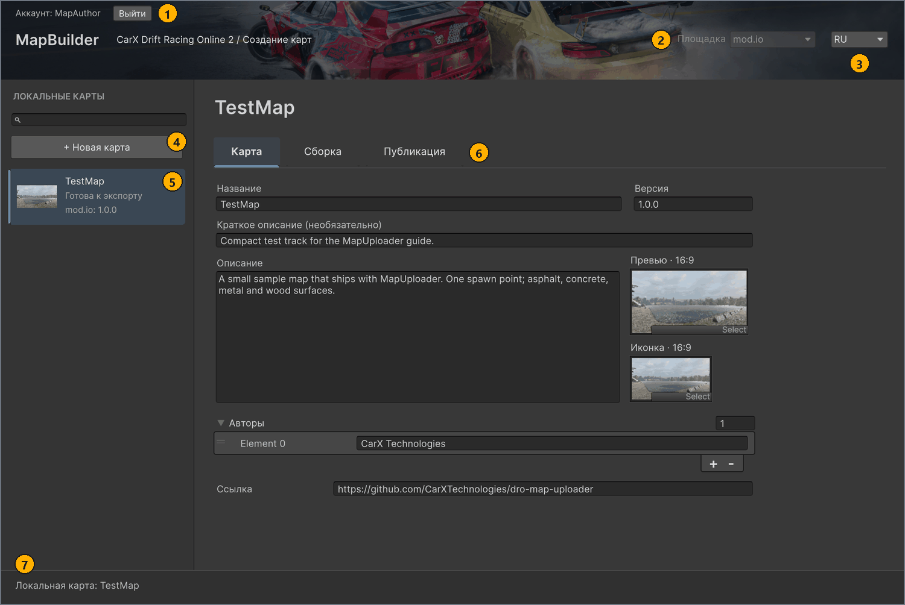
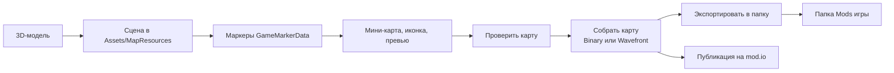

# MapUploader для CarX Drift Racing Online 2

[English](README.md) · **Русский**

Относится к: MapUploader `feature/2.0/3.0` · Unity 6000.3.19f1 · скриншоты 26.10.2026

Создавайте карты для CarX Drift Racing Online 2 в Unity, проверяйте их в игре и публикуйте на mod.io.

Настройки карты, сборка, экспорт и публикация выполняются в окне **MapBuilder**, которое открывается из меню **Tools** > **MapBuilder**:

| # | Элемент | Назначение |
| --- | --- | --- |
| 1 | Состояние аккаунта, **Войти** (Sign in) / **Выйти** (Sign out) | Показывает состояние аккаунта mod.io: `Не выполнен вход` (`Not signed in`) с кнопкой **Войти** или `Аккаунт: <имя>` (`Account: <name>`) с кнопкой **Выйти**, как на скриншоте. Входить нужно только для публикации: проверка и сборка работают без входа. |
| 2 | Поле **Площадка** (Platform) в шапке окна | Показывает, куда отправляются публикации. Значение всегда `mod.io`. |
| 3 | Раскрывающийся список языка (**EN** / **RU**) | Переключает язык интерфейса. Выбор сохраняется в настройках редактора Unity на этом компьютере. <!-- src: Assets/Editor/MapBuilderEditorWindow.Workspace.cs:14,58 --> |
| 4 | **ЛОКАЛЬНЫЕ КАРТЫ** (LOCAL MAPS) | Список всех настроек карт в проекте с полем поиска. Кнопка **+ Новая карта** (+ New map) создаёт новые настройки карты. |
| 5 | Строка карты | Показывает название карты, состояние её сборки (`Не собрана`, `Готова к экспорту` или `Нужна пересборка`; в английском интерфейсе `Not built`, `Ready to export`, `Rebuild needed`) и состояние её публикации на mod.io, например `mod.io: нет связанной публикации` (`mod.io: not linked`). <!-- src: Assets/Editor/MapBuilderEditorWindow.Workspace.cs:198,209 --> |
| 6 | Вкладки **Карта** (Map), **Сборка** (Build) и **Публикация** (Publish) | Открывают настройки карты, элементы проверки и сборки, а также элементы экспорта и публикации. |
| 7 | Нижняя панель | Показывает строку состояния: выбранную карту, например `Локальная карта: TestMap` (`Local map: TestMap`), или результат последней операции. Пока операция выполняется, здесь видны индикатор выполнения и кнопка **Отмена** (Cancel). <!-- src: Assets/Editor/MapBuilderEditorWindow.Workspace.cs:220 --> |

Подробнее окно описано в разделе [Открытие MapBuilder](docs/ru/getting-started.md#window).

## Перед началом работы

- Windows 10 или 11, 64-разрядная. Оптимизатор сборки поставляется только для редактора под Windows x64; в другой системе снимите флажок **Оптимизировать сборку** (Optimize build) в настройках **Оптимизация** (Optimization) каждой карты на вкладке **Сборка**. <!-- src: Assets/Plugins/CarX.Modding.Creator/Editor/SceneExportOptimization.cs:127-130 -->
- Git — чтобы клонировать проект вместе с сабмодулем.
- Unity Editor 6000.3.19f1, именно эта версия: другая версия при открытии перезапишет файлы проекта под себя. Дополнительные модули платформ не нужны.
- ПК-версия CarX Drift Racing Online 2 версии 0.21.4 или новее, которая загружает локальные карты из своей папки `Mods`, — чтобы проверить карту локально. См. [Проверка загрузки локальных карт в игре](docs/ru/test-in-game.md#check-game).
- Аккаунт mod.io — только для публикации.

> [!WARNING]
> **Code** > **Download ZIP** оставляет папку сабмодуля `Assets/Plugins/CarX.Modding.Creator` пустой, и проект не компилируется. Клонируйте репозиторий с помощью git.

## Быстрый старт

Чтобы создать, проверить и опубликовать первую карту:

1. В терминале клонируйте репозиторий вместе с сабмодулем на ветке, которую описывает эта документация. Команда и решение на случай, если сабмодуль не загрузился, приведены в разделе [Получение проекта](docs/ru/getting-started.md#clone).
1. Откройте склонированную папку в Unity 6000.3.19f1 и дождитесь окончания первого импорта. См. [Начало работы](docs/ru/getting-started.md).
1. В окне **Project** создайте папку `Assets/MapResources/<MapName>/`, где `<MapName>` — короткое имя папки, например `MyTrack`, и создайте в ней сцену с тем же именем. Имя сцены должно начинаться с буквы и содержать только буквы, цифры и `_`. См. [Создание папки и сцены карты](docs/ru/scene-setup.md#scene). <!-- src: Assets/Scripts/Rules/MapMetaRules.cs:32-40 -->
1. В окне **Project** импортируйте модель в ту же папку и перетащите её в окно **Hierarchy**. В окне **Inspector** добавьте коллайдер каждой поверхности, по которой можно ехать. См. [Импорт моделей](docs/ru/scene-setup.md#import) и [Добавление коллайдеров](docs/ru/scene-setup.md#colliders).
1. В окне **Hierarchy** выберите каждый объект с коллайдером. В окне **Inspector** добавьте компонент GameMarkerData и в его меню типа выберите поверхность в разделе **Road**, например **Road** > **asphalt**. См. [Разметка дорожных поверхностей](docs/ru/markers.md#road).
1. Создайте пустой GameObject и поместите его туда, где стартует машина. В окне **Inspector** добавьте к нему компонент GameMarkerData; его тип уже `SpawnPoint`. См. [Добавление точек появления](docs/ru/markers.md#spawn).
1. Создайте ещё один пустой GameObject в корне сцены. В окне **Inspector** добавьте компонент Minimap и задайте его границы по области карты. См. [Добавление мини-карты](docs/ru/minimap-and-images.md#minimap).
1. Добавьте компонент CaptureCamera к камере внутри корневого объекта с тегом `Garbage` и снимите мини-карту сверху, иконку и превью. Назначьте изображение мини-карты в поле **Main Texture** компонента Minimap. См. [Съёмка изображений с помощью CaptureCamera](docs/ru/minimap-and-images.md#capture).
1. В строке меню Unity выберите **Tools** > **MapBuilder**. В разделе **ЛОКАЛЬНЫЕ КАРТЫ** нажмите **+ Новая карта** и сохраните настройки карты в `Assets/MapResources/<MapName>/`. См. [Создание или выбор карты](docs/ru/map-settings.md#new-map).
1. На вкладке **Карта** в поле **Название** (Name) введите название, которое увидят игроки; оно не обязано совпадать с `<MapName>`. Перетащите иконку в поле **Иконка · 16:9** (Icon · 16:9) и, при желании, превью в поле **Превью · 16:9** (Preview · 16:9). См. [Заполнение вкладки «Карта»](docs/ru/map-settings.md#map-tab).
1. На вкладке **Сборка** нажмите **Проверить карту** (Validate map) и исправьте все ошибки. Затем нажмите кнопку **Собрать карту** (Build map). Состояние в строке карты сменится на `Готова к экспорту`. См. [Сборка карты](docs/ru/build.md) и [Проверка карты](docs/ru/validation.md). <!-- src: Assets/Editor/MapBuilderEditorWindow.Workspace.cs:198 -->
1. На вкладке **Публикация** в разделе **Куда отправить сборку** (Build destination) выберите вариант **Экспорт в папку** (Export to folder). В поле **Папка** (Folder) введите абсолютный путь `<game folder>/Mods/<MapName>`, где `<game folder>` — папка с исполняемым файлом игры. Нажмите кнопку **Экспортировать в папку** (Export to folder), затем загрузите карту в игре. См. [Тест в игре](docs/ru/test-in-game.md). <!-- src: game -->
1. В шапке окна **MapBuilder** нажмите **Войти** и завершите вход в mod.io. См. [Вход в mod.io](docs/ru/publish.md#sign-in).
1. На вкладке **Публикация** в разделе **Куда отправить сборку** выберите вариант **Площадка**. В разделе **Публикации** (Publications) нажмите **Создать публикацию** (Create publication).
1. Когда в нижней панели появится `Публикация создана.` (`Publication created.`), не снимая выбор с новой публикации, снова нажмите кнопку **Собрать карту** на вкладке **Сборка**, а затем **Обновить публикацию** (Update publication) на вкладке **Публикация**. Первая загрузка содержит временный id вместо mod.io id публикации. См. [Создание публикации](docs/ru/publish.md#create).

Результат: в нижней панели появится `Публикация обновлена.` (`Publication updated.`), а карта окажется на mod.io как скрытая публикация. Как сделать её публичной, см. в разделе [Открытие публикации для игроков](docs/ru/publish.md#make-public). <!-- src: Assets/Editor/MapBuilderEditorWindow.Publish.cs:105 -->

## Как это устроено

Вы настраиваете сцену Unity с маркерами и изображениями, проверяете и собираете её, экспортируете сборку в папку `Mods` игры, чтобы проверить карту, и публикуете ту же сборку на mod.io.

## Документация

| Страница | Что вы делаете на странице |
| --- | --- |
| [Начало работы](docs/ru/getting-started.md) | Клонируете проект, устанавливаете Unity, открываете MapBuilder и выбираете язык его интерфейса. |
| [Подготовка сцены](docs/ru/scene-setup.md) | Создаёте папку и сцену карты, настраиваете модели, материалы, коллайдеры, динамические объекты, группы LOD и освещение. |
| [Маркеры GameMarkerData](docs/ru/markers.md) | Расставляете точки появления, задаёте дорожные поверхности, анимируете объекты и заменяете материалы вариантами render core. |
| [Мини-карта, иконка и превью](docs/ru/minimap-and-images.md) | Добавляете мини-карту, снимаете изображения с помощью CaptureCamera и проверяете требования к изображениям. |
| [Настройки карты (вкладка «Карта»)](docs/ru/map-settings.md) | Создаёте настройки карты и заполняете вкладку **Карта**. |
| [Сборка карты](docs/ru/build.md) | Выбираете сцену и формат, собираете карту, настраиваете оптимизацию и находите кэш сборки. |
| [Проверка карты](docs/ru/validation.md) | Запускаете **Проверить карту** и разбираете окно **Map Validation**. |
| [Тест в игре](docs/ru/test-in-game.md) | Экспортируете карту в папку `Mods` игры, проезжаете её и проходите чек-лист перед публикацией. |
| [Публикация на mod.io](docs/ru/publish.md) | Входите в аккаунт, затем создаёте, обновляете и удаляете публикации. |
| [Решение проблем](docs/ru/troubleshooting.md) | Находите причину и решение для сообщений проверки, ошибок сборки, неактивных элементов управления и проблем в игре. |
| [Справочник](docs/ru/reference.md) | Находите лимиты, поддерживаемые компоненты, дорожные поверхности, меню, места хранения настроек и глоссарий. |

[Оглавление документации](docs/ru/README.md) перечисляет те же страницы в порядке чтения.

## Основные ограничения

| Что | Ограничение |
| --- | --- |
| Название | 50 символов: буквы, цифры, пробелы и `- _ ' . , : ! ? ( ) & + /`, без пробелов в начале и в конце. <!-- src: Assets/Scripts/Rules/MapMetaRules.cs:8; Assets/Resources/CarX.Modding/ModIoConfig.asset:28 --> |
| Краткое описание (Summary) | 250 символов. Используется только первая строка. Если краткое описание пустое, берётся первая строка описания; если пусты оба поля, краткое описание будет `<Name> track.` <!-- src: Assets/Scripts/Rules/MapMetaRules.cs:47-60; Assets/Resources/CarX.Modding/ModIoConfig.asset:29 --> |
| Описание (Description) | 50 000 символов. На mod.io оно попадает через **Создать публикацию**, если оно не пустое, и через **Обновить публикацию** (Update publication) с установленным флажком **Обновить описание** (Update description). <!-- src: Assets/Resources/CarX.Modding/ModIoConfig.asset:30; Assets/Editor/MapBuilder.Publishing.cs:91,235-237 --> |
| Иконка и превью (Preview) | Иконка обязательна, превью — нет. Формат, размер файла и размер в пикселях см. в разделе [Требования к изображениям](docs/ru/minimap-and-images.md#images). |
| Имя сцены | Начинается с буквы и содержит только буквы, цифры и `_`. <!-- src: Assets/Scripts/Rules/MapMetaRules.cs:32-45 --> |
| Размер сборки | Карта ≤ 4096 МБ, метаданные ≤ 24 МБ; размер измеряется по папкам кэша сборки `MapTemp` и `MetaTemp`, а не по `mod.cxmod`. Проверяется только при создании или обновлении публикации. <!-- src: Assets/Editor/MapBuilder.Storage.cs:158-182; Assets/Resources/CarX.Modding/ModIoConfig.asset:25-26 --> |
| Состав сцены | Ровно 1 Minimap; не меньше 1 SpawnPoint; ≤ 500 источников света (экспортируются только Point и Spot, а в игре они включаются только ночью); ≤ 1000 Rigidbody; ≤ 8 уровней LOD на LODGroup. <!-- src: Assets/Editor/MapSceneRules.cs:11-24; Assets/Editor/Validation/SceneValidator.cs:286-292,827; Assets/Plugins/CarX.Modding.Creator/Editor/SceneFormatCollector.cs:98-100; game --> |

Далее: [Справочник](docs/ru/reference.md)

## Где получить помощь

Сначала загляните в раздел [Решение проблем](docs/ru/troubleshooting.md). Чтобы сообщить о неверном шаге или устаревшем скриншоте, создайте issue в [трекере задач этого репозитория](https://github.com/CarXTechnologies/dro-map-uploader/issues) и укажите страницу и ветку.

## Для интеграторов

Чтобы создать или опубликовать карту, эти страницы не нужны. Они описывают формат файлов мода и слой публикации для тех, кто расширяет MapUploader или читает результаты его работы.

[Формат мода: Wavefront и Binary](docs/ru/advanced/mod-format.md) · [Площадки публикации](docs/ru/advanced/publishing-vendors.md)
