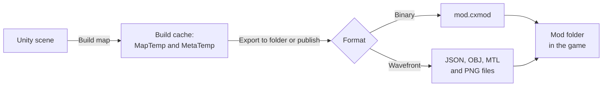

# Mod format: Wavefront and Binary

**English** · [Русский](../../ru/advanced/mod-format.md)

This page explains how MapUploader stores a built map: the build cache, the Wavefront file tree, the Binary `mod.cxmod` container and the way the game reads a mod folder. You don't need it to make or publish a map. Read it when you inspect exported files, look into a map that doesn't load, or write a tool that reads mods.

## How a map becomes a mod



A build writes staging files; exporting or publishing turns them into the chosen format, and the game reads either format from a mod folder.

The **Build map** button writes the map in two parts into the build cache. The Map part in `MapTemp` holds the scene, and the Meta part in `MetaTemp` holds the metadata and its images. Both formats stage their files in the [Wavefront tree](#wavefront-tree) layout, except that a Binary build writes binary meshes (`.cxmesh`) to `models/` instead of `.obj` files. To find the build cache, see [Where the build goes](../build.md#cache).

The mod itself is written only when you export or publish the map. The **Export to folder** button writes it into the folder you choose, and **Create publication** and **Update publication** upload it to mod.io. For Binary, this is the moment the staging files are packed into [`mod.cxmod`](#binary). <!-- src: Assets/Editor/MapBuilder.Storage.cs:85-113 -->

Both formats come from the same exporter. They share the scene rules, the metadata and the conversion of HDRP materials, and apart from Material markers, which only Binary applies, they carry the same content. The destination doesn't choose the format: publishing to mod.io and exporting to a folder both take whichever format you built. After you switch **Format**, build Map and Meta together: a build in the other format discards both parts of the previous build; see [Choose the scene and format](../build.md#format).

The format isn't tied to one game. A game needs a compatible loader, plus its own adapters for rendering, physics and gameplay markers. Neither format contains Unity assets, so a mod doesn't depend on the Editor version that built it. The only content type today is `map`. <!-- src: Assets/Plugins/CarX.Modding.Creator/Runtime/Meta/ModMeta.cs:31-32 -->

## Binary and Wavefront compared

|  | Binary | Wavefront |
| --- | --- | --- |
| Default format | Yes | No |
| The mod folder holds | One file, `mod.cxmod` | A tree of `.json`, `.obj`, `.mtl` and `.png` files |
| Metadata and scene documents | Binary documents | JSON text |
| Geometry | Binary meshes, each unique mesh stored once | Text OBJ, one file per material set |
| Material textures | Re-encoded with mipmaps as BC7 or RGBA32, chosen in **Binary textures** | PNG |
| Icon, preview and minimap images | PNG, unchanged | PNG |
| Material markers | Applied | Ignored; validation warns |
| Compression | Deflate, per resource | None |
| Readable in a text editor | No | Yes |

Binary is the format to test and publish with: the game reads one file, the textures arrive ready for the GPU, and Material markers work only in Binary. Wavefront is for reading or comparing the exported data as text. A copy of the game that loads local maps reads both formats.

## What reaches the mod

The exporter walks every root object of the scene and writes only what the game can rebuild. Objects tagged `Garbage` and their children are always left out; see [Organize the scene](../scene-setup.md#garbage) for how inactive and disabled objects are treated.

| Content | Exported when | Written to |
| --- | --- | --- |
| Static geometry | The object has a MeshFilter and a MeshRenderer, a MeshCollider with a mesh, or an enabled Box, Sphere or Capsule collider that isn't a trigger. | `prefabs/`, `hierarchies/`, `models/` |
| LOD groups | The group has at most 8 levels. More levels are a validation error, which stops the build. | `lods/` |
| Dynamic objects | A Rigidbody on an active object has at least one enabled Box, Sphere, Capsule or Mesh collider. | `hierarchies/` |
| Vertex animation | An Animator has an Animation marker. Its subtree is baked into animation data instead of static geometry. | `animations/` |
| Lights | A Point or Spot light is enabled and on an active object. | `lights/` |
| Markers | The marker is SpawnPoint or Road. | `markers/` |
| Render core materials | A renderer has a Material marker, and the build is Binary. | `models/` |
| Map settings and images | Every build of the Meta part: **Name**, **Version**, **Description**, **Authors**, **URL**, the **Icon · 16:9** and **Preview · 16:9** images and the Minimap textures. | `<id>.json`, `textures/` |

Everything else stays out of the mod, for example Directional and Area lights, Volume, Reflection Probes, Terrain, cameras, audio, particles, UI, video players and joints. Validation reports these components as notes or warnings; see [Supported components and budgets](../reference.md#budgets).

<a name="wavefront-tree"></a>
## The Wavefront tree

A Wavefront mod folder looks like this. `<id>` is the metadata id, and `<Scene>` is the name of the scene you built.

```text
<mod folder>/
├── <id>.json                 map metadata
├── hierarchies/
│   └── <Scene>.json          placed objects and Rigidbody records
├── prefabs/
│   └── <Scene>.json          unique mesh, material and collider combinations
├── lods/
│   └── <Scene>.json          LOD groups and their switch distances
├── markers/
│   └── <Scene>.json          spawn points and road surfaces
├── lights/
│   └── <Scene>.json          Point and Spot lights
├── animations/
│   └── <Scene>.json          baked vertex animation, only when the scene has Animation markers
├── models/
│   ├── <material set>.obj    render meshes that share one set of materials
│   ├── <material set>.mtl    that set of materials
│   ├── colliders_<n>.obj     collision meshes
│   ├── <texture>.png         material textures
│   └── <material>.pbr.json   Layered Lit materials
└── textures/
    └── <image>.png           icon, preview and minimap images
```

`<id>.json` and `textures/` make up the Meta part; everything else is the Map part.

File and object names come from asset ids and content hashes rather than from GameObject names, so building the same scene again gives the same names. A mesh asset is named `<GUID>_<local file id>`. A generated mesh, such as an optimization sector, and a set of materials get `h` followed by a 32-digit hexadecimal hash.

### The metadata file

`<id>.json` describes the map. Its fields, in file order:

| Field | Value |
| --- | --- |
| `contentType` | Always `map`. |
| `id` | The mod.io id of the linked publication when its row is selected while you build; otherwise the id of the map config. The game keys the networked physics of dynamic objects by this id, so build after you link a publication; see [Update a publication](../publish.md#update). |
| `version` | The data format version, `v1.0`. |
| `contentVersion` | **Version** from the **Map** tab, or `1.0.0` when it is empty. <!-- src: Assets/Editor/MapBuilder.cs:170 --> |
| `name` | **Name**. |
| `description` | **Description**. The summary isn't stored in the mod; only mod.io receives it. |
| `icon` | The path of the **Icon · 16:9** image inside the mod, without an extension: `textures/<texture name>`. |
| `largeIcon` | The path of the **Preview · 16:9** image, in the same form. |
| `minimap` | `textures`: the paths of the Minimap textures; the game shows only the first one. `boundsCenterX` and `boundsCenterY`: the world X and Z of the image centre. `boundsSizeX` and `boundsSizeY`: the world X and Z extent. See [Add the minimap](../minimap-and-images.md#minimap). |
| `madeIn` | The tool that built the map: `Mod Map Uploader v3.0`. <!-- src: Assets/Editor/MapBuilder.cs:168 --> |
| `url` | **URL**. |
| `authors` | **Authors**. |

### Scene documents

Each scene document has an `id`, which is the scene name, and a `version`, which is the data format `v1.0`. The documents refer to each other by index:

- `prefabs/<Scene>.json` lists `prefabInstances`: each unique combination of `mesh`, `material`, `collider` and `primitiveColliders` (the Box, Sphere and Capsule parameters). `mesh` and `collider` are `models/<mesh id>` and `models/collider_<mesh id>`, the names of objects inside the model files. `material` is `models/<material set>`, the `.mtl` file without its extension. A prop repeated across the map is stored once and costs one transform per copy.
- `hierarchies/<Scene>.json` lists `staticObjects`: one entry per placed object outside LOD groups, with its `prefabId`, its world transform `localToWorld` and a `rigidbodyId`. An object with a SpawnPoint or Road marker but no exported geometry gets an entry with `prefabId` `-1`. The same file holds the `rigidbodies` records.
- `lods/<Scene>.json` lists `lodInstances`: the `lodLevels` (each a `prefabId`, a `localOffset` from the LOD group and a `lodIndex`), the world transform, a `rigidbodyId` and the switch distances `LODDistances0` (levels 0–3) and `LODDistances1` (levels 4–7). A switch distance is the group's world size divided by the level's screen-relative transition height. A group with one level stays a LOD group and keeps its cull distance; see [LOD groups](../scene-setup.md#lod).
- `markers/<Scene>.json` lists `markers`: `staticInstanceId` (an index into `staticObjects`), `head` (`SpawnPoint` or `Road`), `param` and `data`. For a road, `param` is one of the 26 surface presets, for example `Road/asphalt`, and `data` is a JSON string with the surface values: friction, roll friction, bumps, water rate and one of 7 physical surface types. When `data` is empty, the game uses its own values for that surface. For a spawn point, `data` holds the GameObject name. See [Mark road surfaces](../markers.md#road).
- `lights/<Scene>.json` lists `lights`: the world transform, `type` (Unity's light type: `0` Spot, `2` Point), colour, intensity, range, spot angles, shadow type and near plane, and colour temperature. Intensity is candela × 0.1, at most 5000. See [Light export rules](../reference.md#lights). <!-- src: Assets/Plugins/CarX.Modding.Creator/Editor/SceneFormatCollector.cs:71-85 -->
- `animations/<Scene>.json` holds the baked vertex animation: one asset per distinct baked object, with its position, normal and tangent atlases and its material surfaces, and one instance per Animation marker. Wavefront stores the atlases and surface textures as Base64 text. See [Animate objects](../markers.md#animation).

`rigidbodyId` in `staticObjects`, `lodInstances` and animation `instances` is a 1-based index into `rigidbodies`, and `0` means the object is static.

<details><summary>Rigidbody record fields</summary>

Each entry in `rigidbodies` describes one Rigidbody and the colliders attached to it. A Rigidbody without an enabled supported collider gets no record, but its geometry is still exported. To set up dynamic objects, see [Add dynamic objects](../scene-setup.md#dynamic).

| Field | Value |
| --- | --- |
| `name` | The GameObject name. |
| `transform` | The world position and rotation of the body. Its scale is always 1. |
| `mass`, `linearDamping`, `angularDamping` | As set on the Rigidbody. |
| `isKinematic`, `useGravity`, `detectCollisions` | As set on the Rigidbody. |
| `constraints` | The Rigidbody constraints, as Unity's flags value. |
| `automaticCenterOfMass`, `centerOfMass` | Whether Unity computes the centre of mass, and the centre of mass in the body's local axes. |
| `automaticInertiaTensor`, `inertiaTensor`, `inertiaRotation` | Whether Unity computes the inertia tensor, and its value and rotation. |
| `linearVelocity`, `angularVelocity` | The initial velocities. |
| `colliders` | One record per enabled collider attached to the body. Each has a `transform` (position and rotation relative to the body, plus the collider's world scale); either `primitive` (Box, Sphere or Capsule) or `mesh` with `vertices`, `triangles` and `convex`; the `trigger` flag; and `friction`, `restitution`, `frictionCombine` and `bounceCombine` from the collider's Physic Material. Without a Physic Material, `friction` is `0.6`. <!-- src: Assets/Plugins/CarX.Modding.Creator/Runtime/Instances/RigidbodyInstance.cs:27 --> |

</details>

### Models and materials

Each `<material set>.obj` holds every render mesh that uses that set of materials, and the `.mtl` file of the same name defines the set. Meshes without materials go to `empty.obj`, which has no `.mtl`. Collision meshes go to `colliders_<n>.obj` files of up to 1 000 000 triangles each. <!-- src: Assets/Plugins/CarX.Modding.Creator/Editor/UnityGoObjExporter.cs:23-25 -->

Inside a file, each mesh is an object named by its id: `o <id>` for a render mesh and `o collider_<id>` for a collision mesh. The game finds a mesh by this name across all the files in `models/`.

The OBJ files follow the standard with two additions: a `vc r g b a` line after each vertex gives its vertex colour (white when the mesh has none), and a `#shadow off` line comes before a mesh that doesn't cast shadows. Positions and normals are in the mesh's own space, in Unity's coordinates (metres, Y up), without axis conversion; the world transform of each copy is in `hierarchies/` or `lods/`. Only UV0 is written, and faces are triangles.

Material textures are PNG files next to the `.mtl`. For how HDRP material settings become these values, see [HDRP material export](../reference.md#materials).

<details><summary>MTL keys</summary>

Each material starts with `newmtl <id>`, where `<id>` is the material's asset id. A texture line carries Tiling and Offset as `-s <u> <v> 1 -o <u> <v> 0` when they differ from the defaults.

| Key | Meaning |
| --- | --- |
| `cx_rc`, `cx_rc_rev` | The render core variant and its `.rc.json` document, and the variant revision when it is above 1. Written only in Binary builds; the ordinary keys that follow stay as the fallback. |
| `cx_pbr` | The `.pbr.json` document of a Layered Lit material. |
| `illum` | Blend mode: `1` alpha test, `2` opaque, `4` alpha blend. |
| `ds` | Double-sided, with the normal mode: `1` Mirror, `2` None, `3` Flip. Without this key, the material is single-sided. <!-- src: Assets/Plugins/CarX.Modding.Creator/Runtime/Meta/MtlDoubleSidedCode.cs:4 --> |
| `Kd`, `map_Kd` | Base colour and base colour map. |
| `d`, `map_d` | Opacity and opacity map, for alpha-test and alpha-blend materials. |
| `map_Bump` | Normal map. |
| `Pr`, `map_Pr` | Roughness, as a value or a map. |
| `Pm`, `map_Pm` | Metallic, as a value or a map. |
| `Ke`, `map_Ke` | Emission colour and emission map. |

</details>

<a name="binary"></a>
## The Binary container

`mod.cxmod` is an indexed archive. It holds the resources of the Wavefront tree, converted to binary forms, under the same relative names. <!-- src: Assets/Plugins/CarX.Modding.Creator/Runtime/Binary/BinaryModArchive.cs:18 -->

### What the container holds

| Resource | What it holds |
| --- | --- |
| `<id>.json` and the scene documents | The same documents as in Wavefront, stored as binary documents (`CXBD`) instead of JSON text. Data that Wavefront stores as Base64 text, such as the vertex animation atlases, is stored as raw bytes. |
| `models/<material set>.cxmesh`, `models/colliders_<n>.cxmesh`, `models/empty.cxmesh` | A geometry group, including the collision groups and the group of meshes without materials, as a binary document: for each mesh, its name, shadow flag, material names and a reference to a `geometry/` resource. |
| `geometry/<SHA-256>.cxgeom` | Mesh data (`CXBM`) without names or materials, so a mesh used in several groups is stored once. |
| `models/<material set>.mtl` | The set of materials, as a binary document. |
| `models/cx_<SHA-256>.cxtex` | Material textures, re-encoded with mipmaps (`CXTX`). Roughness, metallic and opacity are packed into one map, and the emission colour is baked into a texture. |
| `models/*.pbr.json`, `models/*.rc.json` | Layered Lit and render core material documents, as binary documents. |
| `textures/<image>.png` | The icon, preview and minimap images, copied unchanged. |

The PNG files of re-encoded material textures aren't stored. Packing needs both built parts; without them, it stops with `Binary map requires both Meta and Binary Map staging data. Rebuild Map and Meta.` <!-- src: Assets/Plugins/CarX.Modding.Creator/Editor/BinaryMapPacker.cs:62 -->

**Binary textures** under **Advanced settings** on the **Build** tab (shown only when **Format** is Binary) chooses the texture encoding: **BC7 (high quality)**, the default, or **RGBA32 (lossless)**. A texture whose width or height isn't a multiple of 4 is always stored as RGBA32. The choice is an editor preference on this computer, kept in the EditorPrefs key `CarX.Modding.BinaryTextureEncoding`. It applies when the container is packed, so a new value takes effect at the next export or upload without a new build. <!-- src: Assets/Plugins/CarX.Modding.Creator/Editor/BinaryMapPacker.cs:14-20 -->

### File layout

All numbers are little-endian. The reference reader is [`BinaryModArchive.cs`](https://github.com/CarXTechnologies/CarX.Modding.Creator/blob/9692638e3538922cb3197c9760c186809f36e176/Runtime/Binary/BinaryModArchive.cs) in the CarX.Modding.Creator SDK.

| Part | Type | Contents |
| --- | --- | --- |
| Magic | 4 bytes | `CXMP` |
| Container version | int32 | `2` |
| Index offset | int64 | The position of the index from the start of the file. |
| Resource blocks | bytes | From byte 16: the stored bytes of each unique resource, one after another. |
| Index: count | int32 | The number of resource names, from 1 to 100 000. |
| Index: one entry per name | mixed | Name length in bytes (uint16) and the UTF-8 name; block offset (int64); stored size (int32); original size (int32); compression (byte: `0` none, `1` Deflate); SHA-256 of the original bytes (32 bytes); CRC-32 of the original bytes (uint32). |

The index ends the file, sorted by name. Names use forward slashes and are relative to the mod folder. They can't start with `/`, contain `:`, or have empty, `.` or `..` segments, and lookups ignore case. <!-- src: Assets/Plugins/CarX.Modding.Creator/Runtime/Binary/BinaryModArchive.cs:100-111 -->

### Integrity and limits

- **Deduplication.** Resources with identical contents, found by SHA-256, share one block, so several names can point at the same bytes.
- **Compression.** Each resource is compressed with raw Deflate only when that makes it smaller. `.png` and `.cxgeom` resources are never compressed. <!-- src: Assets/Plugins/CarX.Modding.Creator/Runtime/Binary/BinaryModArchive.cs:304 -->
- **Checksums.** Readers check the CRC-32 (polynomial `0xEDB88320`) of every resource they read. A mismatch fails the read with `Binary resource checksum mismatch: <name>`. <!-- src: Assets/Plugins/CarX.Modding.Creator/Runtime/Binary/BinaryModArchive.cs:249 -->
- **Safe replacement.** The packer writes a temporary file next to `mod.cxmod`, reads its index back, and only then replaces the old file. If packing fails, the previous `mod.cxmod` stays as it was. <!-- src: Assets/Plugins/CarX.Modding.Creator/Runtime/Binary/BinaryModArchive.cs:208-224 -->
- **Limits.** A container holds at most 100 000 resource names, a name is at most 1024 characters, and each resource is at most 256 MB. <!-- src: Assets/Plugins/CarX.Modding.Creator/Runtime/Binary/BinaryModArchive.cs:20-21,104 -->

## How the game reads a mod folder

These rules describe a copy of the game that loads local maps; to find out whether yours does, see [Check that the game loads local maps](../test-in-game.md#check-game). For where to put a map for a local test, see [Where the game looks for local maps](../test-in-game.md#local-maps).

- **Where mods are.** On PC, every folder directly inside `<folder with the game executable>/Mods/` is one local mod, and the folder name is its mod ID. <!-- src: game -->
- **mod.io installs.** In game builds that support mod.io, maps downloaded from mod.io are read the same way from their install folders. Such a folder is named `<modIoId>_<modfileId>`, and that name is the mod ID. <!-- src: game -->
- **Binary or loose files.** If the mod folder contains `mod.cxmod`, every resource is read from it, and loose files next to it are ignored. Otherwise the game reads the loose files. <!-- src: Assets/Plugins/CarX.Modding.Creator/Runtime/Providers/DefaultFileProvider.cs:44-57 -->
- **Which files load.** The game loads every `.json` file in `hierarchies/`, `prefabs/`, `lods/`, `markers/`, `lights/` and `animations/`, every model file (`.obj` or `.cxmesh`) in `models/` and every `.png` file in `textures/`, whatever its name. A `.obj` file is skipped when a `.cxmesh` file of the same name is next to it. Materials and material textures are then loaded by the names that the models and scene documents use. <!-- src: game -->
- **Metadata.** The game reads every `.json` file in the root of the mod folder as metadata and uses the first one. A `contentType` other than `map` is rejected; an empty one is accepted. <!-- src: game -->
- **Paths.** A path from the mod data must stay inside the mod folder. A path that leads outside, through `..` or an absolute path, is ignored and logged as an error.
- **Images.** For an image path without an extension, such as `icon`, the game tries `.cxtex`, then `.png`, then `.jpg`. <!-- src: game -->
- **Size.** The game checks a load budget while it reads a map, so a very large map may fail to load.

> [!WARNING]
> Empty the mod folder before a Wavefront export: the export doesn't remove old files, and without `mod.cxmod` the game loads every file it finds. Scene files from an older export then load next to the new ones, and an old `<id>.json` can be the metadata that the game picks, for example after linking a publication changed the id.

<a name="compatibility"></a>
## Format compatibility

A mod carries several version numbers. The game checks the ones in this table and refuses a map whose version it doesn't know, except where the table says otherwise.

| Version | Where | Written by MapUploader | Read by the game |
| --- | --- | --- | --- |
| Container | The `mod.cxmod` header | `2` | `1` and `2` |
| Data format | `version` in the metadata and in every scene document | `v1.0` | `v1.0`, or an empty value <!-- src: Assets/Plugins/CarX.Modding.Creator/Runtime/Meta/ModdingVersion.cs:6 --> |
| Binary document | Each `CXBD` document | `2` | `1` and `2` |
| Mesh data | Each `.cxgeom` resource (`CXBM`) | `2` | `1` and `2` |
| Texture | Each `.cxtex` resource (`CXTX`) | `1` | `1` |
| Vertex animation | `formatVersion` in `animations/<Scene>.json` | `1` | `1` |
| Render core material | `version` in each `.rc.json`, and `cx_rc_rev` in the `.mtl` | `1`, and the variant revision of the SDK | An unknown version, variant or revision falls back to the ordinary material; the map still loads. |
| Tool | `madeIn` in the metadata | `Mod Map Uploader v3.0` | Not checked |
| Map version | `contentVersion` in the metadata | **Version** from the **Map** tab | Not checked |

The data format version goes up only for changes that older games can't read. Version 2 binary documents store a name and a length for every field, so a game skips fields it doesn't know, and a newer MapUploader can add fields without breaking older games. <!-- src: game -->

When a game meets a version it doesn't read, it stops loading the map with a message like one of these: <!-- src: game -->

```text
Mod data format '<version>' (<document type>) is not supported by this game client. Update the game.
Mod format version '<version>' is not supported by this game client. Update the game.
Unsupported binary document version <n> (<document type>). Update the game client.
Unsupported binary mod container. Update the game client.
Unsupported binary mod mesh version: <n>
Unsupported binary texture version.
Unsupported mod vertex animation format.
```

## Next steps

← [Reference](../reference.md) · [Contents](../README.md) · [Publishing vendors (for integrators)](publishing-vendors.md) →
