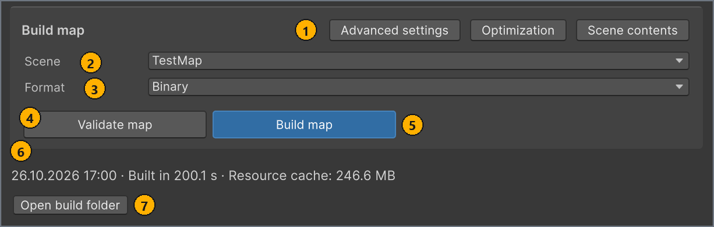
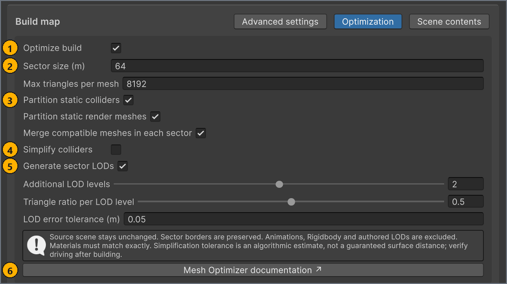

# Build the map

**English** · [Русский](../ru/build.md)

On the **Build** tab, MapBuilder checks the map and turns its scene and map settings into the files that the game loads. Build the map again after every change to the scene or the map settings, before you export or publish it.

You don't need to sign in to mod.io to validate or build a map.

## Before you start

- A map selected in **LOCAL MAPS**, with **Name** and **Icon** filled in on the **Map** tab. See [Fill in the map settings](map-settings.md).
- The map scene, enabled in Unity's build scene list. Scenes under `Assets/MapResources` are added for you. See [Create the map folder and scene](scene-setup.md#scene).
- A Windows x64 Unity Editor. On another system, turn off **Optimize build** first. See [Optimization](#optimization).

## The Build tab

To open the Build tab:

1. In the **MapBuilder** window (**Tools** > **MapBuilder**), in **LOCAL MAPS**, select the map.
1. Select the **Build** tab.

The tab holds the **Build map** box with the build controls. Outside the box, the tab shows the summary of the last build, messages about the build state and **Open build folder**. The following screenshot shows the tab for the `TestMap` sample after a successful Binary build.



| # | Element | What it does |
| --- | --- | --- |
| 1 | **Advanced settings**, **Optimization**, **Scene contents** | Each button opens its panel inside the box. Select the same button again to close the panel. Only one panel is open at a time. |
| 2 | **Scene** | The scene to build, chosen from the enabled scenes in Unity's build scene list. |
| 3 | **Format** | **Binary** (default) or **Wavefront**. |
| 4 | **Validate map** | Checks the map settings and the scene without building anything, then opens the **Map Validation** window. |
| 5 | **Build map** button | Runs the same checks, then builds the parts selected in **Rebuild targets**. |
| 6 | Summary of the last build | When the last build of this map finished, how long it took and how large its build cache is. |
| 7 | **Open build folder** | Shows the build cache of this map in File Explorer. See [Where the build goes](#cache). |

<a name="format"></a>
## Choose the scene and format

To choose what to build:

1. On the **Build** tab, in **Scene**, select the map scene.
1. Optional: To get loose, readable files instead of one container, in **Format**, select **Wavefront**.

How **Scene** works:

- It lists the scenes that are enabled in Unity's build scene list, by file name. If **Scene** is empty, no scene is enabled in that list.
- For a map that was never built, **Scene** starts on the scene that was active when you selected the map. After a build, it starts on the scene of that build. If that scene isn't in the list, the first scene in the list is selected.
- **Validate map** and the **Build map** button open the selected scene when another scene is active. If your open scenes have unsaved changes, Unity first asks whether to save them. If you cancel, the build stops, and validation checks only the map settings.

MapBuilder maintains Unity's build scene list, so the scenes under `Assets/MapResources` appear in **Scene** without any setup: <!-- src: Assets/Editor/MapBuilderProcessor.cs:11-79 -->

- It adds every scene under `Assets/MapResources` to the list, enabled, each time the editor loads or recompiles scripts, and each time such a scene is created or saved.
- Each time Unity saves or creates an asset, MapBuilder removes every disabled scene from the list. Each time an asset is moved or deleted, it removes disabled scenes outside `Assets/MapResources` and turns disabled scenes inside it back on. A disabled scene under `Assets/MapResources` also comes back, enabled, the next time the editor loads or that scene is saved.
- To remove a scene from **Scene** for good, move it out of `Assets/MapResources`, then disable it in the list.
- A scene outside `Assets/MapResources` isn't added for you. Add it under **File** > **Build Profiles** > **Scene List** and keep it enabled.

The two formats differ in what the game receives when you export or publish the map:

| Format | What the game receives | Use it when |
| --- | --- | --- |
| **Binary** (default) | One compressed file, `mod.cxmod`, with compact geometry, typed scene data and prepared textures. Material markers (render core variants) apply only to this format. | In most cases. |
| **Wavefront** | Loose OBJ, MTL, PNG and JSON files. Material markers are ignored, and the original materials are exported. | You want to read or compare the exported files. |

- Apart from Material markers, both formats export the same scene content, and the game loads either one from the map's mod folder. For the file layout, see [Mod format: Wavefront and Binary](advanced/mod-format.md).
- Some checks of **Validate map** depend on the format, so validate the map in the format that you build.
- After you switch the format, build **Map** and **Meta** together: a build in the other format discards both parts of the previous build.
- When you select a map, **Format** returns to the format of the map's last build, or to **Binary** for a map that was never built.

## Validate and build the map

To build the map:

1. On the **Build** tab, select **Validate map**.
   The **Map Validation** window opens and lists the problems that the checks found.
1. Fix every error in the list. For each message and its fix, see [Fix validation problems](validation.md).
1. In the **Map Validation** window, select **Re-run**.
   Repeat steps 2 and 3 until the window lists no errors. Warnings and notes don't stop the build.
1. On the **Build** tab, select the **Build map** button.
   The window footer shows a progress bar with the current step: `Checking map settings…`, `Validating and collecting scene resources…`, `Building map geometry…`, then `Building map metadata…`. <!-- src: Assets/Editor/MapBuilderEditorWindow.Workspace.cs:402-407 -->

Result: The summary line on the **Build** tab and the window footer read `Built in <n> s · Resource cache: <n> MB`, and the map's row in **LOCAL MAPS** shows `Ready to export`. <!-- src: Assets/Editor/MapBuilderEditorWindow.Workspace.cs:385-387 -->

What else to know about a build:

- The **Build map** button runs the same checks as **Validate map**, and an error stops the build. The summary line then reads `Build incomplete. Check validation results and the Console.` <!-- src: Assets/Editor/MapBuilderEditorWindow.Workspace.cs:387 -->
- After a build, the **Map Validation** window opens when the checks reported anything, even only warnings or notes. When they reported nothing, the window closes.
- Some problems, such as the Rigidbody rules, aren't checked by validation. The build finds them and stops, and they appear only in the Console. See [Build errors in the Console](troubleshooting.md#build-errors). <!-- src: Assets/Plugins/CarX.Modding.Creator/Editor/RigidbodyExporter.cs:39 -->
- To stop a build, select **Cancel** in the window footer. The parts that were being built are discarded, and the Console logs `Build cancelled.` <!-- src: Assets/Editor/MapBuilder.cs:320 -->
- The build runs on the Editor's main thread, so the Editor can respond slowly until the build finishes.
- The date and time, `<dd.MM.yyyy HH:mm> ·`, appear at the start of the summary line the next time you open the **MapBuilder** window. The summary of each map is kept on this computer between sessions. <!-- src: Assets/Editor/MapBuilderEditorWindow.Workspace.cs:248-249,389 -->
- `Resource cache` is the size of the whole build cache folder of the map, not the size of the finished mod.

> [!IMPORTANT]
> MapBuilder doesn't detect edits to the scene, or to the pixels of the icon and preview images. After such an edit, build the map again, even when its row still shows `Ready to export`.

Until the build is complete and matches the current settings, the **Build** tab shows one of these messages: <!-- src: Assets/Editor/MapBuilderEditorWindow.cs:819-833 -->

| Message | What it means |
| --- | --- |
| `Map geometry and metadata have not been built yet.` | The map has never been built, or no part of its last build finished. |
| `Map geometry has not been built yet.` | Only **Meta** is built. This also happens after you change an optimization setting. |
| `Map metadata has not been built yet.` | Only **Map** is built. This also happens after **Create publication**, because the metadata has to carry the ID of the new publication. |
| `The build is outdated or its files are missing. Build the selected scene in the current format.` | The selected **Scene** or **Format** differs from the build, the map settings changed after the build, or the build cache folder is gone. |

## Greyed-out controls

A control on the **Build** tab is greyed out in these cases:

| Control | Greyed out when |
| --- | --- |
| **Validate map** | Publication thumbnails are downloading from mod.io. |
| **Build map** button | Publication thumbnails are downloading from mod.io, or **Rebuild targets** is **Nothing**. |
| **Scene** | **Rebuild targets** doesn't include **Map**. The build then keeps the scene of the last build. |
| **Open build folder** | The map has no build cache folder yet. |
| The whole **Build map** box | A build, **Create publication** or **Update publication** is running. |

## Advanced settings

To open the advanced settings:

- On the **Build** tab, select **Advanced settings**.

| Option | Default | What it does | When to change |
| --- | --- | --- | --- |
| **Rebuild targets** | **Everything** | Chooses the parts that the **Build map** button builds. **Map** is the scene: geometry, colliders, materials, markers, lights, dynamic objects and vertex animation. **Meta** is the map metadata: name, description, version, authors, URL, icon, preview and minimap. **Nothing** greys out the button. The option returns to **Everything** each time you select a map. <!-- src: Assets/Editor/MapBuilderEditorWindow.Workspace.cs:225 --> | To rebuild only the metadata, in **Rebuild targets**, clear **Map** so that only **Meta** is selected, for example after you change only the **Map** tab or the minimap. A **Meta** build doesn't check the scene. Otherwise keep **Everything**. |
| **Binary textures** | **BC7 (high quality)** | How the Binary format stores material textures. **BC7 (high quality)** is smaller, with high-quality lossy compression. **RGBA32 (lossless)** is lossless and larger. Both include mipmaps. A texture whose width or height isn't a multiple of 4 is always stored as RGBA32. Shown only for **Binary**. <!-- src: Assets/Plugins/CarX.Modding.Creator/Editor/BinaryTextureBaker.cs:41-47 --> | Select **RGBA32 (lossless)** when compression artefacts show on a texture in the game. |

The **Binary textures** choice is an Editor preference on this computer (EditorPrefs key `CarX.Modding.BinaryTextureEncoding`), not a map setting, so it applies to every map. It takes effect when the map is packed, that is, when you export or publish it, so a change needs no new build. <!-- src: Assets/Plugins/CarX.Modding.Creator/Editor/BinaryMapPacker.cs:14-20 -->

<a name="optimization"></a>
## Optimization

During a build, optimization cuts the static geometry of the map into sectors, merges compatible pieces in each sector and generates LODs for the sector meshes. It is on by default and works with both formats. Each map has its own settings, stored in its map config.

To open the optimization settings:

- On the **Build** tab, select **Optimization**.

The following screenshot shows the panel with the default settings.



| # | Element | What it does |
| --- | --- | --- |
| 1 | **Optimize build** | Turns optimization on or off for this map. |
| 2 | **Sector size (m)**, **Max triangles per mesh** | Set the cell size of the sector grid and the triangle limit of one sector render mesh. |
| 3 | **Partition static colliders**, **Partition static render meshes**, **Merge compatible meshes in each sector** | Choose what is cut into sectors, and whether the pieces in a sector are merged. |
| 4 | **Simplify colliders** | Off by default. When it and **Partition static colliders** are both on, **Collider triangle ratio** and **Collider error tolerance (m)** appear. |
| 5 | **Generate sector LODs** | Generates LODs for the sector render meshes. **Additional LOD levels**, **Triangle ratio per LOD level** and **LOD error tolerance (m)** control them. |
| 6 | **Mesh Optimizer documentation ↗** | Opens the meshoptimizer documentation in your browser. |

The panel has these options, in this order. The last two rows describe settings that only the map config's **Inspector** shows, under **Optimization**. Keep the defaults unless profiling the map in the game shows a reason to change them: cutting meshes into sectors can raise the total count of triangles and draw calls. A value outside its range is clamped to the range. <!-- src: Assets/Plugins/CarX.Modding.Creator/Runtime/BuildOptimizationSettings.cs:9-47 -->

| Option | Default | What it does | When to change |
| --- | --- | --- | --- |
| **Optimize build** | On | Turns optimization on for this map. When it is off, the other options are greyed out, the panel shows `Optimization is off: …`, validation adds a Geometry warning, and static meshes and colliders are exported as they are. | Clear it only in a Unity Editor that isn't Windows x64, where the build stops otherwise. |
| **Sector size (m)** | 64 m | Edge length of the cubic grid cells that static render meshes are cut into, from 1 m to 1024 m. Triangles that cross a cell border are split. Colliders use a grid of their own. <!-- src: Assets/Plugins/CarX.Modding.Creator/Runtime/BuildOptimizationSettings.cs:37 --> | Keep the default unless profiling shows a reason. |
| **Max triangles per mesh** | 8192 | Most triangles in one sector render mesh, from 128 to 65 536. A sector with more triangles becomes several meshes. <!-- src: Assets/Plugins/CarX.Modding.Creator/Runtime/BuildOptimizationSettings.cs:38 --> | Keep the default unless profiling shows a reason. |
| **Partition static colliders** | On | Cuts static MeshColliders into collider sectors. A MeshCollider is cut only when it is the only MeshCollider on its object, is enabled, isn't a trigger, isn't convex and has a mesh. Box, Sphere and Capsule Colliders are exported as they are. | Clear it to export MeshColliders unchanged. |
| **Partition static render meshes** | On | Cuts static render meshes into sectors. A renderer keeps its own mesh when it is disabled, uses a transparent material (render queue 3000 or higher) or a transparent render core variant of a Material marker, has an empty material slot, has a MaterialPropertyBlock or a baked lightmap, or has a material count that differs from its submesh count. A mesh that isn't readable or isn't made of triangles also keeps its own mesh, and so does such a MeshCollider; the Console then logs `Optimization skipped '<name>': …`. <!-- src: Assets/Plugins/CarX.Modding.Creator/Editor/SceneExportOptimization.cs:215-231,273-281 --> | Clear it to export render meshes unchanged. Sector LODs then stop as well. |
| **Merge compatible meshes in each sector** | On | Merges the pieces in a sector into one mesh, with one submesh per material. Render pieces merge when their layer and renderer settings match. Collider pieces merge when their layer, physic material and cooking options match. The pieces of an object with a Road marker merge only with each other, so they keep their surface. | Clear it to keep the pieces of each object separate. |
| **Simplify colliders** | Off | Reduces the triangles of the collider sectors with meshoptimizer. Works only together with **Partition static colliders**. | It is off by default because simplified collision drifts from the visible surface and can leave bumps and gaps at road seams. Select it only for heavy collision meshes, then drive the whole map. |
| **Collider triangle ratio** | 0.5 | Share of collider triangles to keep, from 0.1 to 1. | Lower it for lighter collision. Drive the map after each change. |
| **Collider error tolerance (m)** | 0.01 m | How far simplified collision may move from the source, from 0 m to 1 m. It is the algorithm's estimate, not a guaranteed distance. <!-- src: Assets/Plugins/CarX.Modding.Creator/Runtime/BuildOptimizationSettings.cs:43 --> | Drive the map after each change. |
| **Generate sector LODs** | On | Generates render LODs for each sector mesh. Works only together with **Partition static render meshes**. | Clear it to export sector meshes without LODs. |
| **Additional LOD levels** | 2 | Number of levels after the full-detail level, from 1 to 3. | Lower it for fewer meshes. |
| **Triangle ratio per LOD level** | 0.5 | Level *n* aims at this ratio to the power *n* of the full-detail triangles: with the default, 50% for level 1 and 25% for level 2. From 0.1 to 0.9. | A lower value makes distant levels coarser. |
| **LOD error tolerance (m)** | 0.05 m | Allowed simplification error of level 1. Level *n* allows *n* times this value. From 0 m to 10 m. <!-- src: Assets/Plugins/CarX.Modding.Creator/Runtime/BuildOptimizationSettings.cs:46 --> | A higher value allows coarser levels. |
| Collider grid (not in the panel) | 128 m cells, 32 768 triangles | Cell size of the collider sectors, from 1 m to 1024 m, and most triangles in one collider sector, from 128 to 262 144. | Keep the default. <!-- src: Assets/Plugins/CarX.Modding.Creator/Runtime/BuildOptimizationSettings.cs:39-40 --> |
| Small-piece merge (not in the panel) | 128 triangles | A piece of one material smaller than this moves into a neighbouring sector, so that it doesn't become a submesh or mesh of its own. `0` turns it off; the maximum is 4096. | Keep the default. <!-- src: Assets/Plugins/CarX.Modding.Creator/Runtime/BuildOptimizationSettings.cs:41 --> |

**What optimization leaves as it is.** These objects keep their original meshes and colliders: <!-- src: Assets/Plugins/CarX.Modding.Creator/Editor/SceneExportOptimization.cs:120-141 -->

- inactive objects;
- objects with a Rigidbody, Animator, Animation or LODGroup on themselves or on a parent: dynamic objects, animated objects and your own LOD groups;
- objects with a marker other than Road or Material on themselves or on a parent.

Objects tagged `Garbage` and their children aren't exported at all. See [Organize the scene](scene-setup.md#garbage).

**Sector LODs.** Vertices on sector borders stay in place, so a level can keep more triangles than its target. A level that saves no triangles is skipped. The last level stays visible at any distance, and LODs add no colliders.

**Your scene stays unchanged.** The optimizer works on copies in an in-memory preview scene. It never edits or saves your scene.

**After you change a setting.** While **Optimize build** is on, changing any option clears the Map part of the build. Selecting or clearing **Optimize build** clears it too. The **Build** tab then shows `Map geometry has not been built yet.`, and the map's row shows `Rebuild needed`. Build the map again. <!-- src: Assets/Editor/BuildOptimizationPanel.cs:63-81 -->

**Check the result.** After a build with optimization, the Console has a line that starts with `Build optimization:`. It counts the source renderers and colliders and the sector meshes and colliders made from them. <!-- src: Assets/Plugins/CarX.Modding.Creator/Editor/SceneExportOptimization.cs:256-259 -->

**Sector-budget warnings.** Validation warns about large static meshes that optimization won't cut into sectors, which with the default settings never happens. For what it checks, see [Sector budget](reference.md#sector-budget).

**Windows x64 Unity Editor only.** Optimization uses meshoptimizer v1.2. Its native library ships only for the Windows x64 Unity Editor and runs only in the Editor, during a build. In any other Editor, the build stops with `meshoptimizer is unavailable for this Editor platform. Install its native Editor library or disable build optimization.` To build there, clear **Optimize build**. The source and license of the library are in `Assets/Plugins/CarX.Modding.Creator/ThirdParty~/meshoptimizer`. <!-- src: Assets/Plugins/CarX.Modding.Creator/Editor/SceneExportOptimization.cs:171-178 -->

## Scene contents

To see what the last build counted:

- On the **Build** tab, select **Scene contents**.

The panel lists each supported component type in the scene, one line per type, with its count and its allowed range: `<Type> : <n> count (<min> min - <max> max)`. Types with a count of 0 aren't listed. <!-- src: Assets/Scripts/ValidItemData.cs:95-98 -->

- Only a build that includes **Map** fills the panel, and **Validate map** doesn't update it. Until then, the panel reads `Build the map to view its scene contents.` <!-- src: Assets/Editor/MapBuilderEditorWindow.cs:811 -->
- The counts come from your scene before optimization. They include inactive objects and disabled components, and they skip objects tagged `Garbage` and their children.
- A count outside its range is a Budget error, which stops the build. For every range, see [Supported components and budgets](reference.md#budgets).

For example, after a build of the `TestMap` sample, the panel lists the following. SphereCollider is missing from the list because the sample has none.

```
Transform : 861 count (1 min - 20000 max)
MeshCollider : 104 count (0 min - 10000 max)
BoxCollider : 46 count (0 min - 10000 max)
CapsuleCollider : 16 count (0 min - 1000 max)
Rigidbody : 2 count (0 min - 1000 max)
MeshRenderer : 537 count (0 min - 10000 max)
MeshFilter : 537 count (0 min - 10000 max)
Light : 5 count (0 min - 500 max)
HDAdditionalLightData : 5 count (0 min - 500 max)
LODGroup : 163 count (0 min - 10000 max)
GameMarkerData : 171 count (1 min - 10000 max)
Minimap : 1 count (1 min - 1 max)
```

<a name="cache"></a>
## Where the build goes

A build writes to the build cache, a staging folder for each map outside the project: <!-- src: Assets/Editor/MapBuilder.Storage.cs:11-14,64-83 -->

```
<temp>/DefaultCompany/ModeMap/StandaloneTemporary<id>/
  MapTemp/     the Map part: geometry, collision, materials, markers, lights
  MetaTemp/    the Meta part: metadata, icon, preview, minimap
```

- `<temp>/DefaultCompany/ModeMap` is Unity's `Application.temporaryCachePath` for this project. On Windows, `<temp>` is usually `%USERPROFILE%\AppData\Local\Temp`. <!-- src: ProjectSettings/ProjectSettings.asset:15-16 -->
- `<id>` is the GUID of the map config asset, so each map has a build cache of its own.
- To open the folder, select **Open build folder**.
- A build empties and rewrites only the parts that it builds.
- The build cache holds staging files, not a game package. A Binary build gets its `mod.cxmod` only when you export or publish the map. See [Export the map to the game folder](test-in-game.md#export) and [Publish to mod.io](publish.md).
- The mod.io size limits apply to these two folders, and MapBuilder checks them only before an upload. See [Build size](reference.md#limits-size).
- If Windows cleans its temp folder, the map's row shows `Rebuild needed`. Build the map again.

## Next steps

← [Fill in the map settings](map-settings.md) · [Contents](README.md) · [Fix validation problems](validation.md) →
