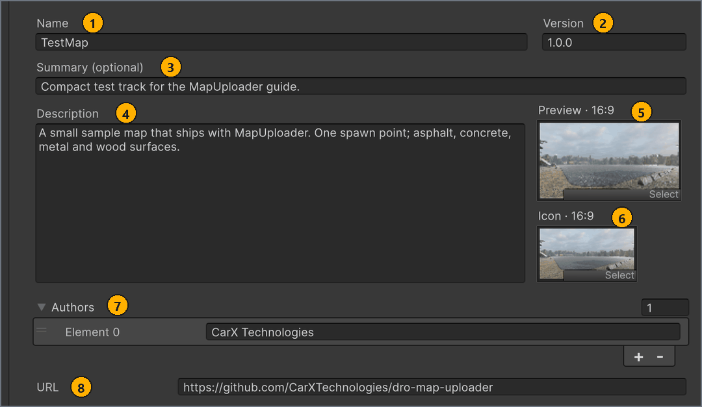

# Fill in the map settings

**English** · [Русский](../ru/map-settings.md)

Each map has a map config: an asset that holds the map's name, texts, images and credits. Create it with **+ New map** and fill it in on the **Map** tab before you build, because the build copies these values into the map metadata and publishing sends some of them to mod.io.

You don't need to sign in to mod.io for anything on this page.

## Before you start

- The map scene, saved in `Assets/MapResources/<MapName>/`, where `<MapName>` is the name of your map. See [Set up the scene](scene-setup.md#scene).
- An icon image and, optionally, a preview image that meet the [image requirements](minimap-and-images.md#images).
- The **MapBuilder** window, opened from **Tools** > **MapBuilder**. See [Open MapBuilder](getting-started.md#window).

## Create or select a map

**+ New map** creates a map config, a MapMetaConfig asset. It doesn't create a scene: you choose the scene later, in **Scene** on the **Build** tab.

To create a map config:

1. In the **MapBuilder** window, under **LOCAL MAPS**, select **+ New map**.
   The `New map` save dialog opens with the file name `NewMapConfig`. <!-- src: Assets/Editor/MapBuilderEditorWindow.Workspace.cs:235 -->
1. In the dialog, go to `Assets/MapResources/<MapName>/`, the folder that holds the map scene.
1. In the file name box, enter the map name, for example `MyMap`, and select **Save**.
   MapBuilder creates `MyMap.asset`, selects the new map and opens the **Map** tab.

Result: the map appears under **LOCAL MAPS** with the status `Not built` and the line `mod.io: not linked`, and **Name** holds the file name, `MyMap`. <!-- src: Assets/Editor/MapBuilderEditorWindow.Workspace.cs:198,209,238 -->

Only the first value of **Name** comes from the file name. Renaming the asset later doesn't change **Name**, and changing **Name** doesn't rename the asset.

To select an existing map:

- In the **MapBuilder** window, under **LOCAL MAPS**, select the map's row.
  The footer shows `Local map: <name>`, and the **Map**, **Build** and **Publish** tabs now work on this map. <!-- src: Assets/Editor/MapBuilderEditorWindow.Workspace.cs:220 -->

The list shows every map config in the project, wherever it is saved, sorted by name. To filter the list, enter part of a map name in the search box. To see where a map config is saved, hover over the map's name: the tooltip shows the asset path.

When no map is selected, for example in a project with no map config yet, the map title in the **MapBuilder** window reads `Select a map` and the **Map** tab has no fields. When the list reads `No maps found.`, clear the search box or create a map. While a build or an upload runs, you can't select another map. <!-- src: Assets/Editor/MapBuilderEditorWindow.Workspace.cs:203 -->

Each row shows the map's Icon (or its Preview when it has no Icon), its **Name** (or the asset name when **Name** is empty), the build status and the mod.io line.

The build status tells you whether the map has a current build. A build has two parts: Map, built from the scene, and Meta, the map metadata: the **Map** tab values and the minimap.

| Build status | What it means |
| --- | --- |
| `Ready to export` | Map and Meta are both built and match the map: the **Map** tab values and the optimization settings haven't changed since the build, and the build cache folders still exist. You can export or publish the map. <!-- src: Assets/Editor/MapBuilderEditorWindow.Workspace.cs:179-183,198 --> |
| `Not built` | No part of the map has a usable build: you haven't built it yet, or the last build of both parts stopped with an error. Build the map on the **Build** tab. <!-- src: Assets/Editor/MapBuilderEditorWindow.Workspace.cs:198 --> |
| `Rebuild needed` | The build is out of date or incomplete: you changed the **Map** tab or the optimization settings, only one part is built, the build cache was deleted, or you created a publication from this build. Build the map again. <!-- src: Assets/Editor/MapBuilderEditorWindow.Publish.cs:210-230 --> |

The mod.io line shows the publication linked to this map.

| mod.io line | What it means |
| --- | --- |
| `mod.io: not linked` | No publication is linked to this map. **Create publication** links the new publication; to link an existing one, see [Update a publication](publish.md#update). <!-- src: Assets/Editor/MapBuilderEditorWindow.Workspace.cs:209 --> |
| `mod.io: version not loaded` | A publication is linked, but MapBuilder hasn't loaded it: you aren't signed in, or the publication isn't in your list of publications. <!-- src: Assets/Editor/MapBuilderEditorWindow.Workspace.cs:211 --> |
| `mod.io: no active file` | The linked publication has no uploaded file. <!-- src: Assets/Editor/MapBuilderEditorWindow.Workspace.cs:212 --> |
| `mod.io: <version>` | The version of the linked publication's current file, for example `mod.io: 1.0.0`. It comes from **Version** at the time of the upload. <!-- src: Assets/Editor/MapBuilderEditorWindow.Workspace.cs:213 --> |
| `mod.io: version not set` | The current file of the linked publication has no version. <!-- src: Assets/Editor/MapBuilderEditorWindow.Workspace.cs:213 --> |

## Fill in the Map tab

The **Map** tab is the form for the selected map config. MapBuilder doesn't check the fields as you type: **Validate map** and the **Build map** button check them.

To fill in the map settings:

1. In the **MapBuilder** window, under **LOCAL MAPS**, select the map.
1. Select the **Map** tab.
1. In **Name**, enter the name players see.
1. Optional: In **Version**, enter the release version, for example `1.0.0`.
   When **Version** is empty, the build and mod.io use `1.0.0`. <!-- src: Assets/Editor/MapBuilder.cs:170 -->
1. Optional: In **Summary (optional)**, enter one line about the map.
1. Optional: In **Description**, enter the full text about the map.
1. Optional: From the **Project** window, drag the preview PNG onto the **Preview · 16:9** box.
1. From the **Project** window, drag the icon PNG onto the **Icon · 16:9** box.
1. Optional: To credit the authors, expand **Authors** and select **+** once for each author.
1. Optional: In each new **Authors** entry, enter one author's name.
1. Optional: In **URL**, enter a link to the map's page, for example a forum thread.

Result: the map's row under **LOCAL MAPS** shows the new name and the icon.

The following screenshot shows the **Map** tab of the `TestMap` sample. The numbers match the table after it.

| # | Field | What to enter | Limit | Where it appears |
| --- | --- | --- | --- | --- |
| 1 | **Name** | The map name players see. | Required. Up to 50 characters: letters of any alphabet, digits, spaces and `- _ ' . , : ! ? ( ) & + /`, with no space at the start or end. | In the game: the **Mods** screen and online rooms (`Modded Track` when it is empty). On mod.io: the publication title, sent by **Create publication**, and by **Update publication** with **Update title** on. <!-- src: Assets/Resources/CarX.Modding/ModIoConfig.asset:28 --> |
| 2 | **Version** | Your release label, for example `1.0.0`. It isn't the mod format version. Raise it before you [update a publication](publish.md#update). | None. Empty means `1.0.0`. | On mod.io: the version of each file you upload, which the map's mod.io line then shows. In the map metadata; the game doesn't show it. <!-- src: Assets/Editor/MapBuilder.Publishing.cs:298-301 --> |
| 3 | **Summary (optional)** | One line about the map. When it is empty, MapBuilder uses the first line of **Description**, or `<Name> track.` when **Description** is empty too. | Up to 250 characters, also when the text comes from **Description**. Only the first line is used. | On mod.io: the publication summary, sent by **Create publication**, and by **Update publication** with **Update description** on. It isn't stored in the map metadata. <!-- src: Assets/Resources/CarX.Modding/ModIoConfig.asset:29 --> |
| 4 | **Description** | The full text about the map. | Up to 50 000 characters. | On mod.io: the publication description, sent by **Create publication** when it isn't empty, and by **Update publication** with **Update description** on. In the map metadata; the game doesn't show it. <!-- src: Assets/Resources/CarX.Modding/ModIoConfig.asset:30 --> |
| 5 | **Preview · 16:9** | A large 16:9 picture of the map, for example 1920 × 1080. | Optional. See [Image requirements](minimap-and-images.md#images). | In the game: the loading screen, and the map picture when you create an online room. It isn't sent to mod.io. |
| 6 | **Icon · 16:9** | The map's icon, a 16:9 picture, for example 636 × 358. | Required. See [Image requirements](minimap-and-images.md#images). | On mod.io: the publication logo, sent by **Create publication**, and by **Update publication** with **Update preview** on. In the game: the map's card on **Track Selection** and in the online room list. When you create a room, it stands in for a missing Preview. |
| 7 | **Authors** | One entry for each author. Empty entries are ignored. | None. | In the game: `by <authors>` under the map name on the **Mods** screen, with up to 5 names separated by `, ` and then `...` when there are more. With no authors, a map installed from mod.io shows its mod.io creator. It isn't sent to mod.io. <!-- src: DR3PC1:Assets/DR3/Scripts/States/Controllers/Mods/ModAuthorResolver.cs:10-12 --> |
| 8 | **URL** | A link to the map's page, for example a forum thread. | None. | Only in the map metadata. The game doesn't show it, and it isn't sent to mod.io. |

Changing **Name** after you publish doesn't rename the publication until you update it with **Update title** on. See [Publish to mod.io](publish.md).

The game crops the Icon and the Preview in some places; for the part that stays visible, see [Image requirements](minimap-and-images.md#images). To capture the images in Unity, see [Capture images with CaptureCamera](minimap-and-images.md#capture).

**Validate map** reports problems with these fields in the `Meta` category of the **Map Validation** window. See [Fix validation problems](validation.md#catalogue). An empty **Name** gives `The track has no name. Fill in Name on the Map tab.` <!-- src: Assets/Editor/Validation/MapMetaValidator.cs:48 -->

> [!IMPORTANT]
> **Create publication** sends **Description** to mod.io only once. To change the description on mod.io later, update the publication with **Update description** on, as described in [Update a publication](publish.md#update).

## How changes are saved

There is no Save button. MapBuilder writes each change to the map config as you make it.

A build keeps a copy of these values. When you change a field after a build, the map's row shows `Rebuild needed`, and the **Build** tab shows `The build is outdated or its files are missing. Build the selected scene in the current format.` You can't export the map or upload it to mod.io until you build it again. See [Build the map](build.md). <!-- src: Assets/Editor/MapBuilderEditorWindow.cs:822 -->

While a build or an upload runs, the fields on the **Map** tab are greyed out and you can't change them.

> [!TIP]
> To rebuild only the metadata after you change the **Map** tab of a built map, on the **Build** tab select **Advanced settings**, leave only **Meta** selected in **Rebuild targets**, and select the **Build map** button. **Rebuild targets** returns to **Everything** whenever you select a map.

When you select a map config in the **Project** window, the **Inspector** shows a shorter form, with the boxes `Mod Name (max 50 characters)`, `Summary (optional, max 250 - first description line when empty)`, `Mod Description` and `Preview, Icon (16:9)`, but without Version, Authors or URL, so use the **Map** tab instead. Until a build includes the current values, the **Inspector** also shows `Meta is changed. Please rebuild meta in "Tools > MapBuilder"`. <!-- src: Assets/Editor/MapMetaConfigDrawer.cs:70 -->

The map config also stores the map's build optimization settings. See [Optimization](build.md#optimization).

## Next steps

Build the map on the **Build** tab: choose the scene and the format, validate the map and build it.

← [Minimap, icon and preview](minimap-and-images.md) · [Contents](README.md) · [Build the map](build.md) →
