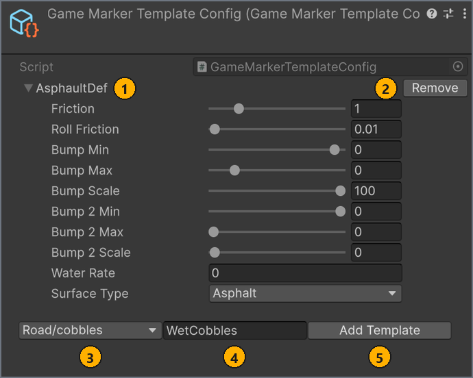
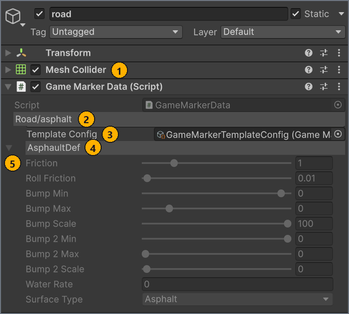
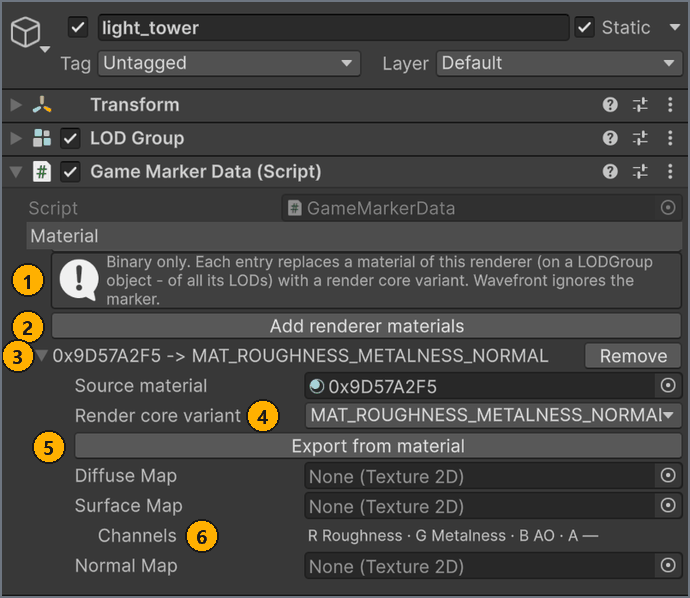

# Add markers

**English** · [Русский](../ru/markers.md)

Applies to: MapUploader `feature/2.0/3.0` · Unity 6000.3.19f1 · screenshots 2026-10-26

Markers tell the game what your scene objects are: where the car appears, which road surface each collider has, which objects play an animation and which materials use render core variants. Add them once the scene has its models and colliders.

## Before you start

- A map scene in `Assets/MapResources/<MapName>/` with its models and colliders. See [Set up the scene](scene-setup.md).
- For Animation markers, an Animator whose controller contains the animation clips.
- For Material markers, the **Binary** build format. See [Choose the scene and format](build.md#format).

## Add the GameMarkerData component

Every marker is a GameMarkerData component. Under the **Script** field, its first row is the type menu: a grey bar that shows the current type and opens the menu of types when you select it. The type decides what the marker does.

To add a marker:

1. In the **Hierarchy**, select the GameObject.
1. In the **Inspector**, select **Add Component**.
1. Type `GameMarkerData`, then select **Game Marker Data** in the results.
   The component appears with the type `SpawnPoint`.
1. In the type menu, select the type you need.

Result: the type menu shows the chosen type, for example `Road/asphalt`.

These rules apply to every marker:

- Put one GameMarkerData on a GameObject. Validation checks only the first one on each object.
- A map needs at least 1 GameMarkerData component and can have up to 10 000. <!-- src: Assets/Editor/MapSceneRules.cs:23 -->
- Markers on objects tagged `Garbage`, and on their children, are ignored by validation and export.

## Start from the example prefabs

`Assets/ExamplePrefab/` contains prefabs with markers already set up.

To use an example prefab:

- Drag the prefab from the **Project** window into the **Hierarchy**, then move it into place.

| Prefab | What it contains | Use it for |
| --- | --- | --- |
| `SpawnPoint` | An empty GameObject with a `SpawnPoint` marker and the Draw Zone Behaviour helper | A spawn point |
| `Road` | A cube with a Box Collider and a `Road/asphalt` marker | A drivable block |
| `Box` | A cube with a Rigidbody (mass 200) and a child `Road` that has a Box Collider. The child's `Road/asphalt` marker gives no surface, because the object is dynamic. | A dynamic object. See [Add dynamic objects](scene-setup.md#dynamic). |

Don't use `Ambient.prefab`. Its marker type, `Ambient`, is no longer supported; see [Remove unsupported markers](#unsupported).

The marker of `Road.prefab` carries road values that are all `0`. When you drop the prefab into the **Hierarchy**, Unity selects the new instance, so its marker gets the surface defaults right away; see [Values saved by an earlier version](#older-values).

## Choose the marker type

The type menu has 29 entries: **SpawnPoint**, a **Road** submenu with 26 surfaces, **Animation** and **Material**. <!-- src: Assets/Scripts/MarkerData.cs:9-40 -->

| Type | Put it on | What it does | Formats |
| --- | --- | --- | --- |
| **SpawnPoint** | An empty GameObject | Marks a place where the car appears and a fast-travel point in the game | Binary and Wavefront |
| **Road** > *surface* | The GameObject with the collider | Gives that collider a road surface | Binary and Wavefront |
| **Animation** | The GameObject with the Animator | Bakes the Animator's clips into vertex animation | Binary and Wavefront |
| **Material** | The GameObject with the MeshRenderer or the LODGroup | Replaces its materials with render core variants | Binary only |

To give several GameObjects the same type:

1. In the **Hierarchy**, select the GameObjects whose GameMarkerData you want to change.
1. In the type menu of the GameMarkerData component, select the type.
   The button in the component changes to **Select : &lt;type&gt;**, for example **Select : Road/concrete**.
1. Select **Select : &lt;type&gt;**.

Result: every selected marker has the new type.

The button changes only the type. A Road marker keeps the values it had, and gets new ones the next time the **Inspector** shows it on its own, as described in Physics values below.

## Add spawn points

A spawn point marks where the car appears and gives players a place to teleport to. A map needs at least one.

To add a spawn point:

1. Select **GameObject** > **Create Empty**.
1. Players see the spawn point's name in the game. In the **Hierarchy**, rename the new GameObject to something meaningful, for example `Start` or `Pit lane`.
1. In the **Inspector**, in the Transform, set **Position** and **Rotation**. The car takes both.
1. Add the GameMarkerData component. Its type is already `SpawnPoint`.

Result: the GameMarkerData component shows only the type menu, set to `SpawnPoint`.

How the game uses spawn points:

- By default, the car starts at the first spawn point in Hierarchy order. Make the start position the first spawn point in the **Hierarchy**, and don't put one spawn point inside another: a child spawn point comes before its parent.
- Every spawn point is a fast-travel point on the in-game world map, which shows your [minimap](minimap-and-images.md#minimap). The world map lists each point under its GameObject name, and players confirm the teleport.
- Without spawn points, validation reports an error: `The map has no SpawnPoint marker, so there is nowhere for a car to appear. …` <!-- src: Assets/Editor/Validation/SceneValidator.cs:282 -->
- When several spawn points share a name, validation warns: `<n> spawn points are all named '<name>'. …` <!-- src: Assets/Editor/Validation/SceneValidator.cs:706 -->

The `SpawnPoint` example prefab also has the Draw Zone Behaviour helper. While the **Scene** view draws gizmos, it draws a green box at the point, and with **Cast To Floor** selected it moves the GameObject down until it sits on the first collider below it. To place a point at an exact height, clear **Cast To Floor**. The helper isn't exported, and validation ignores it. <!-- src: Assets/Resources/MapSkipComponentConfig.asset:16 -->

## Mark road surfaces

A Road marker tells the game which road surface a collider has, for example `asphalt`, `grass` or `metal`.

To mark a road surface:

1. In the **Hierarchy**, select the GameObject that has the collider.
1. Add the GameMarkerData component.
1. In the type menu, select **Road**, then the surface.

Result: the type menu shows `Road/<surface>`, for example `Road/asphalt`, and the **Template Config** field appears.

> [!IMPORTANT]
> Put the Road marker on the same GameObject as the collider. Validation also accepts a collider on a child object, but the surface applies only to the marker's own GameObject, so the child's collider gets no surface.

In the TestMap sample, `Content/workshop_map_main/road` is set up this way: the GameObject has only a Mesh Collider and a `Road/asphalt` marker.

- A Road marker with no collider on its GameObject or its children is a validation error: `'<name>' is marked as Road but has no Collider on it or its children, …` <!-- src: Assets/Editor/Validation/SceneValidator.cs:267 -->
- A collider without a Road marker still collides, but the game gives it a default physics material instead of a road surface.
- A Road marker on a LODGroup object, or on a renderer that is one of its LOD levels, gives no surface. Put the collider and the marker on a separate GameObject that isn't part of any LOD level.
- A Road marker on the GameObject with a Rigidbody, or on one of its children, gives no surface. The colliders of a dynamic object use the friction and bounciness of their physics material instead. This also applies to the child of the `Box` example prefab.
- Unity Terrain isn't exported. A Road marker on a Terrain passes validation, because a Terrain Collider counts as a collider, but the map gets no ground there. Model the ground as a mesh; see [Import models](scene-setup.md#import).
- Build optimization never merges colliders that carry different Road markers, so every collider keeps its surface.

### Road surfaces

The **Road** submenu lists `default` first, then 25 surfaces in alphabetical order. A marker stores its type as `Road/<surface>`, and the game picks its own surface template by the part after `Road/`. The following table groups the surfaces to make them easier to find; for the menu order, see [Road surfaces and physics fields](reference.md#surfaces).

| Group | Surfaces |
| --- | --- |
| Default | `default` |
| Paved | `asphalt`, `brick`, `concrete`, `kerb_racetrack`, `pavement`, `paving_slab` |
| Cobbles | `cobbles`, `cobbles_big` |
| Loose ground | `dirt`, `earth`, `grass`, `gravel`, `sand` |
| Snow and ice | `ice_snowy`, `road_icy`, `snow`, `snow_asphalt`, `snow_cobbles`, `snow_gravel` |
| Water | `liquid_water` |
| Metal, plastic and wood | `metal`, `metal_grille`, `plastic`, `wood`, `wood_plank` |

### Physics values

For each Road marker, the game loads its own surface template of the same name. If the marker carries physics values, they replace the template's values. If it carries none, the game uses the template unchanged.

A marker gets its values from the **Inspector**, which updates the marker each time it shows it: when you select the marker's GameObject on its own and the GameMarkerData component is expanded. Selecting a marker can therefore change what it exports. A marker exports these values: <!-- src: Assets/Editor/MarkerDataDrawer.cs:197-210 -->

| Marker state | Values the marker exports |
| --- | --- |
| Never shown in the **Inspector** and saved without values, for example most Road markers in the TestMap sample that you haven't selected | None. The game uses its surface template. |
| Saved with values and not shown since, for example 5 Road markers in the TestMap sample | The saved values. Values that are `0` in every field count as none, and the game uses its surface template. See [Values saved by an earlier version](#older-values). |
| Shown, with no **Template Config** | The surface defaults from `Assets/Resources/DefaultRoadValues/<surface>.asset`. The **Inspector** writes them the first time it shows the marker, and again each time its surface changes. |
| Shown, with a **Template Config** and a named template | The template's values, copied each time the **Inspector** shows the marker |
| Shown, with a **Template Config** and **Custom** | The marker's own values. They start from the surface defaults and are reset to the new surface's defaults whenever you change the surface. |
| Type changed with **Select : &lt;type&gt;** and not shown since | The values it had before the change, for example asphalt values on a `Road/grass` marker. To refresh them, select the marker on its own. |

The surface defaults don't set **Water Rate** and **Surface Type**, so a marker filled from them carries **Water Rate** `0` and **Surface Type** `Asphalt` on every surface. For example, a `Road/grass` marker with the defaults gives the game the Surface Type `Asphalt`. To set these two fields, assign a **Template Config** and use a template or **Custom**. <!-- src: Assets/Resources/DefaultRoadValues/grass.asset:15-23 -->

The physics fields are visible on a marker only after you assign a **Template Config**, under the template menu row, as described in Reuse road values with templates. The fields and their ranges are: <!-- src: Assets/Plugins/CarX.Modding.Creator/Runtime/Instances/PhysicMaterialProperties.cs:13-31 -->

| Field | Range or values |
| --- | --- |
| **Friction** | 0 to 5 |
| **Roll Friction** | 0 to 1 |
| **Bump Min** | −1 to 0.05 |
| **Bump Max** | −0.2 to 1 |
| **Bump Scale** | 0 to 100 |
| **Bump 2 Min** | −1 to 0 |
| **Bump 2 Max** | 0 to 1 |
| **Bump 2 Scale** | −1 to 100 |
| **Water Rate** | Any number |
| **Surface Type** | `Asphalt`, `Grass`, `Sand`, `Earth`, `Snow`, `Ice` or `Gravel` |

**Surface Type** is one of the values, not the marker's surface: the 26 surfaces of the **Road** submenu are a separate list.

### Values saved by an earlier version

An earlier version of the project saved road values under another type name. They load in this version like any other values, in your older map scenes too. When you save such a scene or asset, Unity stores the values under the current type name.

These values in the project come from an earlier version:

- the `AsphaultDef` template in `Assets/Resources/GameMarkerTemplateConfig.asset`: **Friction** `1`, **Roll Friction** `0.01`, **Bump Scale** `100` and `0` in every other field, so its **Surface Type** is `Asphalt`; <!-- src: Assets/Resources/GameMarkerTemplateConfig.asset:47-57 -->
- the `Road` example prefab: `0` in every field;
- 5 Road markers in the TestMap sample: `road` and `roadside` use the `AsphaultDef` template, and `terrain`, `wall_coll` and `big_bw_strips (1)` carry `0` in every field.

Such a marker exports its saved values, even if the **Inspector** has never shown it. Values that are `0` in every field are not exported, because **Friction** `0` would make the surface as slippery as ice: `terrain`, `wall_coll`, `big_bw_strips (1)` and markers of the `Road` prefab therefore get the game's surface template. <!-- src: Assets/Plugins/CarX.Modding.Creator/Editor/SceneFormatCollector.cs:555-561 --> The first time the **Inspector** shows one of these markers without a **Template Config**, it replaces the values with the surface defaults, as on any new Road marker. A marker that uses the `AsphaultDef` template takes the template's values.

## Reuse road values with templates

A template config holds named sets of road values. Every marker that uses a template takes its values, so you tune a surface in one place. Templates also let you see and edit a marker's values.

To create a template:

1. In the **Project** window, open the folder for the config, for example `Assets/MapResources/<MapName>/`.
1. Select **Assets** > **Create** > **Map** > **GameMarkerTemplateConfig**. <!-- src: Assets/Scripts/GameMarkerTemplateConfig.cs:4 -->
   Unity creates the asset `GameMarkerTemplateConfig` and selects its name.
1. Press <kbd>Enter</kbd> to keep the name, or type a new one and press <kbd>Enter</kbd>.
1. In the **Inspector** of the config, in the surface menu, select **Road**, then the surface.
1. In the template name field, enter a name, for example `WetCobbles`.
   While the field is empty, it shows `TEMPLATE NAME`. <!-- src: Assets/Editor/GameMarkerTemplateConfigDrawer.cs:72 -->
   The following screenshot shows a template config with one template, `AsphaultDef`, with the same values as the `AsphaultDef` template in `Assets/Resources/GameMarkerTemplateConfig.asset`.

   

   | # | Element | What it does |
   | --- | --- | --- |
   | 1 | Template | A template, labelled with its name. Expand it to see and edit its values. |
   | 2 | **Remove** | Deletes the template. |
   | 3 | Surface menu | Sets the surface of a new template; its values start from that surface's defaults. Select `Road/…` entries only. |
   | 4 | Template name field | The name of a new template. |
   | 5 | **Add Template** | Adds the template. It is hidden while the name is empty and unavailable when a template with that name exists. |

1. Select **Add Template**.
   The template appears in the list under its name, with the defaults of its surface as its values.
1. Expand the template and set its values, including **Water Rate** and **Surface Type**.

Result: the config lists the template with your values.

To apply a template to a Road marker:

1. In the **Hierarchy**, select the GameObject with the Road marker.
1. In the GameMarkerData component, assign your config to **Template Config**.
   The template menu appears, set to **Custom**.
1. In the template menu, select your template.
   The following screenshot uses the template config made for this guide.

   

   | # | Element | What it does |
   | --- | --- | --- |
   | 1 | Mesh Collider | The collider on the same GameObject as the marker. |
   | 2 | Type menu | The marker type and surface, here `Road/asphalt`. |
   | 3 | **Template Config** | The template config. The physics fields appear only after you assign it. |
   | 4 | Template menu | The selected template, or **Custom** for values that belong to this marker only. The arrow at the start of the row shows or hides the values. |
   | 5 | Physics values | The values the marker exports. They are read-only while a named template is selected. |

1. Repeat these steps for every marker that should use the template.

Result: the template menu shows the template's name, and the marker takes the template's values. To see them, expand the template menu row with the arrow at its start: the values are greyed out. To give one marker its own editable values, select **Custom** in its template menu.

> [!NOTE]
> A template's values reach a marker only when the **Inspector** shows that marker. After you edit a template, select each marker that uses it before you build.

- The template menu lists every template of the config, whatever its surface. The surface still comes from the marker type; the template supplies only the values.
- Create only `Road/…` templates. The surface menu of the config also offers **Animation** and **Material**, but only Road markers use templates.
- When you remove a template, the markers that used it switch to **Custom** the next time the **Inspector** shows them.
- **Template Config** and the template are set on each marker separately: **Select : &lt;type&gt;** changes only the type.

## Animate objects with vertex animation

An Animation marker bakes the clips of an Animator into vertex animation, which the game plays without an Animator. It works in both formats.

To animate an object:

1. In the **Hierarchy**, select the GameObject with the Animator: the root of the animated hierarchy.
1. Add the GameMarkerData component.
1. In the type menu, select **Animation**.
   The **Animator** field is filled with the Animator on this GameObject.
1. Set the fields described in the following table.

Result: the next build bakes every clip of the Animator's controller, and the object starts with **Initial clip** in the game.

The Animation marker has these fields: <!-- src: Assets/Plugins/CarX.Modding.Creator/Runtime/Meta/AnimationMeta.cs:11-16 -->

| Option | Default | What it does | When to change |
| --- | --- | --- | --- |
| **Animator** | The Animator on this GameObject | The Animator whose clips are baked. It must be inside the exported map. | When the marker isn't on the Animator's GameObject |
| **Bake frames per second** | `30` | How many frames per second are baked, from 1 to 60 | Lower it when the build reports that the animation is too large; raise it for fast motion |
| **Initial clip** | The first clip, `0: <clip name>` | The clip the object starts with. All clips are baked either way. Shows `Assign an Animator with clips` when the Animator has no clips. | To start with another clip |
| **Playback speed** | `1` | Speed multiplier, 0 or more | To slow down or speed up the animation |
| **Initial phase (0..1)** | `0` | Where in the clip playback starts, as a fraction of its length | To keep copies of the same object out of step |
| **Loop** | Selected | Repeats the clip | Clear it for a clip that plays once |

Validation checks only that the marker has an Animator with clips: `Animation marker requires an Animator with animation clips.` The build checks the following rules and stops with an error in the **Console** when one fails: <!-- src: Assets/Editor/Validation/SceneValidator.cs:256 -->

- Each Animator has one Animation marker.
- Animated hierarchies don't overlap: a marked Animator can't be inside the hierarchy of another marked Animator.
- The hierarchy under the Animator contains no LODGroup and no other Animator. Use one level of detail per animated object.
- The hierarchy has at least one enabled MeshRenderer or SkinnedMeshRenderer, every such renderer has a mesh, and each mesh has as many materials as submeshes.
- The baked data stays within its size limit. Otherwise the build reports `VAT for '<name>' is too large …`; reduce the vertices, the clips or **Bake frames per second**. <!-- src: Assets/Plugins/CarX.Modding.Creator/Editor/VertexAnimationBaker.cs:128 -->

An Animator or SkinnedMeshRenderer without an Animation marker isn't exported, and validation shows a Components note for it. The game plays the baked clips only: Animator transitions, parameters, events, scripts and IK aren't reproduced, and collider shapes don't deform with the animation. For the full scope, see [VertexAnimation.md](https://github.com/CarXTechnologies/CarX.Modding.Creator/blob/3ec9bd8620bf8f1e03ea10715c24ba2be9986acd/VertexAnimation.md) in the SDK.

## Replace materials with render core variants

Without a marker, the game builds each material from one of a few standard templates, chosen by its HDRP settings: opaque, alpha test, transparent or emissive. A Material marker replaces the materials of one renderer with explicit render core variants, such as foliage, window, color mask, road sign emission or four-layer blend, with their own textures and parameters. Only **Binary** builds apply it. Wavefront ignores the marker, and validation warns about it.

To replace materials:

1. In the **Hierarchy**, select the GameObject with the MeshRenderer. For an object with LOD levels, select the GameObject with the LODGroup: its marker covers the renderers of all its LODs.
1. Add the GameMarkerData component.
1. In the type menu, select **Material**.
   The marker lists one entry per material of the renderer, each with a variant suggested from its HDRP settings.
1. Optional: Every entry replaces its material. To keep a material as it is, select **Remove** on its entry.
1. Expand an entry. Its header reads `<material> -> <variant>`.
1. In **Render core variant**, select a variant.
1. Select **Export from material**.
   The variant fields are filled from the HDRP Lit or Layered Lit material, generated textures are saved as PNG files in a `RenderCore` folder next to the material, and the **Console** shows `'<material>' exported to <variant>.` <!-- src: Assets/Editor/RenderCoreMaterialMarkerSettingsDrawer.cs:523 -->
1. Optional: If the **Console** line ends with `Set manually: <fields>`, set those fields by hand.
1. Repeat the last four steps for each remaining entry.

Result: each entry header shows the variant you chose, and the next **Binary** build replaces each listed material with its variant. The original material is still exported as a fallback for game versions that can't apply the variant.

The following screenshot shows a Material marker on a LODGroup object, with its first entry expanded.

| # | Element | What it does |
| --- | --- | --- |
| 1 | Binary-only note | Reminds you that only Binary builds apply the marker. |
| 2 | **Add renderer materials** | Adds entries for renderer materials that aren't listed yet, for example after you change the renderer's materials. |
| 3 | Entry header | Shows `<material> -> <variant>`. Expand it to edit the entry; its **Remove** button deletes the entry. |
| 4 | **Render core variant** | The variant that replaces the material. |
| 5 | **Export from material** | Fills the variant fields from the source HDRP material. It is unavailable without a source material. |
| 6 | `Channels` | The channel layout of a packed map, for example `R Roughness · G Metalness · B AO · A —`. |

- An entry without a diffuse texture renders white, and validation warns about it. **Export from material** fills the texture.
- The variant menu offers 20 variants. `MAT_INTERIOR` isn't offered: it needs a second UV set, and mod meshes carry only UV0. <!-- src: Assets/Plugins/CarX.Modding.Creator/Runtime/RenderCore/ModRenderCoreVariantTable.g.cs:207 -->
- A LOD renderer whose own GameObject has a Material marker uses that marker instead of the LODGroup's marker.
- A marker changes only its own object. The same material on another object, without a marker or with different settings, is exported separately.
- On an object inside an Animation marker's hierarchy, the Material marker is ignored: animated objects keep their own materials.
- After an SDK update, an entry can show `Exported from material for revision <n> of <variant>, the current revision is <m>. …`. Until you select **Export from material** again, the game uses the source material. <!-- src: Assets/Editor/RenderCoreMaterialMarkerSettingsDrawer.cs:204 -->
- **Unused values** lists stored values that the chosen variant doesn't have. They aren't exported; its **Remove** button deletes them.

`MAT_LAYERS4` blends four layers by the mesh's vertex colors: RGB is the layer mask and A tints the albedo. A mesh without vertex colors is exported white and shows only the fourth layer. The game keeps the vertex colors of a mesh with `MAT_LAYERS4`, so they also multiply the emission of the mesh's other submeshes. Put emissive parts on a separate GameObject: build optimization merges objects with `MAT_LAYERS4` only with each other, so that object stays a separate mesh. Validation warns about a mesh without vertex colors and about a mesh that mixes `MAT_LAYERS4` and emission.

For the variants, their packed-map channels and the revision rules, see [RenderCoreMaterial.md](https://github.com/CarXTechnologies/CarX.Modding.Creator/blob/3ec9bd8620bf8f1e03ea10715c24ba2be9986acd/RenderCoreMaterial.md) in the SDK. For how Layered Lit materials are exported, see [LayeredPbr.md](https://github.com/CarXTechnologies/CarX.Modding.Creator/blob/3ec9bd8620bf8f1e03ea10715c24ba2be9986acd/LayeredPbr.md).

## Remove unsupported markers

Maps made with older versions of MapUploader can contain marker types that the game no longer supports: `Ambient`, `TimeObjectActivator` and `NetworkObject`. For such a marker, the **Inspector** shows `Unsupported marker: <type>. Select SpawnPoint, Road, Animation or Material, or remove the component.`, validation shows a Markers warning, and export skips the marker. <!-- src: Assets/Editor/MarkerDataDrawer.cs:80 -->

To remove an unsupported marker:

- In the **Inspector**, right-click the header of the GameMarkerData component and select **Remove Component**.

Result: the warning for that object disappears from the next validation.

If the object should be another marker, select a supported type in the type menu instead. Moving physics objects need no marker: give them a Rigidbody, as described in Add dynamic objects on the Set up the scene page.

The TestMap sample has no unsupported markers. `Assets/ExamplePrefab/Ambient.prefab` still has an `Ambient` marker, so each instance of it in a scene gives this warning.

## Next steps

Add the minimap, then capture the icon and preview of the map.

← [Set up the scene](scene-setup.md) · [Contents](README.md) · [Minimap, icon and preview](minimap-and-images.md) →
