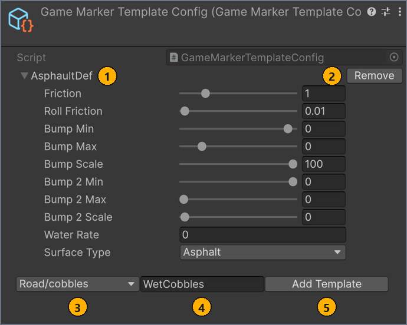
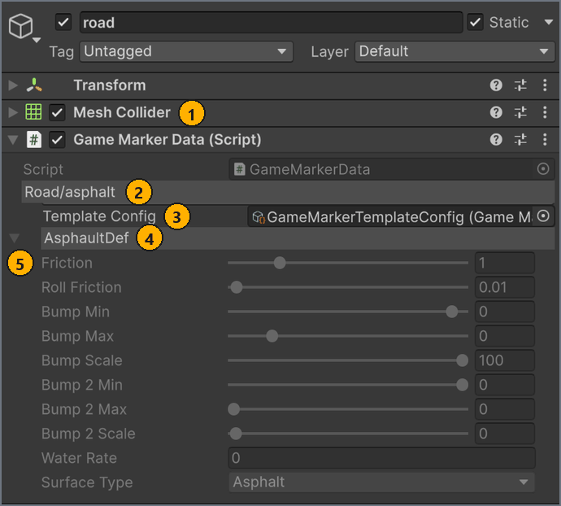
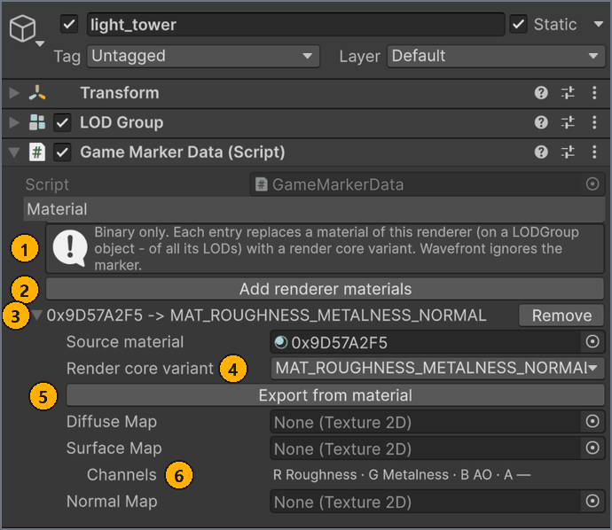

# Add markers

**English** · [Русский](../ru/markers.md)

Markers tell the game what your scene objects are: where the car appears, which road surface each collider has, which objects play an animation, which materials use render core variants and where sounds play. Add them once the scene has its models and colliders.

## Before you start

- A map scene in `Assets/MapResources/<MapName>/` with its models and colliders. See [Set up the scene](scene-setup.md).
- For Animation markers, an Animator whose controller contains the animation clips.
- For Material markers, the **Binary** build format. See [Choose the scene and format](build.md#format).
- For **Sound** > **Custom** markers, your sounds as `.ogg` or `.wav` files in the project.

## Add the GameMarkerData component

Every marker is a GameMarkerData component. Under the **Script** field, its first row is the type menu: a grey bar that shows the current type and opens the menu of types when you select it. The type decides what the marker does.

To add a marker:

1. In the **Hierarchy**, select the GameObject.
1. In the **Inspector**, select **Add Component**.
1. Type `GameMarkerData`, then select **Game Marker Data** in the results.
   The component appears with the type `SpawnPoint`.
1. In the type menu, select the type you need.

Result: the type menu shows the chosen type, for example `Road/asphalt`.

These rules apply to every marker:

- Put one GameMarkerData on a GameObject. Validation checks only the first one on each object.
- A map needs at least 1 GameMarkerData component and can have up to 10 000. <!-- src: Assets/Editor/MapSceneRules.cs:23 -->
- Markers on objects tagged `Garbage`, and on their children, are ignored by validation and export.

## Start from the example prefabs

`Assets/ExamplePrefab/` contains prefabs with markers already set up.

To use an example prefab:

- Drag the prefab from the **Project** window into the **Hierarchy**, then move it into place.

| Prefab | What it contains | Use it for |
| --- | --- | --- |
| `SpawnPoint` | An empty GameObject with a `SpawnPoint` marker and the Draw Zone Behaviour helper | A spawn point |
| `Road` | A 1 × 1 × 1 m cube with a Box Collider and a `Road/asphalt` marker | A drivable block |
| `Box` | A cube with a Rigidbody (mass 200) and a child `Road` that has a Box Collider. The child's `Road/asphalt` marker gives no surface, because the object is dynamic. | A dynamic object. See [Add dynamic objects](scene-setup.md#dynamic). |

Don't use `Ambient.prefab`. Its marker type, `Ambient`, is no longer supported; see [Remove unsupported markers](#unsupported).

## Choose the marker type

The type menu has 40 entries: **SpawnPoint**, a **Road** submenu with 27 surfaces, **Animation**, **Material**, a **ClipZone** submenu with 2 zone kinds, a **Miniature** submenu with 4 kinds, a **Sound** submenu with 3 kinds and a **Water** submenu with **Sea**. <!-- src: Assets/Scripts/MarkerData.cs:9-51 -->

| Type | Put it on | What it does | Formats |
| --- | --- | --- | --- |
| **SpawnPoint** | An empty GameObject | Marks a place where the car appears and a fast-travel point in the game | Binary and Wavefront |
| **Road** > *surface* | The GameObject with the collider | Gives that collider a road surface | Binary and Wavefront |
| **Animation** | The GameObject with the Animator | Bakes the Animator's clips into vertex animation | Binary and Wavefront |
| **Material** | The GameObject with the MeshRenderer or the LODGroup | Replaces its materials with render core variants | Binary only |
| **ClipZone** > *kind* | An empty GameObject whose children are the points of the zone center line | Makes a free ride clipping zone: touch and go or triple | Binary and Wavefront |
| **Miniature** > *kind* | Any GameObject, often the root of a group | Sets what the object and its children are in the 3D preview on the world map; see [3D preview on the world map](minimap-and-images.md#world-map-3d) | Binary and Wavefront |
| **Sound** > *kind* | An empty GameObject at the place of the sound | Plays a game sound or your own audio file at the object, or the background sound of the whole map; see [Add sounds](#sound) | Binary and Wavefront |
| **Water** > **Sea** | An empty GameObject at the sea level | Adds an endless sea at the height of the object; see [Add a sea](#water) | Binary and Wavefront |

To give several GameObjects the same type:

1. In the **Hierarchy**, select the GameObjects whose GameMarkerData you want to change.
1. In the type menu of the GameMarkerData component, select the type.
   The button in the component changes to **Select : &lt;type&gt;**, for example **Select : Road/concrete**.
1. Select **Select : &lt;type&gt;**.

Result: every selected marker has the new type.

The button keeps the **Template Config** and the template of each marker. For a **Road** type, it also resets the marker's own values, which **Custom** uses, to the defaults of the new surface, as changing the surface of one marker does. When the selected markers have different surfaces, it resets those that already had the new surface too; when every selected marker already has it, their **Custom** values stay. After the button, a marker without a **Template Config** gets the game's surface of its new type, a marker with a named template exports the template's values, and a **Custom** marker exports the defaults of the new surface; see [Physics values](#values). <!-- src: Assets/Editor/MarkerDataDrawer.cs:64-80 -->

## Add spawn points

A spawn point marks where the car appears and gives players a place to teleport to. A map needs at least one.

To add a spawn point:

1. Select **GameObject** > **Create Empty**.
1. Players see the spawn point's name in the game. In the **Hierarchy**, rename the new GameObject to something meaningful, for example `Start` or `Pit lane`.
1. In the **Inspector**, in the Transform, set **Position** and **Rotation**. The car takes both.
1. Add the GameMarkerData component. Its type is already `SpawnPoint`.

Result: the GameMarkerData component shows only the type menu, set to `SpawnPoint`.

How the game uses spawn points:

- By default, the car starts at the first spawn point in Hierarchy order. Make the start position the first spawn point in the **Hierarchy**, and don't put one spawn point inside another: a child spawn point comes before its parent.
- Every spawn point is a fast-travel point on the in-game world map, which shows your [minimap](minimap-and-images.md#minimap). The world map lists each point under its GameObject name, and players confirm the teleport.
- Without spawn points, validation reports an error: `The map has no SpawnPoint marker, so there is nowhere for a car to appear. …` <!-- src: Assets/Editor/Validation/SceneValidator.cs:301 -->
- When several spawn points share a name, validation warns: `<n> spawn points are all named '<name>'. …` <!-- src: Assets/Editor/Validation/SceneValidator.cs:1062 -->

The `SpawnPoint` example prefab also has the Draw Zone Behaviour helper. While the **Scene** view draws gizmos, it draws a green box at the point, and with **Cast To Floor** selected it moves the GameObject down until it sits on the first collider below it. To place a point at an exact height, clear **Cast To Floor**. The helper isn't exported, and validation ignores it. <!-- src: Assets/Resources/MapSkipComponentConfig.asset:16 -->

## Mark road surfaces

A Road marker tells the game which road surface a collider has, for example `asphalt`, `grass` or `metal`.

To mark a road surface:

1. In the **Hierarchy**, select the GameObject that has the collider.
1. Add the GameMarkerData component.
1. In the type menu, select **Road**, then the surface.

Result: the type menu shows `Road/<surface>`, for example `Road/asphalt`, and the **Template Config** field appears, empty. With **Template Config** empty, the game gives the collider its own surface of that name with all its values, **Surface Type** and **Water Rate** included. <!-- src: Assets/Scripts/GameMarkerData.cs:10-19 -->

> [!IMPORTANT]
> Put the marker on the collider's own GameObject: a collider on a child object passes validation but gets no surface. A **Template Config** replaces all the values of the game's surface, so with one, set **Surface Type** and **Water Rate** in its template or in **Custom**; see [Reuse road values with templates](#templates).

In the TestMap sample, `Content/workshop_map_main/road` is set up this way: the GameObject has only a Mesh Collider and a `Road/asphalt` marker. Its marker also uses the `AsphaultDef` template, so the game gets the template's values instead of its own `asphalt`; see [Values saved by an earlier version](reference.md#older-values).

- A Road marker with no collider on its GameObject or its children is a validation error: `'<name>' is marked as Road but has no Collider on it or its children, …` <!-- src: Assets/Editor/Validation/SceneValidator.cs:286 -->
- A collider without a Road marker still collides, but the game gives it a default physics material instead of a road surface.
- A Road marker on a LODGroup object, or on a renderer that is one of its LOD levels, gives no surface. Put the collider and the marker on a separate GameObject that isn't part of any LOD level.
- A Road marker on the GameObject with a Rigidbody, or on one of its children, gives no surface. The colliders of a dynamic object use the friction and bounciness of their physics material instead. This also applies to the child of the `Box` example prefab.
- A Road marker on a Unity Terrain passes validation, because a Terrain Collider counts as a collider, but Terrain isn't exported, so the map gets no ground there. Model the ground as a mesh; see [Set up the scene](scene-setup.md#before-you-start).
- Build optimization never merges colliders that carry different Road markers, so every collider keeps its surface.

### Road surfaces

The **Road** submenu lists `default` first, then 26 surfaces in alphabetical order, except that `snow_deep` comes right after `snow_asphalt`. A marker stores its type as `Road/<surface>`, and the game picks its own surface by the part after `Road/`. The following table groups the surfaces to make them easier to find; for the menu order and the **Surface Type** of each surface in the game, see [Road surfaces and physics fields](reference.md#surfaces).

| Group | Surfaces |
| --- | --- |
| Default | `default` (no game surface) |
| Paved | `asphalt`, `brick`, `concrete`, `kerb_racetrack`, `pavement` (no game surface), `paving_slab` |
| Cobbles | `cobbles`, `cobbles_big` |
| Loose ground | `dirt`, `earth`, `grass`, `gravel`, `sand` |
| Snow and ice | `ice_snowy` (no game surface), `road_icy`, `snow`, `snow_asphalt`, `snow_cobbles`, `snow_deep`, `snow_gravel` |
| Water | `liquid_water` |
| Metal, plastic and wood | `metal`, `metal_grille`, `plastic`, `wood`, `wood_plank` |

The game has no surface named `default`, `ice_snowy` or `pavement`. A collider with one of them gets no road surface in the game, with values or without, and behaves like a collider without a Road marker. Validation warns about such a marker with `'<object>' uses the surface '<surface>', which the game doesn't have, …` and names the surface to use instead: `asphalt` instead of `default`, `road_icy` instead of `ice_snowy` and `paving_slab` instead of `pavement`. In the TestMap sample, `Content/workshop_map_main/wall_coll` uses `Road/default` and gets this warning. <!-- src: Assets/Editor/Validation/SceneValidator.cs:275-281,1070-1075 -->

### Physics values

- Without a **Template Config**, a Road marker exports no physics values, and the game uses its own surface with all its values. <!-- src: Assets/Scripts/GameMarkerData.cs:10-19 -->
- **Surface Type**, **Water Rate** and the other values are set only through a template or **Custom**, as described in [Reuse road values with templates](#templates). The marker then exports all its values, and they replace the game's surface entirely. They start from the MapUploader defaults of the surface, which can differ from the game's surface, so assign a **Template Config** only to change a surface.
- For the fields and their ranges, see [Physics fields](reference.md#physics-fields). For what a marker exports in each state, see [When the physics values apply](reference.md#surface-values).

## Reuse road values with templates

A template config holds named sets of road values. Every marker that uses a template takes its values, so you tune a surface in one place. Templates also let you see and edit a marker's values.

To create a template:

1. In the **Project** window, open the folder for the config, for example `Assets/MapResources/<MapName>/`.
1. Select **Assets** > **Create** > **Map** > **GameMarkerTemplateConfig**. <!-- src: Assets/Scripts/GameMarkerTemplateConfig.cs:4 -->
   Unity creates the asset `GameMarkerTemplateConfig` and selects its name.
1. Press <kbd>Enter</kbd> to keep the name, or type a new one and press <kbd>Enter</kbd>.
1. In the **Inspector** of the config, in the surface menu, select **Road**, then the surface.
1. In the template name field, enter a name, for example `WetCobbles`.
   While the field is empty, it shows `TEMPLATE NAME`. <!-- src: Assets/Editor/GameMarkerTemplateConfigDrawer.cs:72 -->
   The following screenshot shows a template config with one template, `AsphaultDef`, with the same values as the `AsphaultDef` template in `Assets/Resources/GameMarkerTemplateConfig.asset`.

   

   | # | Element | What it does |
   | --- | --- | --- |
   | 1 | Template | A template, labelled with its name. Expand it to see and edit its values. |
   | 2 | **Remove** | Deletes the template. |
   | 3 | Surface menu | Sets the surface of a new template; its values start from that surface's defaults. Select `Road/…` entries only. |
   | 4 | Template name field | The name of a new template. |
   | 5 | **Add Template** | Adds the template. It is hidden while the name is empty and unavailable when a template with that name exists. |

1. Select **Add Template**.
   The template appears in the list under its name. Its values are the MapUploader defaults of its surface: **Surface Type** and **Water Rate** match the game's surface, and the other fields can differ from it.
1. Expand the template and set its values, including **Surface Type** and **Water Rate**.

Result: the config lists the template with your values.

To apply a template to a Road marker:

1. In the **Hierarchy**, select the GameObject with the Road marker.
1. In the GameMarkerData component, assign your config to **Template Config**.
   The template menu appears, set to **Custom**.
1. In the template menu, select your template.
   The following screenshot uses the template config made for this guide.

   

   | # | Element | What it does |
   | --- | --- | --- |
   | 1 | Mesh Collider | The collider on the same GameObject as the marker. |
   | 2 | Type menu | The marker type and surface, here `Road/asphalt`. |
   | 3 | **Template Config** | The template config. The physics fields appear only after you assign it. |
   | 4 | Template menu | The selected template, or **Custom** for values that belong to this marker only. The arrow at the start of the row shows or hides the values. |
   | 5 | Physics values | The values the marker exports. They are read-only while a named template is selected. |

1. Repeat these steps for every marker that should use the template.

Result: the template menu shows the template's name, and the marker takes the template's values. To see them, expand the template menu row with the arrow at its start: the values are greyed out. To give one marker its own editable values, select **Custom** in its template menu.

- Each build exports the current values of the template. After you edit a template, build the map again; you don't need to select the markers that use it. <!-- src: Assets/Scripts/GameMarkerData.cs:26-34 -->
- The template menu lists every template of the config, whatever its surface. The surface still comes from the marker type; the template supplies only the values.
- Create only `Road/…` templates. The surface menu of the config also offers **Animation** and **Material**, but only Road markers use templates.
- When you remove a template, the markers that used it export their own **Custom** values, and the **Inspector** shows **Custom** in their template menu. <!-- src: Assets/Scripts/GameMarkerData.cs:36-37 -->
- **Template Config** and the template are set on each marker separately. **Select : &lt;type&gt;** keeps them, and for a **Road** type resets the marker's **Custom** values to the defaults of the new surface. If every selected marker already has that surface, their **Custom** values stay.

## Animate objects with vertex animation

An Animation marker bakes the clips of an Animator into vertex animation, which the game plays without an Animator. It works in both formats.

To animate an object:

1. In the **Hierarchy**, select the GameObject with the Animator: the root of the animated hierarchy.
1. Add the GameMarkerData component.
1. In the type menu, select **Animation**.
   The **Animator** field is filled with the Animator on this GameObject.
1. Set the fields described in the following table.

Result: the next build bakes every clip of the Animator's controller, and the object starts with **Initial clip** in the game.

The Animation marker has these fields: <!-- src: Assets/Plugins/CarX.Modding.Creator/Runtime/Meta/AnimationMeta.cs:11-16 -->

| Option | Default | What it does | When to change |
| --- | --- | --- | --- |
| **Animator** | The Animator on this GameObject | The Animator whose clips are baked. It must be inside the exported map. | When the marker isn't on the Animator's GameObject |
| **Bake frames per second** | `30` | How many frames per second are baked, from 1 to 60 | Lower it when the build reports that the animation is too large; raise it for fast motion |
| **Initial clip** | The first clip, `0: <clip name>` | The clip the object starts with. All clips are baked either way. Shows `Assign an Animator with clips` when the Animator has no clips. | To start with another clip |
| **Playback speed** | `1` | Speed multiplier, 0 or more | To slow down or speed up the animation |
| **Initial phase (0..1)** | `0` | Where in the clip playback starts, as a fraction of its length | To keep copies of the same object out of step |
| **Loop** | Selected | Repeats the clip | Clear it for a clip that plays once |

Validation checks only that the marker has an Animator with clips: `Animation marker requires an Animator with animation clips.` The build checks the following rules and stops with an error in the **Console** when one fails: <!-- src: Assets/Editor/Validation/SceneValidator.cs:267 -->

- Each Animator has one Animation marker.
- Animated hierarchies don't overlap: a marked Animator can't be inside the hierarchy of another marked Animator.
- The hierarchy under the Animator contains no LODGroup and no other Animator. Use one level of detail per animated object.
- The hierarchy has at least one enabled MeshRenderer or SkinnedMeshRenderer, every such renderer has a mesh, and each mesh has as many materials as submeshes.
- The baked data stays within its size limit. Otherwise the build reports `VAT for '<name>' is too large …`; reduce the vertices, the clips or **Bake frames per second**. <!-- src: Assets/Plugins/CarX.Modding.Creator/Editor/VertexAnimationBaker.cs:128 -->

An Animator or SkinnedMeshRenderer without an Animation marker isn't exported, and validation shows a Components note for it. The game plays the baked clips only: Animator transitions, parameters, events, scripts and IK aren't reproduced, and collider shapes don't deform with the animation. For the full scope, see [Supported scope](https://github.com/CarXTechnologies/CarX.Modding.Creator/blob/365f9c9c803640246b5f2c2072e28a053b66c41d/VertexAnimation.md#supported-scope) in the SDK's VertexAnimation.md.

## Replace materials with render core variants

Without a marker, the game builds each material from one of a few standard templates, chosen by its HDRP settings: opaque, alpha test, transparent or emissive. A Material marker replaces the materials of one renderer with explicit render core variants, such as foliage, window, color mask, road sign emission or four-layer blend, with their own textures and parameters. Only **Binary** builds apply it. Wavefront ignores the marker, and validation warns about it.

To replace materials:

1. In the **Hierarchy**, select the GameObject with the MeshRenderer. For an object with LOD levels, select the GameObject with the LODGroup: its marker covers the renderers of all its LODs.
1. Add the GameMarkerData component.
1. In the type menu, select **Material**.
   The marker lists one entry per material of the renderer, each with a variant suggested from its HDRP settings.
1. Optional: Every entry replaces its material. To keep a material as it is, select **Remove** on its entry.
1. Expand an entry. Its header reads `<material> -> <variant>`.
1. In **Render core variant**, select a variant.
1. Select **Export from material**.
   The variant fields are filled from the HDRP Lit or Layered Lit material, generated textures are saved as PNG files in a `RenderCore` folder next to the material, and the **Console** shows `'<material>' exported to <variant>.` <!-- src: Assets/Editor/RenderCoreMaterialMarkerSettingsDrawer.cs:543 -->
1. Optional: If the **Console** line ends with `Set manually: <fields>`, set those fields by hand.
1. Repeat the last four steps for each remaining entry.

Result: each entry header shows the variant you chose, and the next **Binary** build replaces each listed material with its variant. The original material is still exported as a fallback for game versions that can't apply the variant.

The following screenshot shows a Material marker on a LODGroup object, with its first entry expanded.

| # | Element | What it does |
| --- | --- | --- |
| 1 | Binary-only note | Reminds you that only Binary builds apply the marker. |
| 2 | **Add renderer materials** | Adds entries for renderer materials that aren't listed yet, for example after you change the renderer's materials. |
| 3 | Entry header | Shows `<material> -> <variant>`. Expand it to edit the entry; its **Remove** button deletes the entry. |
| 4 | **Render core variant** | The variant that replaces the material. |
| 5 | **Export from material** | Fills the variant fields from the source HDRP material. It is unavailable without a source material. |
| 6 | `Channels` | The channel layout of a packed map, for example `R Roughness · G Metalness · B AO · A —`. |

- An entry without a diffuse texture renders white, and validation warns about it. **Export from material** fills the texture.
- The variant menu offers 21 variants: 20 render core surfaces and `WATER`, the game water; see [Make game water](#water-material). `MAT_INTERIOR` isn't offered: it needs a second UV set, and mod meshes carry only UV0. <!-- src: Assets/Plugins/CarX.Modding.Creator/Runtime/RenderCore/ModRenderCoreVariantTable.g.cs:207 -->
- A LOD renderer whose own GameObject has a Material marker uses that marker instead of the LODGroup's marker.
- A marker changes only its own object. The same material on another object, without a marker or with different settings, is exported separately.
- On an object inside an Animation marker's hierarchy, the Material marker is ignored: animated objects keep their own materials.
- After an SDK update, an entry can show `Exported from material for revision <n> of <variant>, the current revision is <m>. …`. Until you select **Export from material** again, the game uses the source material. <!-- src: Assets/Editor/RenderCoreMaterialMarkerSettingsDrawer.cs:212 -->
- **Unused values** lists stored values that the chosen variant doesn't have. They aren't exported; its **Remove** button deletes them.

`MAT_LAYERS4` blends four layers by the mesh's vertex colors: RGB is the layer mask and A tints the albedo. A mesh without vertex colors is exported white and shows only the fourth layer. The game keeps the vertex colors of a mesh with `MAT_LAYERS4`, so they also multiply the emission of the mesh's other submeshes. Put emissive parts on a separate GameObject: build optimization merges objects with `MAT_LAYERS4` only with each other, so that object stays a separate mesh. Validation warns about a mesh without vertex colors and about a mesh that mixes `MAT_LAYERS4` and emission.

The SDK's RenderCoreMaterial.md describes the alpha-test, `MAT_LAYERS4`, emission and `MAT_INTERIOR` variants in [Variant notes](https://github.com/CarXTechnologies/CarX.Modding.Creator/blob/365f9c9c803640246b5f2c2072e28a053b66c41d/RenderCoreMaterial.md#variant-notes), and when an entry needs **Export from material** again in [Revision policy](https://github.com/CarXTechnologies/CarX.Modding.Creator/blob/365f9c9c803640246b5f2c2072e28a053b66c41d/RenderCoreMaterial.md#revision-policy). For how Layered Lit materials are exported, see [LayeredPbr.md](https://github.com/CarXTechnologies/CarX.Modding.Creator/blob/365f9c9c803640246b5f2c2072e28a053b66c41d/LayeredPbr.md).

### Make game water

The `WATER` variant turns a material into the game water. The look of the water, such as its colour, foam, normal maps and caustics, comes from the map lighting, so the entry has only three fields: **Tiling**, **Ripple speed** and **Foam speed**. <!-- src: Assets/Plugins/CarX.Modding.Creator/Runtime/Water/ModWater.cs:15-25 -->

To make game water:

1. In the **Hierarchy**, select the GameObject with the water mesh.
1. Add a Material marker, as in [Replace materials with render core variants](#material).
1. In the entry of the water material, in **Render core variant**, select `WATER`.

Result: the entry shows `Game water: its look comes from the map lighting. Use UVs in meters (1 UV unit = 1 m) or adjust Tiling.` and the three fields with their defaults. <!-- src: Assets/Editor/RenderCoreMaterialMarkerSettingsDrawer.cs:28 -->

The `WATER` entry has these fields: <!-- src: Assets/Plugins/CarX.Modding.Creator/Runtime/Water/ModWater.cs:19-25 -->

| Option | Default | What it does | When to change |
| --- | --- | --- | --- |
| **Tiling** | `0.05` | Wave repeats per UV unit. With UVs in metres, `0.05` repeats the waves every 20 m, as on the maps of the game. From 0.001 to 10. | When the mesh UVs aren't in metres |
| **Ripple speed** | `-0.03` | Speed of the small ripples, in UV units per second; the sign sets the direction. From -1 to 1. | To make the water calmer or rougher |
| **Foam speed** | `0.01` | Speed of the foam, in UV units per second; the sign sets the direction. From -1 to 1. | To make the foam move faster or slower |

- The water repeats its waves by the mesh UVs times **Tiling**. Unwrap the water mesh with UVs in metres, 1 UV unit = 1 m, and keep **Tiling** at `0.05`. With other UVs, set **Tiling** to `0.05` divided by the UV units per metre: validation warns outside 0.01 to 0.25 repeats per metre and suggests the value. <!-- src: Assets/Editor/Validation/SceneValidator.cs:30-31,602-605 -->
- For `WATER`, **Export from material** is replaced by **Reset to defaults**: the water takes nothing from the HDRP material and bakes no textures.
- Don't give the water a collider that isn't a trigger: cars drive on such a water surface. Validation warns about it.
- Game versions without water show the fallback material, the HDRP material exported as if the entry weren't there. Give the water mesh an HDRP material that looks acceptable on its own. <!-- src: game -->
- For a sea that reaches the horizon, add a [Water/Sea marker](#water).

## Add sounds

A Sound marker adds a sound to the map. It works in both formats and has 3 kinds:

- **Sound** > **Preset** plays a sound of the game at the object, for example the sea or a crowd.
- **Sound** > **Custom** plays your own `.ogg` or `.wav` file at the object. The build copies the file into the map unchanged.
- **Sound** > **Ambience** plays the background sound of a game track, or wind, over the whole map. Its position doesn't matter.

To add a sound:

1. Select **GameObject** > **Create Empty**.
1. In the **Inspector**, in the Transform, set **Position** to the place of the sound.
1. Add the GameMarkerData component.
1. In the type menu, select **Sound**, then the kind.
1. For **Preset** and **Ambience**, in **Sound**, select a sound. For **Custom**, in **Audio clip**, select your clip.
1. Set the fields described in the following table.

Result: the **Scene** view shows a sphere at the object, and with the object selected, two wire spheres show **Min Distance** and **Max Distance**. The next build exports the sound.

The Sound marker has these fields: <!-- src: Assets/Plugins/CarX.Modding.Creator/Runtime/Sounds/SoundMarkerSettings.cs:16-35 -->

| Option | Default | What it does | When to change |
| --- | --- | --- | --- |
| **Sound** | `None` | **Preset** and **Ambience** only. The game sound, grouped by category: for **Preset**, sounds of places, such as `Water/sea_close` or `People/crowd_small`; for **Ambience**, the background of a game track, such as `Tracks/ebisu`, or `Weather/wind`. <!-- src: Assets/Plugins/CarX.Modding.Creator/Runtime/Sounds/ModSoundPresets.cs:21-79 --> | Always: a marker without a sound is a validation error |
| **Audio clip** | None | **Custom** only. The `.ogg` or `.wav` file that plays. | Always: a marker without a clip is a validation error |
| **Volume** | `1` | Loudness, from 0 to 1 | To make the sound quieter |
| **Min Distance** | `5` | **Preset** and **Custom** only. Up to this distance, in metres, the sound plays at full volume. From 0.5 to 500. | To make the loud area larger or smaller |
| **Max Distance** | `50` | **Preset** and **Custom** only. Beyond this distance, in metres, the sound isn't heard. From 0.5 to 500. | To make the sound carry further or less far |

These rules apply to Sound markers: <!-- src: Assets/Plugins/CarX.Modding.Creator/Runtime/Meta/SoundsMeta.cs:36-39 -->

- A map has at most 128 Sound markers, which use at most 32 different audio files of 20 MB in total. Validation reports a map over these limits as an error.
- Only `.ogg` and `.wav` files are exported. Convert other formats, and prefer `.ogg` for long sounds: it takes less space.
- Several **Custom** markers with the same clip share one file in the map.
- A map plays one ambience: the first **Sound** > **Ambience** marker in Hierarchy order. Validation warns about the others, and the build skips them.
- **Min Distance** can't be greater than **Max Distance**; validation reports it as an error.

## Add a sea

A **Water** > **Sea** marker adds an endless sea at the height of its GameObject, beyond the map geometry up to the horizon. Its look comes from the map lighting, as for the [game water](#water-material). It works in both formats.

To add a sea:

1. Select **GameObject** > **Create Empty**.
1. In the **Inspector**, in the Transform, set the Y of **Position** to the sea level.
1. Add the GameMarkerData component.
1. In the type menu, select **Water**, then **Sea**.
1. Optional: To hide the map geometry below the sea level under the water, clear **Background**.

Result: the **Scene** view shows a translucent blue plane at the sea level, a larger one with the object selected. The next build exports the sea.

The Water/Sea marker has one field: <!-- src: Assets/Plugins/CarX.Modding.Creator/Runtime/Water/WaterMarkerSettings.cs:13-14 -->

| Option | Default | What it does | When to change |
| --- | --- | --- | --- |
| **Background** | On | On: the sea is drawn behind all map geometry, so it never hides it. Off: map geometry below the sea level is hidden under the water. | Turn it off when parts of the map, such as a shore or a pier, go below the sea level |

- Only the height of the object matters: the sea has no edges.
- A map has one sea. The build exports the first Water/Sea marker and logs `[Water] '<name>' is a second Water/Sea marker and is not exported: …` for each other one; validation warns too. <!-- src: Assets/Plugins/CarX.Modding.Creator/Editor/SceneFormatCollector.cs:577-588 -->
- A marker on an inactive GameObject, or a disabled marker, adds no sea.

## Remove unsupported markers

Maps made with older versions of MapUploader can contain marker types that the game no longer supports: `Ambient`, `TimeObjectActivator` and `NetworkObject`. For such a marker, the **Inspector** shows `Unsupported marker: <type>. Select SpawnPoint, Road, Animation, Material, ClipZone, Miniature, Sound or Water, or remove the component.`, validation shows a Markers warning, and export skips the marker. <!-- src: Assets/Editor/MarkerDataDrawer.cs:114 -->

To remove an unsupported marker:

- In the **Inspector**, right-click the header of the GameMarkerData component and select **Remove Component**.

Result: the warning for that object disappears from the next validation.

If the object should be another marker, select a supported type in the type menu instead: for an `Ambient` sound, a **Sound** type; see [Add sounds](#sound). Moving physics objects need no marker: give them a Rigidbody, as described in [Add dynamic objects (Rigidbody)](scene-setup.md#dynamic).

The TestMap sample still has 8 `Ambient` markers under `AmbientSounds`, so validating TestMap shows 8 such warnings. `Assets/ExamplePrefab/Ambient.prefab` has the same marker, so each instance of it in a scene gives this warning too.

## Next steps

Add the minimap, then capture the icon and preview of the map.

← [Set up the scene](scene-setup.md) · [Contents](README.md) · [Minimap, icon and preview](minimap-and-images.md) →
