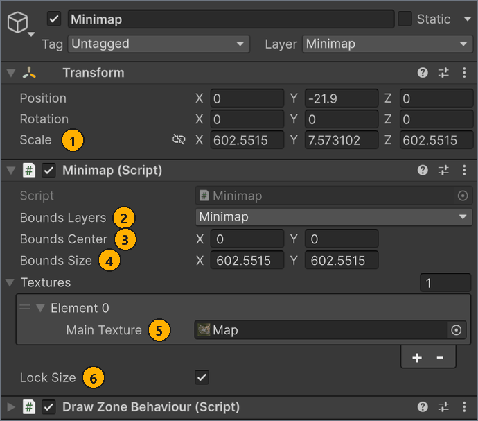
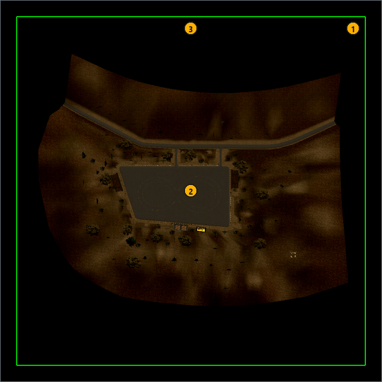
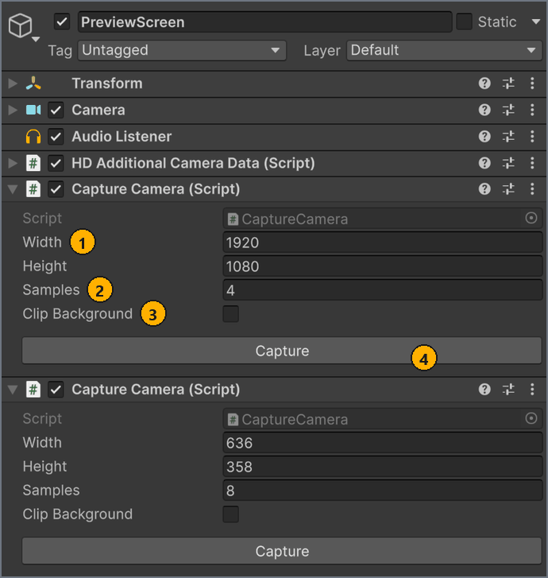

# Minimap, icon and preview

**English** · [Русский](../ru/minimap-and-images.md)

Every map needs a minimap and an Icon, and should have a Preview. Add the Minimap component to the scene, capture the images with CaptureCamera or make them in any image editor, and check them against the image requirements before you build.

## Before you start

- A map scene in `Assets/MapResources/<MapName>/` with its models and colliders. See [Set up the scene](scene-setup.md).
- For capture cameras, a root object tagged `Garbage`. See [Organize the scene](scene-setup.md#garbage).

<a name="minimap"></a>
## Add the minimap

The minimap is a top-down picture of your map that the game lays over a rectangle of the world. The game shows it as the on-screen minimap while you drive, on the map in the pause menu, where your spawn points are [fast-travel points](markers.md#spawn), and as the map preview on **Track Selection**, on the **Mods** screen and in online rooms.

A map needs exactly one Minimap component, on an active object outside any `Garbage` object. <!-- src: Assets/Editor/MapSceneRules.cs:24 -->

Add the minimap in this order: create the Minimap object and frame the area that the image covers, capture a top-down image of that area, then assign the image to the Minimap component.

<a name="frame-area"></a>
### Create the Minimap and frame its area

The minimap rectangle is always aligned with the world X and Z axes. A box drawn by DrawZoneBehaviour shows the rectangle in the **Scene** view, and **Lock Size** copies the size of the box into **Bounds Size**. The TestMap sample uses this setup.

To create the Minimap and frame its area:

1. Select **GameObject** > **Create Empty**.
1. In the **Hierarchy**, rename the new GameObject `Minimap`.
   Keep it active and outside any `Garbage` object, and leave its **Rotation** at 0, 0, 0.
1. In the **Inspector**, select **Add Component**, type `Minimap`, and select **Minimap**.
1. Select **Add Component**, type `Draw Zone Behaviour`, and select **Draw Zone Behaviour**.
1. In **Form**, select **Box**.
1. Select **Is Empty**.
   The **Scene** view draws a green wire box the size of the object's scale.
1. On the Minimap component, select **Lock Size**.
1. In the **Scene** view, looking from the top, scale the object along X and Z until the box frames your map.
1. On the Minimap component, clear **Lock Size**, then select it again.
   **Bounds Size** takes the object's new X and Z scale.
1. In **Bounds Center**, enter the object's **Position** X in **X** and its **Position** Z in **Y**.

Result: the green box shows the area that the minimap image covers, **Bounds Size** matches the box, and **Bounds Center** is its center.

If you know the exact extent of your map, you don't need the box. With **Lock Size** cleared, enter the world X and Z of the center of the area in **Bounds Center**, and its size in meters along world X and Z in **Bounds Size**.

DrawZoneBehaviour isn't exported, and validation ignores it. With **Cast To Floor** selected, it moves the object down onto the first collider below it while the **Scene** view draws gizmos; the minimap ignores height.

### Capture the minimap image

To capture the minimap image:

- Capture a top-down image of the framed area as described in [Capture images with CaptureCamera](#capture), with the camera set up from **Bounds Center** and **Bounds Size** as described in [Set up the minimap camera](#minimap-camera).

Result: the minimap PNG is in your map folder in the **Project** window.

You can also make the image in an image editor. Give it the same proportions as **Bounds Size** X : Y.

<a name="assign-minimap"></a>
### Assign the minimap image

To assign the minimap image:

1. In the **Hierarchy**, select the `Minimap` object.
1. On the Minimap component, in **Textures**, select **+**.
   **Element 0** appears.
1. From the **Project** window, drag your minimap image onto **Element 0** > **Main Texture**.

Result: **Main Texture** shows your image. When you select **Validate map** on the **Build** tab of the **MapBuilder** window, the **Map Validation** window lists no Minimap errors and no `'Minimap': the map has …` Budget error.

The `Minimap` object of the TestMap sample shows a finished setup, with **Bounds Size** taken from the object's scale:



| # | Element | What it does |
| --- | --- | --- |
| 1 | Transform **Scale** X and Z | Copied into **Bounds Size** while **Lock Size** is on. TestMap uses 602.5515 for both. |
| 2 | **Bounds Layers** | Not used by the build or the game. Leave it as it is. |
| 3 | **Bounds Center** | World position of the image center: **X** is world X, **Y** is world Z. It doesn't follow the object's position, so enter it yourself. |
| 4 | **Bounds Size** | World area that the image covers, in meters: **X** along world X, **Y** along world Z. Neither value can be 0. |
| 5 | **Textures** > **Element 0** > **Main Texture** | The minimap image. The game shows only element 0; further elements are exported but unused. |
| 6 | **Lock Size** | Takes **Bounds Size** from the object's world scale X and Z, and replaces any values you type there. The copy happens when you change a field of the Minimap component, not when you scale the object. |

The minimap belongs to the map metadata, so any build whose **Rebuild targets** include **Meta** picks up your changes. A build with only **Meta** selected doesn't check the scene, so select **Validate map** before it. See [Build the map](build.md).

> [!IMPORTANT]
> The map's row in the **MapBuilder** library doesn't notice changes to the scene or to image files. After you edit the minimap or save a new image over an old file, build the map again, even if the row shows `Ready to export`.

### How the game places the image

The game draws the image as a flat rectangle centered on **Bounds Center** and stretched to **Bounds Size**. The top edge of the image faces world +Z, and its width runs along world +X. Transparent pixels stay transparent.

A top-down Scene view of TestMap shows this rectangle:



| # | Element | What it does |
| --- | --- | --- |
| 1 | Outer green box | The **Bounds Size** area, X by Z. DrawZoneBehaviour draws it from the object's scale, which **Lock Size** copies into **Bounds Size**. |
| 2 | Center of the box | **Bounds Center**, here (0, 0). |
| 3 | Top edge of the box | World +Z: the top edge of the minimap image. |

Give the image the same proportions as **Bounds Size** X : Y, because the game stretches it to fill the rectangle. The map doesn't have to sit at the world origin, because **Bounds Center** places the image. Centering the map at (0, 0), as TestMap does, keeps the numbers simple.

### What validation checks

**Validate map** reports these errors for the minimap. The first two are in the Budget category, the rest in the Minimap category. <!-- src: Assets/Editor/Validation/SceneValidator.cs:901-950 -->

```text
'Minimap': the map has 0, at least 1 is required.
'Minimap': the map has <n>, at most 1 is allowed.
'<name>': Bounds Size is <size>. Set it to the size of the map in world units, or the minimap collapses to a point in game.
'<name>': no textures assigned. Add at least one entry with a Main Texture.
'<name>': Textures element <i> has no Main Texture assigned.
'<name>': Textures element <i> is a <Type>. Only Texture2D can be exported.
```

For the cause and the fix of each message, see the minimap entries in [Troubleshooting](troubleshooting.md#msg-bounds-size).

A Minimap under a `Garbage` object isn't counted, so validation reports the minimap as missing. A Minimap on an inactive object passes validation, but the build exports the minimap only from an active object, so keep it active.

<a name="world-map-3d"></a>
## 3D preview on the world map

The world map shows a map at **Track Selection**, on the **Mods** screen, in online rooms and in the pause menu. By default it shows the minimap image. A map can show a 3D miniature in the style of the game's own tracks instead: roads and pads in grey, buildings as lighter boxes that get lighter with height, and the terrain as a dark backdrop.

The miniature is a mesh with three submeshes: 0 is roads and pads, 1 is objects, 2 is terrain. Its vertices are in the world space of the map, the same space as the minimap rectangle. The build exports it to the mod, and the game colors it. <!-- src: Assets/Scripts/Minimap.cs:24-34 -->

The generator also draws the miniature from above into a minimap image in the same colors. That image becomes the minimap image of the map, so the picture of the map, such as the preview panel at **Track Selection**, matches the 3D miniature and loads as fast as any minimap. <!-- src: Assets/Plugins/CarX.Modding.Creator/Editor/MiniatureTextureRenderer.cs:7-16 -->

<a name="world-map-3d-enable"></a>
### Turn on the 3D preview

1. Select the Minimap object.
1. In **World Map Preview**, select **Generated 3D**.
   The **Generate 3D preview** button and the **Show in Scene view** box appear under the component.
1. Select **Generate 3D preview**.
   The generator saves two files next to the scene, named after the scene: the miniature `_Miniature.asset`, which **Miniature Mesh** now points to, and the minimap image `_MiniatureMap.png`, which replaces the image in **Textures** > **Element 0** > **Main Texture**. <!-- src: Assets/Editor/MinimapEditor.cs:44,83-100 -->
   When **Bounds Size** is under 10 m, the generator also clears **Lock Size** and sets **Bounds Center** and **Bounds Size** to a square around the roads and objects with a 10% margin. <!-- src: Assets/Editor/MinimapEditor.cs:19-20,150-174 -->
1. Look at the miniature in the **Scene** view: it floats 30 m over the map in the game's colors. To hide it, clear **Show in Scene view**. <!-- src: Assets/Editor/MinimapEditor.cs:17,50 -->

Result: the build exports the mesh in **Miniature Mesh** and the image in **Textures**. When **Miniature Mesh** is empty, the build generates the miniature from the scene, as the button does, but doesn't draw the image: the minimap image stays the one in **Textures**. <!-- src: Assets/Editor/MapBuilder.cs:143-152 -->

After generating, you can set either result by hand:

- **Your own miniature.** Model it in your 3D tool in the world space of the map with the three submeshes above, and set it in **Miniature Mesh**.
- **Your own image.** Set it in **Textures** > **Element 0** > **Main Texture**. The image that the generator replaced stays in the project, so you can set it back.

Generating again rewrites the two generated files and points both fields back to them. <!-- src: Assets/Editor/MinimapEditor.cs:87,100,107-126 -->

<a name="world-map-3d-markers"></a>
### Mark what each object is

The **Miniature** markers tell the generator what an object is, so that it doesn't guess. Put a GameMarkerData on an object and select the type. The marker also applies to all children of the object, so mark the root of a group. See [Add markers](markers.md). <!-- src: Assets/Plugins/CarX.Modding.Creator/Editor/MiniatureCollector.cs:205-220 -->

| Type | What the object becomes |
| --- | --- |
| **Miniature/Road** | Roads and pads: all its faces, in the road color |
| **Miniature/Terrain** | The terrain backdrop: all its faces, coarser, in the backdrop color |
| **Miniature/Object** | Boxes: one for each group of touching pieces of its mesh |
| **Miniature/Hidden** | Nothing |

An object marked **Miniature/Object** is taken whole: a stand built of seats and beams is one box, and a mesh merged from separate buildings gives one box for each building. Groups under 0.5 m are left out. <!-- src: Assets/Plugins/CarX.Modding.Creator/Editor/MiniatureCollector.cs:26,131-135,369 -->

Typical marking: **Road** on the root of the road meshes, **Terrain** on the terrain and rocks, **Object** on buildings and stands, **Hidden** on trees, grass, fences, guardrails, poles, signs, cars and invisible walls.

<a name="world-map-3d-auto"></a>
### How the generator decides without markers

Objects without a **Miniature** marker on them or their parents are sorted automatically. The rules work for most maps, but not for all: when the result is wrong, mark the objects.

- **Left out.** Disabled renderers, objects under a Garbage object, LOD levels other than the first, and renderers with a cutout or transparent material (render queue 2450 or higher, or alpha test on): foliage, glass, decals. A marker doesn't bring these back. <!-- src: Assets/Plugins/CarX.Modding.Creator/Editor/MiniatureCollector.cs:179-198 -->
- **Ground or object.** A mesh at least 15 m wide where 70% of the surface or more faces up or down, slopes included, is ground. Anything else is an object. <!-- src: Assets/Plugins/CarX.Modding.Creator/Editor/MiniatureCollector.cs:21-23,127 -->
- **Road or terrain.** Each submesh of a ground mesh goes by the average color of its material: the color textures (base color, albedo, diffuse, main texture, all splat layers) times the tint. Grey with saturation up to 0.2, neither too dark nor white, is a road, like asphalt and concrete. Colored is terrain, like grass, soil and sand. Grey rock counts as road, so mark rocks as **Terrain**. <!-- src: Assets/Plugins/CarX.Modding.Creator/Editor/MaterialColorSampler.cs:13-18,39 -->
- **Objects.** Each separate piece of an object mesh that is at least 5 m in size becomes a box of its bounds, turned with the object. Smaller pieces are left out: barriers, cones, signs and lamps would only clutter the miniature. A mesh merged from many buildings gives one box for each of them. An object built of many small pieces, such as a stand, disappears, so mark it as **Object**. <!-- src: Assets/Plugins/CarX.Modding.Creator/Editor/MiniatureCollector.cs:27,136-141 -->
- **Flipped normals.** Ground faces turned down are turned up, so flat meshes exported with flipped normals still show.

The minimap image isn't used: on many maps it is a photo, a line drawing or a stylized picture, and its colors say nothing reliable about the surfaces.

<a name="world-map-3d-limits"></a>
### Size of the miniature

The generator simplifies the roads to a grid of about 1/600 of the map size, 1.5 m at most, and the terrain to about 1/150, 6 m at most, and keeps the ground under 120 000 triangles and the objects under 20 000 boxes. Over the limits it simplifies further or drops the rest of the objects, and the **Console** shows a warning that starts with [Miniature]. <!-- src: Assets/Plugins/CarX.Modding.Creator/Editor/MiniatureCollector.cs:14-15,32-37,146,489 -->

The minimap image is 2048 pixels on its long side and covers the minimap rectangle; outside the map it is transparent. Roads are drawn over the terrain and objects over the roads. Seams between the roads and the terrain and holes inside the map, such as a lake or the footprint of a hidden building, are painted in the terrain color. <!-- src: Assets/Plugins/CarX.Modding.Creator/Editor/MiniatureTextureRenderer.cs:11,23,190,213 -->

<a name="capture"></a>
## Capture images with CaptureCamera

CaptureCamera saves a camera's view as a PNG file in your project. Use it for the minimap, the Icon and the Preview.

To capture an image:

1. Select **GameObject** > **Camera**.
1. In the **Hierarchy**, drag the new camera onto your `Garbage` object.
   Validation and export skip everything under a `Garbage` object, so the camera stays out of the map.
1. Point the camera at what the image shows.
   For the minimap, use the settings in [Set up the minimap camera](#minimap-camera).
1. In the **Inspector**, select **Add Component**, type `Capture Camera`, and select **Capture Camera**.
1. In **Width** and **Height**, enter the image size in pixels. The default is 1024 × 1024. <!-- src: Assets/Scripts/CaptureCamera.cs:6-7 -->
1. Optional: For a smoother image, in **Samples**, enter a supersampling factor, for example `4`. The default is 1. <!-- src: Assets/Scripts/CaptureCamera.cs:9 -->
1. Optional: For a transparent background, select **Clip Background**.
1. Select **Capture**.
   Unity renders the image and opens the `Save Capture` dialog in the project's `Assets` folder. <!-- src: Assets/Editor/CaptureCameraEditor.cs:86 -->
1. In the dialog, open a folder inside `Assets`, for example `Assets/MapResources/<MapName>/`, enter a file name, and select **Save**.
   If you cancel the dialog, nothing is saved.

Result: the PNG appears in the **Project** window with **Read/Write** on and **Non-Power of 2** set to **None**. It passes the Read/Write check for the Icon and the Preview, and Unity doesn't resize it when its sides aren't powers of two, such as 1920 × 1080. With **Clip Background**, **Alpha Is Transparency** is on too. The file must still stay within the size limits in [Image requirements](#images). <!-- src: Assets/Editor/CaptureCameraEditor.cs:111-114 -->

Save inside `Assets` to use the image in the map. Saved anywhere else, the PNG file is written without these import settings, and the Console shows `Capture saved outside the project: <path>. Copy it into Assets to use it as an icon, preview or minimap.` A copy that you put into `Assets` later gets Unity's default import settings, so set them as described in [Set the import settings](#import-settings). <!-- src: Assets/Editor/CaptureCameraEditor.cs:120 -->

Each CaptureCamera component has its own **Capture** button, so one camera can produce several images. The TestMap camera `Screen/PreviewScreen` has two components, one for the Preview and one for the Icon:



| # | Element | What it does |
| --- | --- | --- |
| 1 | **Width** and **Height** | Size of the saved PNG, in pixels. |
| 2 | **Samples** | Supersampling factor. Capture renders at **Width** × **Samples** by **Height** × **Samples**, then scales the image down. |
| 3 | **Clip Background** | Saves the PNG with a transparent background. |
| 4 | **Capture** | Renders the image and opens the `Save Capture` dialog. |

### Settings for each image

These sizes come from the TestMap sample:

| Image | Width × Height | Samples | Camera in TestMap |
| --- | --- | --- | --- |
| Preview | 1920 × 1080 | 4 | `Screen/PreviewScreen`, perspective |
| Icon | 636 × 358 | 8 | `Screen/PreviewScreen`, perspective |
| Minimap | 1024 × 1024 | 8 | `Screen/MinimapScreen`, orthographic, top-down |

The Icon becomes the mod.io logo, and mod.io makes thumbnails up to 1280 × 720 from it, so a larger 16:9 Icon, such as 1280 × 720, stays sharper there. <!-- src: Assets/Plugins/Modio/Modio/API/Generated/Definitions/RequestObjects/EditModRequest.cs:31 -->

Higher **Samples** values take more GPU memory: 1920 × 1080 at **Samples** 4 renders at 7680 × 4320 before it's scaled down.

<a name="minimap-camera"></a>
### Set up the minimap camera

A top-down orthographic camera gives an image that matches the minimap rectangle exactly. Set it up from your **Bounds Center** and **Bounds Size**:

| Setting | Value | TestMap |
| --- | --- | --- |
| Transform **Position** (world) | X = **Bounds Center** X, Z = **Bounds Center** Y; Y above the highest point of the map | 0, 52, 0 |
| Transform **Rotation** | 90, 0, 0, so the camera looks down with world +Z at the top of the image | 90, 0, 0 |
| Camera **Projection** | **Orthographic** | Orthographic |
| Camera **Size** | **Bounds Size** Y ÷ 2 | 300 |
| Camera **Clipping Planes** > **Far** | More than the distance from the camera down to the lowest point of the map | 125 |
| Camera **Culling Mask** | The layers to show on the minimap | `Default` |
| CaptureCamera **Width** : **Height** | The same proportions as **Bounds Size** X : Y | 1024 × 1024 |
| CaptureCamera **Clip Background** | On, so the area outside your map is transparent | Off |

The Transform shows world values only when the camera's parent sits at the origin. Keep your `Garbage` object at position 0, 0, 0, with rotation 0, 0, 0 and scale 1. TestMap's `Screen` object isn't at the origin, so its `MinimapScreen` camera shows local values.

After you capture the image, assign it to **Main Texture** on the Minimap component. See [Assign the minimap image](#assign-minimap).

### How Capture renders

- Without **Clip Background**, Capture renders the camera's view as the camera is set up. A camera whose **Background Type** is **Sky** captures the sky.
- With **Clip Background**, Capture renders the view twice, on black and on white, and computes the transparency from the difference. Post-processing, such as tonemapping and bloom, and anti-aliasing are off for these two renders, so the image can look slightly different from the **Game** view.
- Capture turns off **Occlusion Culling** on the camera while it renders. Afterwards it restores **Occlusion Culling** and the other camera settings that it changes.

<a name="images"></a>
## Image requirements

Validation checks the Icon and the Preview that you assign on the **Map** tab, and the minimap image on the Minimap component. To assign the Icon and the Preview, see [Fill in the map settings](map-settings.md#map-tab).

| Requirement | Icon | Preview | Minimap |
| --- | --- | --- | --- |
| Where you assign it | **Map** tab, **Icon · 16:9** | **Map** tab, **Preview · 16:9** | Minimap component, **Element 0** > **Main Texture** |
| Required | Yes; missing is an error | No; missing is a warning | Yes; missing is an error |
| File format | PNG. JPG gives a warning, any other format an error. | PNG. JPG gives a warning, any other format an error. | Any image that Unity imports as a Texture2D |
| **Read/Write** | Must be on | Must be on | Not needed |
| File size | At most 8 MB | At most 10 MB | No limit of its own <!-- src: Assets/Resources/CarX.Modding/ModIoConfig.asset:27; Assets/Editor/Validation/MapMetaValidator.cs:14 --> |
| Pixel size | Not checked. mod.io needs at least 512 × 288; 16:9 recommended. | Not checked; 16:9 recommended | Not checked; same proportions as **Bounds Size** X : Y <!-- src: Assets/Plugins/Modio/Modio/API/Generated/Definitions/RequestObjects/EditModRequest.cs:31 --> |
| Where it appears | On mod.io: the publication logo. In the game: the map's card on **Track Selection** and in the online room list, and the track picture when you create a room on a map without a Preview. | In the game: the loading screen, and the track picture when you create an online room. | In the game: the on-screen minimap, the pause-menu map and the map previews on **Track Selection**, on the **Mods** screen and in online rooms. |

- MapBuilder checks no pixel size or proportions; `16:9` in the field labels is a recommendation.
- On **Track Selection** and in online rooms, the game crops the Icon or the Preview to a frame wider than 16:9 instead of stretching it. Online rooms keep a strip through the middle, about 40% of the height of a 16:9 image. The card on **Track Selection** keeps the bottom of the Icon and cuts off about the top sixth. Keep the subject in the middle band of the image, away from its top edge. <!-- src: game -->
- mod.io receives the Icon file as it is and makes 320 × 180, 640 × 360 and 1280 × 720 thumbnails from it. The game receives each image as Unity imports it, saved again as PNG, so the import settings decide its size.
- The Preview isn't a mod.io image; it travels only inside the map's files. **Update preview** on the **Publish** tab uploads the Icon. See [Update a publication](publish.md#update).
- The Icon, the Preview and the minimap image belong to the map metadata, which MapBuilder limits to 24 MB for mod.io (the `MetaTemp` folder of the build cache). The metadata size is checked only right before **Create publication** or **Update publication**. <!-- src: Assets/Resources/CarX.Modding/ModIoConfig.asset:26 -->
- Both build formats keep the three images as PNG files. The **Binary textures** setting doesn't apply to them.

<a name="import-settings"></a>
### Set the import settings

CaptureCamera sets **Read/Write** and **Non-Power of 2** itself for a capture that you save inside `Assets`. Set them by hand for any other image: one made in an image editor, or a capture that you copied into `Assets` later. <!-- src: Assets/Editor/CaptureCameraEditor.cs:114 -->

**Read/Write** is required only for the Icon and the Preview, but the size settings matter for all three images. By default, Unity resizes an image whose sides aren't powers of two, for example 1920 × 1080 to 2048 × 1024. The minimap is stretched to its rectangle anyway, but a resized Icon or Preview shows in the game with the wrong proportions.

To set an image's import settings:

1. In the **Project** window, select the image.
1. In the **Inspector**, expand **Advanced**.
1. For the Icon or the Preview, select **Read/Write**.
1. For the Icon or the Preview, in **Non-Power of 2**, select **None**.
   The TestMap Icon and Preview use this setting.
1. Optional: To keep an image larger than 2048 pixels at its full size, in **Max Size**, select a value at least as large as its longest side.
1. Select **Apply**.

Result: the texture preview in the **Inspector** lists the image's own size, for example `1920x1080`, and **Validate map** reports no Read/Write error for it.

## Next steps

Assign the Icon and the Preview, and fill in the rest of the map settings on the **Map** tab.

← [Add markers](markers.md) · [Contents](README.md) · [Fill in the map settings](map-settings.md) →
