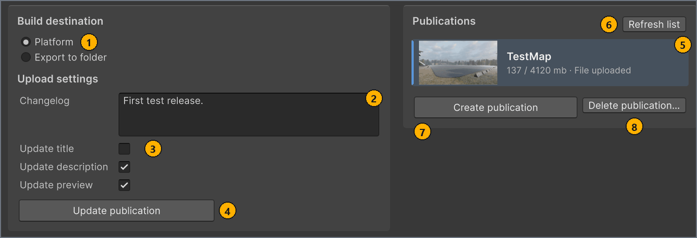

# Publish to mod.io

**English** · [Русский](../ru/publish.md)

Applies to: MapUploader `feature/2.0/3.0` · Unity 6000.3.19f1 · screenshots 2026-10-26

Publish your map on mod.io so that other players can install it in CarX Drift Racing Online 2. Create the publication once, for the first release, and update it for every later version of the map.

## Before you start

- For a new publication: a current build of the map. Its row in **LOCAL MAPS** shows `Ready to export`, and **Scene** and **Format** on the **Build** tab still match that build. See [Build the map](build.md). To update a publication, you build after you link it, as part of the procedure.
- A map that you have exported and checked in the game. See [Test the map in the game](test-in-game.md).
- A mod.io account, and access to the inbox of its email address. You sign in with a one-time code that mod.io sends there.
- An **Icon** of at least 512 × 288 pixels. mod.io refuses a smaller logo, and MapBuilder doesn't check the pixel size. See [Image requirements](minimap-and-images.md#images). <!-- src: Assets/Plugins/Modio/Modio/API/Generated/Definitions/RequestObjects/EditModRequest.cs:31 -->

## The Publish tab

On the **Publish** tab of the **MapBuilder** window, you send the current build to mod.io or export it to a folder. The following screenshot shows the tab while you are signed in, with the **Platform** option selected under **Build destination** and a linked publication selected in **Publications**.



| # | Element | What it does |
| --- | --- | --- |
| 1 | **Platform** option under **Build destination** | Shows the mod.io controls: **Changelog**, the three update toggles, **Update publication** and the **Publications** column. The other option, **Export to folder**, copies the build to a folder for [testing in the game](test-in-game.md#export). <!-- src: Assets/Editor/MapBuilderEditorWindow.cs:917-922 --> |
| 2 | **Changelog** | What changed in this release. mod.io shows it to players on the mod page. MapBuilder sends it with every create and update, and keeps it for each map separately. |
| 3 | **Update title**, **Update description**, **Update preview** | Choose which parts of the mod.io page **Update publication** overwrites. They are cleared by default. <!-- src: Assets/Editor/MapManagerConfig.cs:30-32 --> |
| 4 | **Update publication** | Uploads the current build to the selected publication as a new file. It's unavailable until you are signed in, a linked publication is selected and the build is current. |
| 5 | Linked publication row | The selected publication, highlighted. It's linked to the map selected in **LOCAL MAPS**, and **Update publication** uploads to it. The row shows the logo, the title, and the size and file status of the publication. |
| 6 | **Refresh list** | Reloads your publications from mod.io. |
| 7 | **Create publication** | Creates a new, hidden publication on mod.io and uploads the current build to it. It's unavailable until you are signed in and the build is current. |
| 8 | **Delete publication** | Deletes the selected publication from mod.io after you confirm. With no publication selected, it asks for the publication's id. |

Before you sign in, the tab shows the `Not signed in to https://mod.io/g/carx-dro2.` box, **Publications** shows `No publications on mod.io yet.` (right after Unity starts, it can read `the vendor` instead of `mod.io`), and **Create publication** and **Update publication** are unavailable. You don't need to sign in to validate, build or export the map. <!-- src: Assets/Plugins/CarX.Modding.Creator/Publishing/ModIo/ModIoAuthProvider.cs:154 -->

Until a linked publication is selected, an info box under **Build destination** reminds you to create a publication or to select an existing one.

The **Publications** column appears only while the **Platform** option is selected. When the window is narrower than 1120 px, the two columns of the tab stack. <!-- src: Assets/Editor/MapBuilderEditorWindow.Workspace.cs:64 -->

The **Platform** field in the window header always shows mod.io, and you can't change it.

<a name="sign-in"></a>
## Sign in to mod.io

You sign in with the email address of your mod.io account and a one-time code. You need to be signed in only to see, create, update or delete publications.

To sign in:

1. In the header of the **MapBuilder** window, select **Sign in**.
   The `mod.io terms of use` dialog opens. MapBuilder skips it when you have already accepted the same terms text. <!-- src: Assets/Plugins/CarX.Modding.Creator/Editor/Publishing/EditorModAuthPrompt.cs:60-64 -->
1. If the `mod.io terms of use` dialog opens, read the terms and select **Accept**.
   The `Sign in to mod.io` dialog opens. If you signed in before, **Email** already holds the address you used last time.
1. In **Email**, enter the email address of your mod.io account, and select **Continue**.
   mod.io sends a code of 5 characters to that address, and the dialog asks for it. <!-- src: Assets/Plugins/CarX.Modding.Creator/Publishing/ModIo/ModIoAuthProvider.cs:140 -->
1. In **Code**, enter the code from the email, and select **Continue**.
   The code expires after a few minutes. If mod.io stops accepting it, select **Cancel** and sign in again.

Result: the header shows `Account: <your mod.io name>` and **Sign out**, and **Publications** lists your publications. While their logos download, **Validate map** and the **Build map** button are unavailable for a moment. <!-- src: Assets/Editor/MapBuilderEditorWindow.cs:539 -->

MapBuilder remembers your email address and your acceptance of the terms for your user account on this computer. The mod.io plugin caches your session on disk, so you stay signed in after you restart Unity, until the session expires.

The header shows the sign-in state:

| Header shows | State |
| --- | --- |
| `Not signed in` and **Sign in** | You are signed out. Validation, building and export to a folder still work. |
| `Signing in…` | A sign-in is in progress. **Sign in** is unavailable until it ends. |
| `Account: <name>` and **Sign out** | You are signed in to mod.io as `<name>`. <!-- src: Assets/Editor/MapBuilderEditorWindow.cs:537-548 --> |
| `Unavailable` | mod.io isn't initialized yet or couldn't start. The info box on the **Publish** tab says why. |

To sign out:

- In the header of the **MapBuilder** window, select **Sign out**.
  MapBuilder signs you out at once, without a confirmation, and the header shows `Not signed in`.

<a name="create"></a>
## Create a publication

Create the publication once, for the first release of the map. The build must be current, because mod.io creates the publication together with its file.

To create the publication:

1. In the **MapBuilder** window, in **LOCAL MAPS**, select the map.
1. On the **Publish** tab, under **Build destination**, select the **Platform** option.
1. Optional: Under **Upload settings**, in **Changelog**, enter a note for players, for example `First release.`
1. Under **Publications**, select **Create publication**.
   The footer shows the progress, from `Creating publication…` to the upload itself. For a Binary build, the `Packing the map` progress bar also appears while MapBuilder packs the build. See [Upload progress](#upload-progress).

Result: the footer shows `Publication created.` The new publication appears in **Publications**, selected and linked to the map, and the map's row in **LOCAL MAPS** shows `Rebuild needed`. <!-- src: Assets/Editor/MapBuilderEditorWindow.Publish.cs:182-184 -->

If the footer shows `Publication did not complete. See the Console.`, the Console says why. When mod.io creates the publication but refuses its file, MapBuilder deletes the incomplete publication again.

If the map or its metadata isn't built, **Publications** shows `Build the map and its metadata first. A publication is created together with its files.` <!-- src: Assets/Editor/MapBuilderEditorWindow.Publish.cs:281 -->

**Create publication** sends these values to mod.io:

- the name, from **Name**;
- the summary: the first line of **Summary (optional)**, or the first line of **Description** when **Summary (optional)** is empty, or `<Name> track.` when both are empty; <!-- src: Assets/Scripts/Rules/MapMetaRules.cs:47-60 -->
- the logo, which is the **Icon** file as it is;
- the description, from **Description**, when it isn't empty, cut to 50 000 characters; <!-- src: Assets/Plugins/CarX.Modding.Creator/Publishing/ModIo/ModIoPublisher.cs:191-194 -->
- the build, as a file for the Windows platform, with **Version** (`1.0.0` when empty) and **Changelog**. <!-- src: Assets/Plugins/CarX.Modding.Creator/Publishing/ModIo/ModIoPublisher.cs:185-206 -->

mod.io creates the publication hidden. **Description**, **Preview**, **Authors** and **URL** also travel inside the build, in the map metadata.

> [!IMPORTANT]
> Each **Create publication** makes another, separate publication on mod.io, even for a map that already has one. To release a new version, [update the publication](#update) instead.

### Finish the publication

The build that **Create publication** uploads was made before the publication existed, so its metadata carries a placeholder id instead of the publication's mod.io id. That is why the map shows `Rebuild needed` and the **Build** tab shows `Map metadata has not been built yet.` Build the map again and update the publication. <!-- src: Assets/Editor/MapBuilderEditorWindow.cs:832 -->

To finish the publication:

1. Optional: To build faster, on the **Build** tab, select **Advanced settings** and set **Rebuild targets** to **Meta**.
   Only the metadata needs to be built again.
1. On the **Publish** tab, check that you are still signed in and that the new publication's row is selected in **Publications**.
   Only then does the next build carry the publication's mod.io id.
1. On the **Build** tab, select the **Build map** button.
   When the build finishes, the map's row in **LOCAL MAPS** shows `Ready to export`.
1. On the **Publish** tab, select **Update publication**.

Result: the footer shows `Publication updated.`, and the list reloads. The publication's file on mod.io now carries the publication's mod.io id. <!-- src: Assets/Editor/MapBuilderEditorWindow.Publish.cs:105 -->

### Make the publication public

MapBuilder never changes the visibility of a publication, so it stays hidden until you change it on mod.io. The mod.io page also shows the review status, which MapBuilder can't read.

To make the publication public:

1. In **Publications**, point to the size line of the publication's row.
   The tooltip ends with `Full status and visibility:` and the address of the publication's page. <!-- src: Assets/Editor/MapBuilderEditorWindow.Items.cs:246 -->
1. In a browser, open that address.
   You can't copy text from the tooltip, so type the address. It has the form `https://mod.io/g/carx-dro2/m/<id>`, where `<id>` is the publication's numeric id. You can also sign in on the mod.io website and open the publication from your list of mods. <!-- src: Assets/Plugins/CarX.Modding.Creator/Publishing/ModIo/ModIoPublisher.cs:355-363 -->
1. On the publication's page, make the publication public.

Result: other players can find and install the map in game builds that support mod.io. <!-- src: DR3PC1:Assets/DR3/Scripts/Services/ModIo/ModIoService.cs:41-51 -->

Delete your local test copy from the game's `Mods` folder now, or the game lists the map twice. See [Remove the local copy after you publish](test-in-game.md#after-publish).

<a name="update"></a>
## Update a publication

Update the publication each time you release a new version of the map. Every update uploads the whole build again as a new file. The game identifies a map installed from mod.io by the publication id and the file id, `<modIoId>_<modfileId>`. <!-- src: DR3PC1:Assets/DR3/Scripts/States/Controllers/Mods/ModRoomsHelper.cs:123-137 -->

To update the publication:

1. In the **MapBuilder** window, in **LOCAL MAPS**, select the map.
1. On the **Map** tab, in **Version**, enter the new version, for example `1.1.0`.
   The map's row in **LOCAL MAPS** shows `Rebuild needed`.
1. On the **Publish** tab, under **Build destination**, select the **Platform** option.
1. Under **Publications**, check the title, and select the publication's row, unless it is already selected.
   A row that shows `Select for this map` isn't linked yet: selecting it links the publication to the selected map at once. MapBuilder has no command to remove a link. <!-- src: Assets/Editor/MapBuilderEditorWindow.Items.cs:227 -->
1. On the **Build** tab, select the **Build map** button.
   When the build finishes, the map's row in **LOCAL MAPS** shows `Ready to export`.
1. On the **Publish** tab, under **Upload settings**, in **Changelog**, enter what changed in this version.
   MapBuilder keeps the changelog of each map and doesn't clear it after publishing, so replace the previous text.
1. Select or clear **Update title**, **Update description** and **Update preview**, as described in the table that follows this procedure.
1. Select **Update publication**.

Result: the footer shows `Publication updated.`, and the list reloads. Once mod.io has processed the new file, the map's mod.io line in **LOCAL MAPS** shows its version, for example `mod.io: 1.1.0`; if it still shows the old version, select **Refresh list** later. If the footer shows `Update did not complete. See the Console.`, the Console says why. <!-- src: Assets/Editor/MapBuilderEditorWindow.Publish.cs:101-105 -->

> [!IMPORTANT]
> Build the map after you link the publication, while you are signed in and its row is selected: only then does the build carry the publication's mod.io id. **Update publication** doesn't check the id, and the game uses it to sync [dynamic objects](scene-setup.md#dynamic) between players in online rooms.

The three toggles choose which parts of the mod.io page the update overwrites. They are cleared by default, they apply to every map in the project, and MapBuilder keeps them between sessions. <!-- src: Assets/Editor/MapManagerConfig.cs:30-32 -->

| Toggle | Overwrites on mod.io | Taken from |
| --- | --- | --- |
| **Update title** | The publication's name | **Name** |
| **Update description** | The summary and the description | **Summary (optional)**, or its fallback, and **Description**. When **Description** is empty, the description on mod.io stays as it was. |
| **Update preview** | The logo | The **Icon** file, not the **Preview** <!-- src: Assets/Plugins/CarX.Modding.Creator/Publishing/ModIo/ModIoPublisher.cs:294-297 --> |

With all three toggles cleared, the update sends only the new file with its **Version** and **Changelog**. An update never changes the visibility of the publication.

The game reads the map's name, authors and icon from the map metadata inside the file, so players see changes to them once they have the new version, whatever the toggles. The toggles change only the mod.io page.

<a name="upload-progress"></a>
## Upload progress

While MapBuilder creates or updates a publication, the progress bar in the window footer shows the current stage and the elapsed time. For a Binary build, the separate `Packing the map` progress bar appears before the upload, while MapBuilder packs the build into `mod.cxmod`. <!-- src: Assets/Editor/MapBuilder.Storage.cs:17-18 -->

| Footer shows | What happens |
| --- | --- |
| `Creating publication…`, `Connecting to mod.io…`, `Preparing publication files…`, `Sending files / waiting for mod.io…` | **Create publication** only: MapBuilder connects to mod.io and prepares the build. <!-- src: Assets/Editor/MapBuilderEditorWindow.Workspace.cs:408-411 --> |
| `Preparing…` | MapBuilder and the mod.io plugin prepare the upload. |
| `Packing files… <n>% · <done> / <total> MB` | The mod.io plugin compresses the build into one file. |
| `Uploading… <n>% · <sent> / <total> MB` | The file is being sent to mod.io. |
| `Processing on mod.io…` | mod.io processes the uploaded file. <!-- src: Assets/Editor/UploadProgressText.cs:33-40 --> |

Each line ends with the elapsed time, for example `Uploading… 63% · 120 / 190 MB · 1:05`.

**Cancel** in the footer stops the operation only until MapBuilder starts sending to mod.io. After that, **Cancel** is unavailable, and its tooltip reads `Sending to the platform cannot be cancelled once started`. <!-- src: Assets/Editor/MapBuilderEditorWindow.cs:1056 -->

## The Publications list

After you sign in, **Publications** lists the publications that you created for CarX Drift Racing Online 2 on mod.io. A publication that is linked to another local map isn't listed; select that map in **LOCAL MAPS** to see it.

Each row shows these elements:

| Row element | Meaning |
| --- | --- |
| Logo | The publication's logo on mod.io. |
| Title | The publication's name on mod.io, or `Blank <n>` when it has none. <!-- src: Assets/Editor/MapBuilderEditorWindow.Items.cs:199 --> |
| `<MB> / 4120 mb · File uploaded` or `<MB> / 4120 mb · No file uploaded` | The size of the publication's current file in megabytes, and whether the publication has a file. 4120 MB is the limit for a map, 4096 MB, plus the limit for its metadata, 24 MB. The tooltip of this line ends with the address of the publication's page. <!-- src: Assets/Editor/MapBuilderEditorWindow.Items.cs:205-214 --> |
| `Select for this map` | The publication isn't linked to any local map. Select the row to link it to the map selected in **LOCAL MAPS**. <!-- src: Assets/Editor/MapBuilderEditorWindow.Items.cs:227 --> |
| `Old version!` | An earlier version of the uploader published it: the publication carries that version's `Map` tag. <!-- src: Assets/Editor/MapBuilder.Publishing.cs:17-22 --> |

The selected row is highlighted. When the list is empty, it reads `No publications on mod.io yet.` and `Build the map and click Create publication.` Before you sign in, it reads the same, because nothing is loaded yet; right after Unity starts, the first line can read `the vendor` instead of `mod.io`. After you sign out, the rows loaded earlier stay in the list until you sign in again. <!-- src: Assets/Editor/MapBuilderEditorWindow.Items.cs:27-32,157-159 -->

**Refresh list** reloads the list. The list also reloads when the window opens, when you sign in, after each update, and after each create or delete that succeeds. <!-- src: Assets/Editor/MapBuilderEditorWindow.Publish.cs:188,239-254 --> Each time the list loads with at least one publication, MapBuilder removes the links to publications that no longer exist on your account.

MapBuilder keeps the links, the changelogs and the three toggles in `Assets/Resources/MapManagerConfig.asset`. Keep this file when you move the project to another computer; without it, link each publication again by selecting its row. <!-- src: Assets/Editor/MapManagerConfig.cs:24-32 -->

For the meaning of the mod.io line under each map in **LOCAL MAPS**, see [Create or select a map](map-settings.md#new-map).

## Delete a publication

Delete a publication when you no longer want it on mod.io. You need to be signed in. The local map, its settings and its build stay in the project.

> [!CAUTION]
> Deleting removes the publication and every file published to it from mod.io. You can't undo it.

To delete a publication:

1. On the **Publish** tab, under **Build destination**, select the **Platform** option.
1. Under **Publications**, select the publication's row.
   If the row shows `Select for this map`, selecting it links the publication to the selected map. A successful deletion removes that link again; if you cancel the deletion or it fails, the publication stays linked to the selected map. To delete an unlinked publication without linking it, delete it by its id, as described in **Delete a publication that the list can't show** below.
1. Select **Delete publication**.
   The `Delete from mod.io` dialog opens with the name and the id of the publication. <!-- src: Assets/Plugins/CarX.Modding.Creator/Editor/Publishing/ModPublisherSession.cs:167-168 -->
1. Check the name and the id, and select **Delete**.

Result: the Console shows `Deleted mod <id>.`, the list reloads without the publication, and the map's mod.io line in **LOCAL MAPS** shows `mod.io: not linked`. <!-- src: Assets/Plugins/CarX.Modding.Creator/Publishing/ModIo/ModIoPublisher.cs:352 -->

<details>
<summary>Delete a publication that the list can't show</summary>

When you can't select a publication, for example because the list fails to load, delete it by its id. **Delete publication** asks for the id when no row is selected.

To delete a publication by its id:

1. If a row in **Publications** is selected, in **LOCAL MAPS** select a map that shows `mod.io: not linked`.
   No row is selected for a map without a linked publication.
1. Select **Delete publication**.
   The `Delete from mod.io` dialog asks for **Item id** and says where mod.io shows the id. <!-- src: Assets/Plugins/CarX.Modding.Creator/Editor/Publishing/ModPublisherSession.cs:148-153 -->
1. In **Item id**, enter the numeric id of the publication, and select **Continue**.
1. In the confirmation dialog, check the id, and select **Delete**.

Result: the Console shows `Deleted mod <id>.`

A local map that was linked to the deleted publication keeps its link until the list next loads with at least one publication on your account. Until then, the map's mod.io line shows `mod.io: version not loaded`. <!-- src: Assets/Editor/MapManagerConfig.cs:139-142 -->

</details>

## Rename a map

The game shows the name stored in the map metadata, so players see a new name once they have the file that carries it. The mod.io page keeps the old name until an update with **Update title** selected. <!-- src: DR3PC1:Assets/DR3/Scripts/States/Controllers/Mods/ModRoomsHelper.cs:57-61 -->

To rename a published map:

1. On the **Map** tab, in **Name**, enter the new name.
   The map's row in **LOCAL MAPS** shows the new name and `Rebuild needed`. For the rules on names, see [Fill in the Map tab](map-settings.md#map-tab).
1. Update the publication as described in [Update a publication](#update), with **Update title** selected.

Result: the publication on mod.io shows the new name, and players see it in the game once they have the new version.

<a name="size-limits"></a>
## Size limits at upload

MapBuilder checks the size of the build only when you select **Create publication** or **Update publication**. **Validate map** and the **Export to folder** button don't check it. The check measures the folders of the [build cache](build.md#cache), not the packed `mod.cxmod`:

| Build cache folder | Holds | Limit |
| --- | --- | --- |
| `MapTemp` | The map: geometry, materials and textures | 4096 MB |
| `MetaTemp` | The map metadata, including the icon, the preview and the minimap images | 24 MB <!-- src: Assets/Resources/CarX.Modding/ModIoConfig.asset:25-26 --> |

If a folder is over its limit, MapBuilder uploads nothing, the footer shows `Publication did not complete. See the Console.` or `Update did not complete. See the Console.`, and the Console shows one of these errors, where `<scene>` is the scene name: <!-- src: Assets/Editor/MapBuilder.Storage.cs:167-178 -->

```text
'<scene>': the map is <X> mb and this vendor accepts 4096 mb.
'<scene>': the meta is <X> mb and this vendor accepts 24 mb.
```

To bring the metadata under its limit, use smaller images for the **Icon**, the **Preview** and the minimap. These are upload limits only: a very large map may still fail to load in the game.

## Next steps

For error messages and their fixes, see the next page.

← [Test the map in the game](test-in-game.md) · [Contents](README.md) · [Troubleshooting](troubleshooting.md) →
