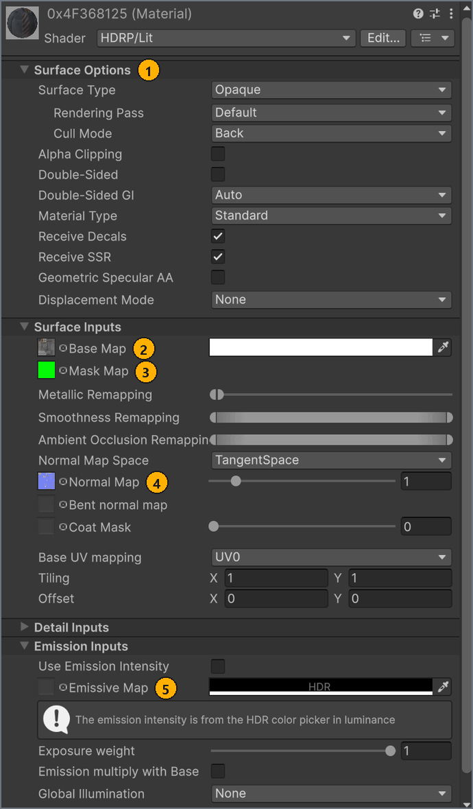

# Set up the scene

**English** · [Русский](../ru/scene-setup.md)

Build the Unity scene that MapBuilder turns into a map: the map folder and scene, your models, materials, colliders, dynamic objects, LOD groups and lights. Do this before you add markers, and come back here whenever validation points to the scene.

<a name="before-you-start"></a>
## Before you start

- The MapUploader project open in Unity 6000.3.19f1. See [Get started](getting-started.md).
- A 3D model of the map in a format that Unity imports, such as FBX, with the ground modelled as a mesh. Unity Terrain isn't exported: validation lists Terrain and TerrainCollider only as Components notes, the build skips them, and a Road marker on a Terrain passes validation but gives no collision in the game. The ground of the TestMap sample is a mesh named `terrain`.

<a name="scene"></a>
## Create the map folder and scene

Keep everything for one map in its own folder under `Assets/MapResources/`: the scene, the models, the materials and, later, the map config. Scenes in this folder appear in **Scene** on the MapBuilder **Build** tab automatically; see [Choose the scene and format](build.md#format).

To create the map folder and scene:

1. In the **Project** window, in `Assets/MapResources/`, create a folder named after the map, for example `MyTrack`.
1. Open that folder, then select **Assets** > **Create** > **Scene** > **Scene**.
1. Name the scene with letters, digits and `_` only, starting with a letter, for example `MyTrack`.
1. Open the scene.

Result: the scene `Assets/MapResources/MyTrack/MyTrack.unity` is open, and Unity's build scene list contains it.

With any other scene name, validation stops the build with an error that starts with `The scene name '<name>' cannot be used for a build.` <!-- src: Assets/Editor/Validation/MapMetaValidator.cs:37-41 -->

The TestMap sample shows a typical layout of a map folder:

```text
Assets/MapResources/TestMap/
├─ Art/                  models, materials and textures
├─ EnvironmentProfiles/  baked reflection probe for the editor preview
├─ Graph/                Shader Graph shaders for the foliage
├─ Icon/                 minimap, icon and preview images
├─ TestMap.unity         the map scene
└─ TestMapConfig.asset   the map config, created later with + New map
```

<a name="import"></a>
## Import models

The build reads the meshes that Unity imported, not your source files. Any format that Unity imports works, such as FBX, OBJ or DAE.

To import a model:

1. Drag the model file from your file manager into `Assets/MapResources/<MapName>/` in the **Project** window.
1. Drag the imported model from the **Project** window into the **Hierarchy**.
1. Save the scene with <kbd>Ctrl</kbd>+<kbd>S</kbd>.

Result: the model shows in the **Scene** view.

Unity measures in meters: 1 unit is 1 m, and the build exports sizes as they are. To check the scale, drag `Assets/ExamplePrefab/Road.prefab`, a 1 × 1 × 1 m cube, next to the model, then delete it. If the model is too large or too small, select it in the **Project** window and, in the **Inspector**, on the **Model** tab, set **Scale Factor**, or select or clear **Convert Units**, then select **Apply**.

What the build takes from your models and textures:

- Each mesh with its positions, normals, vertex colors and one UV set, UV0. Other UV sets, such as lightmap UVs, aren't exported.
- Each MeshRenderer's shadow casting: with **Cast Shadows** set to **Off**, the mesh casts no shadow in the game.
- Each texture at the size Unity imported it, read without compression. The texture's **Max Size** limits the exported resolution; its compression settings don't.

You don't need to turn on **Read/Write** for models or material textures. The build turns it on while it runs and then restores your import settings. The Icon and Preview are different; see [Image requirements](minimap-and-images.md#images).

Unity Terrain isn't exported, so model the ground as a mesh with a MeshCollider; see [Before you start](#before-you-start).

> [!TIP]
> Keep your 3D tool's work files, such as `.blend` or `.max`, outside `Assets/`, and put only the exported model in the project. Unity imports every file under `Assets/`, and it can import a `.blend` file only when Blender is installed.

<a name="materials"></a>
## Set up materials

Use HDRP/Lit materials. The build reads a fixed set of their settings and converts them for the game, the same way for Binary and Wavefront.

To set up a material:

1. Optional: if the model's materials are embedded, Unity doesn't let you edit them. Select the model in the **Project** window and, in the **Inspector**, on the **Materials** tab, select **Extract Materials**, then choose `Assets/MapResources/<MapName>/`.
1. Optional: if the model has no materials, open `Assets/MapResources/<MapName>/` in the **Project** window and select **Assets** > **Create** > **Material**.
   The new material uses the HDRP/Lit shader.
1. In the **Project** window, select the material.
1. In the **Inspector**, under **Surface Options**, set **Surface Type**, **Alpha Clipping** and **Double-Sided**.
1. Under **Surface Inputs**, assign **Base Map**, **Mask Map** and **Normal Map**.
1. Optional: under **Emission Inputs**, assign **Emissive Map** and set its color to anything but black.
1. Drag the material onto the object in the **Scene** view.

Result: the object shows the material in the **Scene** view.

The following screenshot shows `Assets/MapResources/TestMap/Art/0x4F368125.mat`, an HDRP/Lit material from the TestMap sample, with the settings that the build reads.



| # | Element | What it does |
| --- | --- | --- |
| 1 | **Surface Options** | With **Alpha Clipping** on, the material is exported as a cutout. Otherwise **Surface Type** decides: **Opaque** or **Transparent**. **Double-Sided** and its **Normal Mode** are exported too. |
| 2 | **Base Map** and its color | Exported as the diffuse texture and color. In a cutout or transparent material, their alpha becomes the opacity. |
| 3 | **Mask Map** | R is exported as metallic, and A (smoothness) as roughness, 1 − A. G (ambient occlusion) and B (detail mask) are ignored. |
| 4 | **Normal Map** and its strength | Exported as a tangent-space normal map, with the strength baked in. |
| 5 | **Emissive Map** and its color | Emission is exported only when the color isn't black. With a black color, the map is ignored too. |

The build also follows these rules:

- The **Tiling** and **Offset** of the **Base Map** are kept, and the game applies them to all the maps of the material.
- Without a **Mask Map**, the **Metallic** and **Smoothness** values are exported. With a **Mask Map**, **Metallic Remapping** and **Smoothness Remapping** are ignored.
- In a cutout material, the Alpha Clipping **Threshold** is baked into the opacity. **Alpha Remapping** is exported only for **Transparent** materials.
- **Blending Mode** isn't exported: transparent materials always blend by alpha.
- Keep **Normal Map Space** on **TangentSpace**. An object-space normal map isn't exported.
- Keep **Base UV mapping** on **UV0**. Meshes carry only UV0, so the other UV sets and Planar and Triplanar mapping aren't reproduced.
- Only Texture2D textures are exported. A cubemap or a Render Texture in a texture slot is skipped with a Console warning that ends with `only Texture2D can be exported. Skipped.` <!-- src: Assets/Plugins/CarX.Modding.Creator/Editor/MtlTextureMapWriter.cs:391 -->
- Everything else on the material, such as **Detail Inputs**, **Height Map** and **Material Type**, isn't exported.

For every property the build reads, see [HDRP material export](reference.md#materials). In Binary builds, a Material marker can replace a material with one of the game's render core variants; see [Replace materials with render core variants](markers.md#material).

### Layered Lit materials

HDRP/LayeredLit materials are exported with all their layers, 2 to 4. Each layer keeps its **Base Map**, **Mask Map**, **Normal Map**, tiling and values, and the material keeps its **Layer Mask** and **Vertex Color Mode** blending.

**Validate map** doesn't check Layered Lit settings. The build stops with an error in the Console when a Layered Lit material uses one of these:

- **Use Height Based Blend**, **Main Layer Influence**, or **Use Opacity map as Density map** on a layer: `Layered Lit '<material>': '<option>' is not supported by the mod material format.`, where `<option>` is the shader property `_UseHeightBasedBlend`, `_UseMainLayerInfluence` or `_UseDensityMode`. <!-- src: Assets/Plugins/CarX.Modding.Creator/Editor/LayeredPbrWriter.cs:10-25 -->
- **BlendMask UV Mapping** other than **UV0**: the same message, naming `_UVBlendMask`.
- A layer's **Base UV mapping** other than **UV0**: `Layered Lit '<material>': layer <n> requires UV0 mapping for mod export.` <!-- src: Assets/Plugins/CarX.Modding.Creator/Editor/LayeredPbrWriter.cs:65-68 -->

### Other shaders

The build reads material properties by their reference names. A Shader Graph material exports whatever it exposes under the HDRP/Lit names, such as `_BaseColorMap`, `_BaseColor`, `_NormalMap`, `_MaskMap` and `_EmissiveColor`. For example, the TestMap foliage uses `Assets/MapResources/TestMap/Graph/FoliageSimple.shadergraph`, whose texture property has the reference `_BaseColorMap`.

<a name="colliders"></a>
## Add colliders

Cars collide only with colliders, not with visible meshes. Give a collider to every surface that cars drive on or hit.

To add a collider:

1. Select the object.
1. In the **Inspector**, select **Add Component** and add a MeshCollider, BoxCollider, SphereCollider or CapsuleCollider.
1. Optional: to collide with a simpler shape than the visible mesh, assign a low-poly mesh to the MeshCollider's **Mesh**.

Result: while the object is selected, the **Scene** view draws the collider's outline in green.

Next, give each collider object a Road marker on the same GameObject, so that the game knows its surface. See [Mark road surfaces](markers.md#road).

What the build exports:

- A MeshCollider whenever it has a mesh, even when the component is disabled or **Is Trigger** is selected. To leave one out, remove the component or tag the object `Garbage`.
- A BoxCollider, SphereCollider or CapsuleCollider only when it is enabled and **Is Trigger** is cleared.
- No other colliders. TerrainCollider and WheelCollider, for example, are skipped.
- No physics material on static colliders: their surface comes from the Road marker.

A collider doesn't need a renderer on the same object. TestMap keeps visible and collision geometry apart: under `Content/workshop_map_main`, the `road`, `roadside` and `terrain` objects each exist twice, once as a visible mesh and once as a MeshCollider with a Road marker.

Build optimization cuts large static MeshColliders into sectors. See [Optimization](build.md#optimization).

<a name="dynamic"></a>
## Add dynamic objects (Rigidbody)

An object with a Rigidbody becomes a physics object in the game. TestMap has two: `Flora/advertising_stand_small_6` and `Flora/advertising_stand_small_7`, each with a Rigidbody of mass 50 on its LODGroup object. `Assets/ExamplePrefab/Box.prefab` is another example: a Rigidbody with a child BoxCollider.

To add a dynamic object:

1. Select the root of the object. If the object has a LODGroup, select the LODGroup object.
1. In the **Inspector**, select **Add Component** and add a Rigidbody.
1. In the Rigidbody component, set **Mass** and the other values.
1. Make sure that the object or its children have at least one enabled collider.
1. On each MeshCollider of the object, select **Convex**. You can skip this only when **Is Kinematic** is selected on the Rigidbody.

Result: **Validate map** reports no Physics errors for the object.

The build exports the mass, linear and angular damping, gravity, the kinematic flag, the constraints, the center of mass and inertia (automatic or set by hand) and the starting velocities. For each enabled collider of the Rigidbody, including triggers, it also exports the friction and bounciness of the collider's physics material. A map can have up to 1000 Rigidbodies. <!-- src: Assets/Editor/MapSceneRules.cs:17 -->

Of the rules below, **Validate map** checks only **Convex**; it also checks the 1000-Rigidbody limit. The build checks the rest and stops with an error in the Console when:

- A Rigidbody is inside the hierarchy of a LODGroup object, at any depth. Put the Rigidbody on the LODGroup object or on one of its parents. The message starts with `Rigidbody '<name>' cannot split an enclosing LODGroup.` <!-- src: Assets/Plugins/CarX.Modding.Creator/Editor/RigidbodyExporter.cs:37-39 -->
- A collider of a Rigidbody has a sheared transform, which comes from non-uniform scale on a parent of a rotated object. Apply the scale in the model. The message ends with `has a sheared transform. Apply scale in the model first.` <!-- src: Assets/Plugins/CarX.Modding.Creator/Editor/RigidbodyExporter.cs:63-68 -->
- A MeshCollider of a non-kinematic Rigidbody isn't convex: `Rigidbody '<name>': a dynamic MeshCollider must be Convex.` A MeshCollider of a Rigidbody without a mesh stops the build too. <!-- src: Assets/Plugins/CarX.Modding.Creator/Editor/RigidbodyExporter.cs:75-76 -->
- A Rigidbody sits inside an object with an Animation marker. Put the Rigidbody on the Animator root or on one of its parents: `Put Rigidbody on the Animator root or above it; a baked animation cannot contain independent moving bodies.` <!-- src: Assets/Plugins/CarX.Modding.Creator/Editor/SceneFormatCollector.cs:45-46 -->

These cases only add a warning to the Console, and the build continues:

- **Collision Detection** other than **Discrete**. The game uses discrete collision detection, so the continuous modes aren't exported.
- A Rigidbody with no enabled collider. The Rigidbody is skipped, and its meshes are exported as static geometry. The message starts with `Rigidbody '<name>' was skipped: no enabled supported colliders.` <!-- src: Assets/Plugins/CarX.Modding.Creator/Editor/RigidbodyExporter.cs:94 -->
- A collider's physics material uses **Multiply** for **Friction Combine** or **Bounce Combine**. The game approximates it with a geometric mean: `Rigidbody '<name>': Multiply material combine uses the Unity Physics geometric mean approximation.` <!-- src: Assets/Plugins/CarX.Modding.Creator/Editor/RigidbodyExporter.cs:85-86 -->

Build optimization leaves dynamic objects and everything under them as they are.

In the game, a dynamic Rigidbody works like the game's own props: the car body pushes it, and the wheels don't drive on it. A kinematic Rigidbody collides like the map's static geometry, so cars can drive on it. In online rooms, the game keeps dynamic objects in sync between players and matches them by the map's metadata id, so build the map again after you link a publication; see [Update a publication](publish.md#update).

<a name="lod"></a>
## Use LOD groups

Add a LODGroup to an object as in any Unity project. The build exports every level, and the game switches levels at distances calculated from the group's size and transition heights.

- A LODGroup can have at most 8 levels. More is a validation error, which stops the build: `'<name>' has <n> LOD levels; at most 8 are supported…` <!-- src: Assets/Editor/Validation/SceneValidator.cs:811-819 -->
- A LODGroup with a single level is still exported as a LOD group, so the object disappears at its **Culled** transition.
- A LODGroup with no renderers on any level gets a Geometry warning.
- The build recalculates each LODGroup's bounds, so a hand-set **Object Size** is replaced.
- Build optimization leaves your LOD groups as they are. It can generate LODs for merged static geometry instead.
- To make a LOD object dynamic, put the Rigidbody on the LODGroup object. See [Add dynamic objects (Rigidbody)](#dynamic).

<a name="garbage"></a>
## Organize the scene

Organize the hierarchy as you like. A map can have any number of root objects and doesn't need a common parent. The build exports the scene selected in **Scene** on the **Build** tab. If another scene is open, MapBuilder offers to save your changes and then opens that scene.

To leave an object out of the map:

1. Select the object.
1. In the **Inspector**, set **Tag** to `Garbage`.

Result: validation, export and build optimization skip the object and all its children.

Use `Garbage` for capture cameras, reference meshes and other helpers. TestMap keeps its capture cameras under the root object `Screen`, which is tagged `Garbage`; see [Capture images with CaptureCamera](minimap-and-images.md#capture). A camera or another helper outside a `Garbage` object adds a Components note to validation.

> [!IMPORTANT]
> Deactivating an object doesn't remove it from the map: inactive objects, disabled MeshRenderers and disabled MeshColliders are still exported. Tag the object `Garbage` instead.

The exceptions are lights, the Minimap and anything inside a Rigidbody: when inactive, they aren't exported.

Prefabs are optional. The build doesn't use Unity prefabs: it finds objects that share the same mesh, materials and colliders and exports them once, as instances. Keep or unpack prefab instances as you like.

The build doesn't add, remove or move objects in your scene. It only recalculates the bounds of each LODGroup. Build optimization works on a copy in memory.

<a name="lighting"></a>
## Set up lighting

The game supplies its own environment lighting, such as the sky and the sun. From your scene, it takes only Point and Spot lights.

- Only enabled Point and Spot lights on active objects are exported, in both formats. Every other type, including Directional and Area lights, is skipped.
- The build exports each light's position, rotation, color, intensity, range, spot angles, shadow settings and color temperature. It converts the intensity to candela, multiplies it by 0.1 and caps it at 5000. <!-- src: Assets/Plugins/CarX.Modding.Creator/Editor/SceneFormatCollector.cs:71-85 -->
- A map can have up to 500 lights. <!-- src: Assets/Editor/MapSceneRules.cs:20-21 -->
- Volumes (sky, fog, exposure), Directional and Area lights and Reflection Probes light only the scene in the editor.
- Baked lightmaps aren't exported, and build optimization doesn't merge renderers that use a baked lightmap. Don't bake lighting in the map scene.

> [!NOTE]
> In the game, exported lights turn on only at night. Check them at night when you [test the map in the game](test-in-game.md).

To preview the map under the lighting of a game track:

1. In the **Project** window, open `Assets/Art/Internal/EnvironmentProfiles/<track>/`, for example `japan`.
1. Drag `<track>.prefab`, for example `japan.prefab`, into the **Hierarchy**.

Result: the **Scene** view shows the map with that track's sky and sun. The prefab holds a global Volume and a Directional light named `sunlight`.

There are 23 presets, named after game tracks and night variants, such as `ebisu`, `irwindale`, `japan`, `nightClear` and `silverstone`. The TestMap sample uses the `japan` lighting.

A preset adds these notes to validation. They don't block the build:

```text
'sunlight' is a Directional light. It lights the SDK preview only; the game uses its own sun, so it is not exported.
'Volume' is used only for the SDK preview and is not exported or required.
```

Validation adds a note for each enabled Directional light and a light-type warning for each enabled light of another type that isn't Point or Spot, such as an Area light. It adds one more warning when the scene has two or more Directional lights, counting disabled ones. <!-- src: Assets/Editor/Validation/SceneValidator.cs:736-758 -->

<a name="reference-scene"></a>
## Explore the reference scene

The scene of the TestMap sample, `Assets/MapResources/TestMap/TestMap.unity`, shows a complete setup. These are its root objects:

```text
TestMap
├─ SpawnPoint          GameMarkerData SpawnPoint: where the car appears
├─ Marking             road markings: a mesh with a transparent material, no collider
├─ japan               preview lighting: global Volume and Directional light 'sunlight' (not exported)
├─ Content
│  └─ workshop_map_main  the drivable map: road, roadside, terrain and walls with
│                        MeshColliders and Road markers, plus concrete barriers
├─ Flora               trees, bushes, tribunes, billboards, barriers and towers as LOD groups;
│                      4 Point lights on radio_tower; Rigidbodies on
│                      advertising_stand_small_6 and advertising_stand_small_7
├─ ReflectionProbe     preview only (not exported)
├─ Minimap             the map's one Minimap component
├─ Screen              tagged Garbage: capture cameras PreviewScreen and MinimapScreen
└─ AmbientSounds       8 'Ambient' prefab instances with an unsupported marker
```

**Validate map** on TestMap shows no errors. It shows warnings for the 8 `Ambient` markers and for 12 LODGroups with no renderers, and notes for the preview `sunlight` and for the preview-only Volume, ReflectionProbe and HDAdditionalReflectionData. See [Fix validation problems](validation.md).

## Next steps

Add markers: a Road marker on every collider object and at least one spawn point.

← [Get started](getting-started.md) · [Contents](README.md) · [Add markers](markers.md) →
