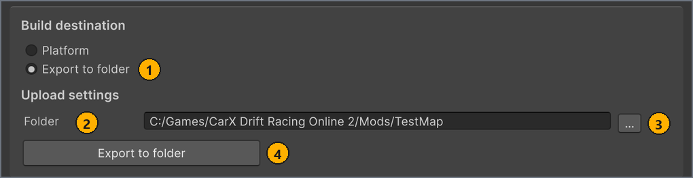

# Test the map in the game

**English** · [Русский](../ru/test-in-game.md)

Copy your map into the game's `Mods` folder and drive it before you publish it. Local testing needs no mod.io account and no sign-in.

## Before you start

- A current build of the map: its row in **LOCAL MAPS** shows `Ready to export`, and **Scene** and **Format** on the **Build** tab still match that build. See [Build the map](build.md). <!-- src: Assets/Editor/MapBuilderEditorWindow.Workspace.cs:198 -->
- CarX Drift Racing Online 2 version 0.21.4 or later on a Windows PC, in a copy that loads local maps. To find out whether yours does, see [Check that the game loads local maps](#check-game).

<a name="export"></a>
## Export the map to the game folder

The export copies the current build into a folder that you choose. For a local test, that folder is a map folder inside the game's `Mods` folder. On this page, `<game folder>` is the folder that contains the game's executable, and `<MapName>` is the name of the map folder, for example `TestMap`.

To export the map:

1. In the **MapBuilder** window, in **LOCAL MAPS**, select your map.
1. Select the **Publish** tab.
1. Under **Build destination**, select the **Export to folder** option.
   The **Folder** field and the **Export to folder** button appear in place of the publication controls.
1. In **Folder**, enter the absolute path `<game folder>/Mods/<MapName>`, for example `C:/Games/CarX Drift Racing Online 2/Mods/TestMap`.
   The folders don't have to exist: the export creates them.

   

   | # | Element | What it does |
   | --- | --- | --- |
   | 1 | **Export to folder** option under **Build destination** | Switches the tab to export mode. The publication controls and the **Publications** column are hidden. |
   | 2 | **Folder** | The absolute path of the map folder. |
   | 3 | **…** | Opens the `External path` folder dialog, where you can choose or create the map folder. The dialog doesn't open in the game folder, so go to `<game folder>/Mods` first. |
   | 4 | **Export to folder** button | Copies the current build into **Folder**. It's unavailable until the build is current and **Folder** holds an absolute path. |

1. Select the **Export to folder** button.
   For a Binary build, the `Packing the map` progress bar appears while MapBuilder packs the build into `mod.cxmod`. <!-- src: Assets/Editor/MapBuilder.Storage.cs:17-18 -->

Result: the **Publish** tab and the window footer show `Exported to <Folder>`, and the map folder holds the map. <!-- src: Assets/Editor/MapBuilderEditorWindow.Publish.cs:140 -->

What the map folder holds depends on the format of the build. The game loads both formats; see [Choose the scene and format](build.md#format).

- **Binary** writes one file, `mod.cxmod`. Loose files from an earlier Wavefront export stay in the folder, and the game ignores them.
- **Wavefront** copies the map as loose JSON, OBJ, MTL and PNG files in several subfolders. It deletes an old `mod.cxmod` from the folder, because the game would read that file instead.

If the **Export to folder** button is unavailable, the hint line of the **Publish** tab says what is missing: `Before exporting, build the map and its metadata in the Build tab.` or `Choose an export folder.` A path that isn't absolute, such as `Mods/TestMap`, also keeps the button unavailable. <!-- src: Assets/Editor/MapBuilderEditorWindow.Workspace.cs:370-372 -->

If the tab shows `Nothing to export — see the Console.`, the Console names the part of the build that is missing. Build the map again, then export it. <!-- src: Assets/Editor/MapBuilderEditorWindow.Publish.cs:141 -->

The export doesn't need a mod.io sign-in, so ignore the `Not signed in to https://mod.io/g/carx-dro2.` box when it shows. In this mode the tab also keeps the **Upload settings** heading; only **Folder**, **…** and the **Export to folder** button apply to an export. <!-- src: Assets/Plugins/CarX.Modding.Creator/Publishing/ModIo/ModIoAuthProvider.cs:154 -->

> [!WARNING]
> **Folder** keeps the same path for every map, so change it before you export another map: exporting a second map into the first map's folder overwrites its `mod.cxmod` or mixes the files of both maps. The export doesn't clear **Folder** first, so empty the folder before a Wavefront export, or the game can read an old metadata file that an earlier export left there. <!-- src: Assets/Editor/MapBuilderEditorWindow.cs:47 -->

<a name="local-maps"></a>
## Where the game looks for local maps

On PC, the game loads local maps from the `Mods` folder next to its executable. If your copy never lists them, see [Check that the game loads local maps](#check-game). <!-- src: game -->

```text
<game folder>/            the folder with the game's executable
├── <game executable>
└── Mods/
    └── <MapName>/        one folder per map; its name is the map's mod ID
        └── mod.cxmod     a Binary export; a Wavefront export puts its files here instead
```

- Each folder directly inside `Mods` is one map, and the folder name is the map's mod ID. Players don't see the mod ID: the game shows the map's **Name** from the map settings, or `Modded Track` when **Name** is empty. <!-- src: game -->
- Put the map files directly in the map folder: not in `Mods` itself, and not in a subfolder of the map folder.
- The game skips folders whose names start with `.`, and **Track Selection** doesn't list empty folders.
- When the map folder holds `mod.cxmod`, the game reads only that file and ignores any loose files next to it.
- Don't give the map folder a name of the form `<digits>_<digits>`, such as `12345_67890`. The game treats such names as maps installed from mod.io. <!-- src: game -->
- The game reads the `Mods` folder again each time you open **Track Selection**, so you don't need to restart the game after an export. A map that you export while **Track Selection** is open appears after you leave the screen and open it again. <!-- src: game -->

> [!TIP]
> To open the game folder from Steam, right-click the game in your library and select **Manage** > **Browse local files**.

<a name="in-game"></a>
## Load the map in the game

Local maps appear in free ride, on the **Mods** tab of the **Track Selection** screen.

To drive the map:

1. Start CarX Drift Racing Online 2.
1. In the main menu, select **Play**.
   The **Mode Selection** screen opens.
1. Select **Freeride**.
   The **Track Selection** screen opens.
1. Select the **Mods** tab.
   The tab appears only when the game finds at least one map in `Mods`, or a map from mod.io.
1. Select the card that shows your map's Icon.
   The **Mods** screen opens. It shows the map's **Name** and, when **Authors** is filled in, the line `by <authors>`. <!-- src: game -->
1. Optional: To check your lights, on the **Mods** screen, set the time of day to **00:00**.
   The screen offers **08:00**, **14:00**, **19:00** and **00:00**; only **00:00** is night. The weather is fixed on this screen. <!-- src: game -->
1. Select **Continue**.

Result: the game loads the map and places your car at the first spawn point. See [Add spawn points](markers.md#spawn).

If the **Mods** tab or your map's card is missing, check the folder against [Where the game looks for local maps](#local-maps). If the folder is right, [check that the game loads local maps](#check-game). If the map fails to load, the game shows `Failed to load the track mod. Please try again.` and returns to **Track Selection**. Very large maps may fail to load. See [`Failed to load the track mod.` in Troubleshooting](troubleshooting.md#msg-load-failed). <!-- src: game -->

To test a change, leave the drive from the pause menu, build and export the map again, and select the map's card again. You don't need to close or restart the game: it reads the map from disk each time the map starts, and it doesn't keep the map files open after loading. To see a new Icon or minimap on the card, or a newly exported map, leave **Track Selection** and open it again. <!-- src: game -->

<a name="check-game"></a>
## Check that the game loads local maps

CarX Drift Racing Online 2 reads the `Mods` folder from version 0.21.4. To find out whether your copy reads the folder, load the TestMap sample, which ships with the project and passes validation. If TestMap loads and your own map doesn't, the problem is in your map. <!-- src: game -->

To check the game:

1. In the **MapBuilder** window, in **LOCAL MAPS**, select `TestMap`.
1. On the **Build** tab, in **Scene**, select `TestMap`.
1. Select the **Build map** button.
   When the build finishes, the `TestMap` row shows `Ready to export`.
1. Export the build to `<game folder>/Mods/TestMap`, as described in [Export the map to the game folder](#export).
1. In the game, in the main menu, select **Play**, then **Freeride**.
   The **Track Selection** screen opens.

Result: **Track Selection** has a **Mods** tab, and the tab shows the `TestMap` card. Your copy of the game loads local maps.

If the **Mods** tab or the `TestMap` card is missing, check the folder against [Where the game looks for local maps](#local-maps). If the TestMap files sit directly in `<game folder>/Mods/TestMap` and the card is still missing, this copy of the game doesn't load local maps.

When you finish, delete the folder `<game folder>/Mods/TestMap`, so that the **Mods** tab lists only your own maps.

## Play with others

To drive your local map with friends, create an online room on it. A player can join the room only if their own `Mods` folder holds your map under the same folder name, so give them a copy of your map folder.

To create a room on your map:

1. In the main menu, select **Play**.
1. On the **Mode Selection** screen, select **Online Rooms**.
1. Select **Create room**.
   The room settings open.
1. In the room settings, select your map.
   Your map is listed under its **Name**, or as `Modded Track` when **Name** is empty. If several maps have no **Name**, they are numbered: `Modded Track 1`, `Modded Track 2`. Fill in **Name** to find yours. <!-- src: game -->
1. Select **Create room**.

Result: the game loads your map in the new room. Players who don't have your map folder don't see the room in their room list, and joining it by code shows `Install the track mod to join this room.` <!-- src: game -->

Rooms on a map published to mod.io work differently. In game builds that support mod.io, a player who doesn't have that map is asked `Download the track mod?` when joining. See [Publish to mod.io](publish.md). <!-- src: game -->

## Check the map before you publish

Go through this list with the exported map before you create the publication.

- [ ] **Validate map** reports no errors. See [Fix validation problems](validation.md).
- [ ] On **Track Selection**, your map's card shows your Icon, and the screen previews your minimap while the card is highlighted.
- [ ] The **Mods** screen shows the correct **Name** and authors.
- [ ] The car starts at the first spawn point in the **Hierarchy**.
- [ ] Every spawn point works: in the pause menu, on the **Map** tab, select each point and confirm `Move to <name>?`. Each point is listed under its GameObject name. <!-- src: game -->
- [ ] On the **Map** tab, the marker of your car sits where the car is on the minimap image. See [Add the minimap](minimap-and-images.md#minimap).
- [ ] You can drive a full lap at speed without falling through the ground, and the edges of the map stop the car.
- [ ] Each road surface grips the way its Road marker says.
- [ ] Dynamic objects move and collide as expected. See [Add dynamic objects (Rigidbody)](scene-setup.md#dynamic).
- [ ] At **00:00**, your Point and Spot lights are on and emissive materials look right. Exported lights are on only from 20:00 to 06:00, so at **14:00** they stay off. See [Set up lighting](scene-setup.md#lighting). <!-- src: game -->

<a name="after-publish"></a>
## Remove the local copy after you publish

Once your map is on mod.io and you install it in the game, the game lists the map twice, because the two copies have different mod IDs: `<MapName>` for the local folder and `<modIoId>_<modfileId>` for the copy from mod.io. The card of the mod.io copy carries the mod.io badge. <!-- src: game -->

To keep only the published map:

- Delete the folder `<game folder>/Mods/<MapName>`.

Result: the next time you open **Track Selection**, the **Mods** tab shows only the copy from mod.io.

To test a new version before you update the publication, export it into the map folder again, and delete the folder when you finish.

## Next steps

When every check passes, publish the map.

← [Fix validation problems](validation.md) · [Contents](README.md) · [Publish to mod.io](publish.md) →
