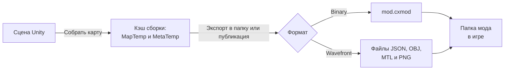

# Формат мода: Wavefront и Binary

[English](../../en/advanced/mod-format.md) · **Русский**

На этой странице описано, как MapUploader хранит собранную карту: кэш сборки, дерево файлов Wavefront, контейнер Binary `mod.cxmod` и то, как игра читает папку мода. Чтобы создать или опубликовать карту, эта страница не нужна. Обращайтесь к ней, когда изучаете экспортированные файлы, разбираетесь, почему карта не загружается, или пишете инструмент, который читает моды.

## Как карта становится модом



Сборка записывает промежуточные файлы; экспорт или публикация превращает их в выбранный формат, а игра читает любой из двух форматов из папки мода.

Кнопка **Собрать карту** (Build map) записывает карту в кэш сборки в двух частях. Часть Map в `MapTemp` содержит сцену, а часть Meta в `MetaTemp` — метаданные и их изображения. Оба формата раскладывают промежуточные файлы по схеме [дерева Wavefront](#wavefront-tree), с одним отличием: сборка Binary записывает в `models/` бинарные меши (`.cxmesh`) вместо файлов `.obj`. Где найти кэш сборки, см. в разделе [Куда записывается сборка](../build.md#cache).

Сам мод записывается только при экспорте или публикации карты. Кнопка **Экспортировать в папку** (Export to folder) записывает его в выбранную вами папку, а кнопки **Создать публикацию** (Create publication) и **Обновить публикацию** (Update publication) загружают его на mod.io. Для Binary именно в этот момент промежуточные файлы упаковываются в [`mod.cxmod`](#binary). <!-- src: Assets/Editor/MapBuilder.Storage.cs:85-113 -->

Оба формата создаёт один и тот же экспортёр. У них общие правила для сцены, общие метаданные и общее преобразование материалов HDRP, и, если не считать маркеров Material, которые применяет только Binary, содержимое у них одинаковое. Формат не зависит от того, куда уходит карта: и публикация на mod.io, и экспорт в папку берут тот формат, в котором вы собрали карту. После смены значения **Формат** (Format) соберите части Map и Meta вместе: сборка в другом формате удаляет обе части предыдущей сборки; см. [Выбор сцены и формата](../build.md#format).

Формат не привязан к одной игре. Игре нужен совместимый загрузчик и собственные адаптеры для рендеринга, физики и игровых маркеров. Ни один из форматов не содержит ассетов Unity, поэтому мод не зависит от версии редактора, в которой его собрали. Сейчас существует только один тип содержимого — `map`. <!-- src: Assets/Plugins/CarX.Modding.Creator/Runtime/Meta/ModMeta.cs:31-32 -->

## Сравнение Binary и Wavefront

|  | Binary | Wavefront |
| --- | --- | --- |
| Формат по умолчанию | Да | Нет |
| Что лежит в папке мода | Один файл `mod.cxmod` | Дерево файлов `.json`, `.obj`, `.mtl` и `.png` |
| Метаданные и документы сцены | Бинарные документы | Текст JSON |
| Геометрия | Бинарные меши, каждый уникальный меш хранится один раз | Текстовые OBJ, по одному файлу на набор материалов |
| Текстуры материалов | Перекодируются с MIP-уровнями в BC7 или RGBA32, по выбору в поле **Текстуры Binary** (Binary textures) | PNG |
| Иконка, превью и мини-карта | PNG без изменений | PNG |
| Маркеры Material | Применяются | Игнорируются; проверка выдаёт предупреждение |
| Сжатие | Deflate, для каждого ресурса отдельно | Нет |
| Можно прочитать в текстовом редакторе | Нет | Да |

Тестируйте и публикуйте карту в формате Binary: игра читает один файл, текстуры приходят готовыми для GPU, а маркеры Material работают только в Binary. Wavefront нужен, чтобы читать или сравнивать экспортированные данные как текст. Копия игры, которая загружает локальные карты, читает оба формата.

## Что попадает в мод

Экспортёр обходит все корневые объекты сцены и записывает только то, что игра может воссоздать. Объекты с тегом `Garbage` и их дочерние объекты не попадают в мод никогда; как обрабатываются неактивные и выключенные объекты, см. в разделе [Организация сцены](../scene-setup.md#garbage).

| Содержимое | Когда экспортируется | Куда записывается |
| --- | --- | --- |
| Статическая геометрия | У объекта есть MeshFilter и MeshRenderer, MeshCollider с мешем или включённый коллайдер Box, Sphere или Capsule, который не является триггером. | `prefabs/`, `hierarchies/`, `models/` |
| Группы LOD | В группе не больше 8 уровней. Больше уровней — ошибка проверки, которая останавливает сборку. | `lods/` |
| Динамические объекты | У Rigidbody на активном объекте есть хотя бы один включённый коллайдер Box, Sphere, Capsule или Mesh. | `hierarchies/` |
| Вершинная анимация | У Animator есть маркер Animation. Его поддерево запекается в данные анимации, а не в статическую геометрию. | `animations/` |
| Источники света | Источник Point или Spot включён и находится на активном объекте. | `lights/` |
| Маркеры | Маркер типа SpawnPoint или Road. | `markers/` |
| Материалы render core | У рендерера есть маркер Material, и сборка в формате Binary. | `models/` |
| Настройки карты и изображения | Каждая сборка части Meta: **Название** (Name), **Версия** (Version), **Описание** (Description), **Авторы** (Authors), **Ссылка** (URL), изображения **Иконка · 16:9** (Icon · 16:9) и **Превью · 16:9** (Preview · 16:9) и текстуры мини-карты. | `<id>.json`, `textures/` |

Всё остальное в мод не попадает, например источники света Directional и Area, Volume, Reflection Probes, Terrain, камеры, звук, частицы, UI, видеоплееры и сочленения (joints). Проверка сообщает об этих компонентах заметками или предупреждениями; см. [Поддерживаемые компоненты и лимиты](../reference.md#budgets).

<a name="wavefront-tree"></a>
## Дерево файлов Wavefront

Папка мода Wavefront выглядит так. `<id>` — это id из метаданных, а `<Scene>` — имя сцены, которую вы собрали.

```text
<mod folder>/
├── <id>.json                 метаданные карты
├── hierarchies/
│   └── <Scene>.json          размещённые объекты и записи Rigidbody
├── prefabs/
│   └── <Scene>.json          уникальные сочетания меша, материалов и коллайдеров
├── lods/
│   └── <Scene>.json          группы LOD и расстояния переключения
├── markers/
│   └── <Scene>.json          точки появления и дорожные поверхности
├── lights/
│   └── <Scene>.json          источники света Point и Spot
├── animations/
│   └── <Scene>.json          запечённая вершинная анимация, только если в сцене есть маркеры Animation
├── models/
│   ├── <material set>.obj    меши для рендеринга с общим набором материалов
│   ├── <material set>.mtl    этот набор материалов
│   ├── colliders_<n>.obj     меши столкновений
│   ├── <texture>.png         текстуры материалов
│   └── <material>.pbr.json   материалы Layered Lit
└── textures/
    └── <image>.png           изображения иконки, превью и мини-карты
```

`<id>.json` и `textures/` составляют часть Meta, всё остальное — часть Map.

Имена файлов и объектов берутся из id ассетов и хешей содержимого, а не из имён GameObject, поэтому повторная сборка той же сцены даёт те же имена. Ассет меша получает имя `<GUID>_<local file id>`. Сгенерированный меш, например сектор оптимизации, и набор материалов получают имя из буквы `h` и 32-значного шестнадцатеричного хеша.

### Файл метаданных

`<id>.json` описывает карту. Его поля в порядке следования в файле:

| Поле | Значение |
| --- | --- |
| `contentType` | Всегда `map`. |
| `id` | ID связанной публикации на mod.io, если во время сборки выбрана её строка; иначе id настроек карты. По этому id игра связывает сетевую физику динамических объектов, поэтому собирайте карту после того, как свяжете её с публикацией; см. [Обновление публикации](../publish.md#update). |
| `version` | Версия формата данных, `v1.0`. |
| `contentVersion` | **Версия** с вкладки **Карта** (Map) или `1.0.0`, если поле пустое. <!-- src: Assets/Editor/MapBuilder.cs:170 --> |
| `name` | **Название**. |
| `description` | **Описание**. Краткое описание в мод не записывается, его получает только mod.io. |
| `icon` | Путь к изображению **Иконка · 16:9** внутри мода без расширения: `textures/<texture name>`. |
| `largeIcon` | Путь к изображению **Превью · 16:9** в том же виде. |
| `minimap` | `textures`: пути к текстурам мини-карты; игра показывает только первую. `boundsCenterX` и `boundsCenterY`: мировые координаты X и Z центра изображения. `boundsSizeX` и `boundsSizeY`: размер по мировым осям X и Z. См. [Добавление мини-карты](../minimap-and-images.md#minimap). |
| `madeIn` | Инструмент, которым собрана карта: `Mod Map Uploader v3.0`. <!-- src: Assets/Editor/MapBuilder.cs:168 --> |
| `url` | **Ссылка**. |
| `authors` | **Авторы**. |

### Документы сцены

У каждого документа сцены есть `id` — имя сцены — и `version` — формат данных `v1.0`. Документы ссылаются друг на друга по индексам:

- `prefabs/<Scene>.json` содержит список `prefabInstances`: каждое уникальное сочетание `mesh`, `material`, `collider` и `primitiveColliders` (параметров Box, Sphere и Capsule). `mesh` и `collider` — это `models/<mesh id>` и `models/collider_<mesh id>`, имена объектов внутри файлов моделей. `material` — это `models/<material set>`, файл `.mtl` без расширения. Объект, который повторяется по всей карте, хранится один раз, а на каждую копию приходится только её трансформация.
- `hierarchies/<Scene>.json` содержит список `staticObjects`: по записи на каждый размещённый объект вне групп LOD, с его `prefabId`, мировой трансформацией `localToWorld` и `rigidbodyId`. Объект с маркером SpawnPoint или Road без экспортированной геометрии получает запись с `prefabId`, равным `-1`. В этом же файле хранятся записи `rigidbodies`.
- `lods/<Scene>.json` содержит список `lodInstances`: `lodLevels` (каждый уровень — это `prefabId`, смещение `localOffset` от группы LOD и `lodIndex`), мировую трансформацию, `rigidbodyId` и расстояния переключения `LODDistances0` (уровни 0–3) и `LODDistances1` (уровни 4–7). Расстояние переключения — это мировой размер группы, делённый на высоту перехода уровня относительно экрана. Группа с одним уровнем остаётся группой LOD и сохраняет своё расстояние отсечения; см. [Использование LOD-групп](../scene-setup.md#lod).
- `markers/<Scene>.json` содержит список `markers`: `staticInstanceId` (индекс в `staticObjects`), `head` (`SpawnPoint` или `Road`), `param` и `data`. Для дороги `param` — один из 26 пресетов поверхности, например `Road/asphalt`, а `data` — строка JSON со значениями поверхности: трение, трение качения, неровности, доля воды и один из 7 физических типов поверхности. Если `data` пустое, игра использует собственные значения для этой поверхности. Для точки появления `data` содержит имя GameObject. См. [Маркеры дорожных поверхностей](../markers.md#road).
- `lights/<Scene>.json` содержит список `lights`: мировую трансформацию, `type` (тип источника света Unity: `0` — Spot, `2` — Point), цвет, интенсивность, дальность, углы конуса, тип теней и их ближнюю плоскость, а также цветовую температуру. Интенсивность записывается как кандела × 0,1, не больше 5000. См. [Правила экспорта света](../reference.md#lights). <!-- src: Assets/Plugins/CarX.Modding.Creator/Editor/SceneFormatCollector.cs:71-85 -->
- `animations/<Scene>.json` содержит запечённую вершинную анимацию: по ассету на каждый отдельный запечённый объект, с его атласами позиций, нормалей и касательных и поверхностями материалов, и по экземпляру на каждый маркер Animation. Wavefront хранит атласы и текстуры поверхностей как текст Base64. См. [Анимация объектов с помощью вершинной анимации](../markers.md#animation).

`rigidbodyId` в `staticObjects`, `lodInstances` и `instances` анимации — это индекс в `rigidbodies`, начинающийся с 1, а `0` означает, что объект статический.

<details><summary>Поля записи Rigidbody</summary>

Каждая запись в `rigidbodies` описывает один Rigidbody и прикреплённые к нему коллайдеры. Rigidbody без включённого поддерживаемого коллайдера записи не получает, но его геометрия всё равно экспортируется. Как настроить динамические объекты, см. в разделе [Добавление динамических объектов (Rigidbody)](../scene-setup.md#dynamic).

| Поле | Значение |
| --- | --- |
| `name` | Имя GameObject. |
| `transform` | Мировая позиция и поворот тела. Масштаб всегда равен 1. |
| `mass`, `linearDamping`, `angularDamping` | Как задано в Rigidbody. |
| `isKinematic`, `useGravity`, `detectCollisions` | Как задано в Rigidbody. |
| `constraints` | Ограничения Rigidbody в виде значения флагов Unity. |
| `automaticCenterOfMass`, `centerOfMass` | Признак автоматического расчёта центра масс и сам центр масс в локальных осях тела. |
| `automaticInertiaTensor`, `inertiaTensor`, `inertiaRotation` | Признак автоматического расчёта тензора инерции, сам тензор и его поворот. |
| `linearVelocity`, `angularVelocity` | Начальные скорости. |
| `colliders` | По записи на каждый включённый коллайдер, прикреплённый к телу. В каждой есть `transform` (позиция и поворот относительно тела плюс мировой масштаб коллайдера); либо `primitive` (Box, Sphere или Capsule), либо `mesh` с `vertices`, `triangles` и `convex`; флаг `trigger`; а также `friction`, `restitution`, `frictionCombine` и `bounceCombine` из Physic Material коллайдера. Без Physic Material `friction` равно `0.6`. <!-- src: Assets/Plugins/CarX.Modding.Creator/Runtime/Instances/RigidbodyInstance.cs:27 --> |

</details>

### Модели и материалы

Каждый файл `<material set>.obj` содержит все меши для рендеринга, которые используют этот набор материалов, а одноимённый файл `.mtl` определяет этот набор. Меши без материалов попадают в `empty.obj`, у которого нет `.mtl`. Меши столкновений попадают в файлы `colliders_<n>.obj` размером до 1 000 000 треугольников каждый. <!-- src: Assets/Plugins/CarX.Modding.Creator/Editor/UnityGoObjExporter.cs:23-25 -->

Внутри файла каждый меш — это объект, названный по его id: `o <id>` для меша рендеринга и `o collider_<id>` для меша столкновений. Игра находит меш по этому имени среди всех файлов в `models/`.

Файлы OBJ соответствуют стандарту с двумя дополнениями: строка `vc r g b a` после каждой вершины задаёт её цвет (белый, если у меша нет цветов вершин), а строка `#shadow off` стоит перед мешем, который не отбрасывает тени. Позиции и нормали заданы в собственном пространстве меша, в координатах Unity (метры, ось Y вверх), без преобразования осей; мировая трансформация каждой копии хранится в `hierarchies/` или `lods/`. Записывается только UV0, а грани — треугольники.

Текстуры материалов — файлы PNG рядом с `.mtl`. Как настройки материалов HDRP превращаются в эти значения, см. в разделе [Экспорт материалов HDRP](../reference.md#materials).

<details><summary>Ключи MTL</summary>

Каждый материал начинается со строки `newmtl <id>`, где `<id>` — id ассета материала. Строка текстуры содержит Tiling и Offset в виде `-s <u> <v> 1 -o <u> <v> 0`, если они отличаются от значений по умолчанию.

| Ключ | Значение |
| --- | --- |
| `cx_rc`, `cx_rc_rev` | Вариант render core и его документ `.rc.json`, а также ревизия варианта, если она больше 1. Записываются только в сборках Binary; следующие за ними обычные ключи остаются запасным вариантом. |
| `cx_pbr` | Документ `.pbr.json` материала Layered Lit. |
| `illum` | Режим смешивания: `1` — alpha test, `2` — непрозрачный, `4` — alpha blend. |
| `ds` | Двусторонний материал с режимом нормалей: `1` — Mirror, `2` — None, `3` — Flip. Без этого ключа материал односторонний. <!-- src: Assets/Plugins/CarX.Modding.Creator/Runtime/Meta/MtlDoubleSidedCode.cs:4 --> |
| `Kd`, `map_Kd` | Базовый цвет и карта базового цвета. |
| `d`, `map_d` | Непрозрачность и карта непрозрачности для материалов alpha test и alpha blend. |
| `map_Bump` | Карта нормалей. |
| `Pr`, `map_Pr` | Шероховатость: значение или карта. |
| `Pm`, `map_Pm` | Металличность: значение или карта. |
| `Ke`, `map_Ke` | Цвет излучения и карта излучения. |

</details>

<a name="binary"></a>
## Контейнер Binary

`mod.cxmod` — индексированный архив. Он содержит ресурсы дерева Wavefront, преобразованные в бинарный вид, под теми же относительными именами. <!-- src: Assets/Plugins/CarX.Modding.Creator/Runtime/Binary/BinaryModArchive.cs:18 -->

### Содержимое контейнера

| Ресурс | Что содержит |
| --- | --- |
| `<id>.json` и документы сцены | Те же документы, что и в Wavefront, но в виде бинарных документов (`CXBD`), а не текста JSON. Данные, которые Wavefront хранит как текст Base64, например атласы вершинной анимации, хранятся как сырые байты. |
| `models/<material set>.cxmesh`, `models/colliders_<n>.cxmesh`, `models/empty.cxmesh` | Группа геометрии, включая группы столкновений и группу мешей без материалов, в виде бинарного документа: для каждого меша — его имя, флаг теней, имена материалов и ссылка на ресурс в `geometry/`. |
| `geometry/<SHA-256>.cxgeom` | Данные меша (`CXBM`) без имён и материалов, поэтому меш, используемый в нескольких группах, хранится один раз. |
| `models/<material set>.mtl` | Набор материалов в виде бинарного документа. |
| `models/cx_<SHA-256>.cxtex` | Текстуры материалов, перекодированные с MIP-уровнями (`CXTX`). Шероховатость, металличность и непрозрачность упакованы в одну карту, а цвет излучения запечён в текстуру. |
| `models/*.pbr.json`, `models/*.rc.json` | Документы материалов Layered Lit и render core в виде бинарных документов. |
| `textures/<image>.png` | Изображения иконки, превью и мини-карты, скопированные без изменений. |

Файлы PNG перекодированных текстур материалов не сохраняются. Для упаковки нужны обе собранные части; без них она останавливается с сообщением `Binary map requires both Meta and Binary Map staging data. Rebuild Map and Meta.` <!-- src: Assets/Plugins/CarX.Modding.Creator/Editor/BinaryMapPacker.cs:62 -->

Поле **Текстуры Binary** в разделе **Дополнительные настройки** (Advanced settings) на вкладке **Сборка** (Build) задаёт кодирование текстур: **BC7 (high quality)** по умолчанию или **RGBA32 (lossless)**. Поле видно, только если в поле **Формат** выбрано Binary. Текстура, ширина или высота которой не кратна 4, всегда хранится как RGBA32. Этот выбор — настройка редактора на этом компьютере, она хранится в ключе EditorPrefs `CarX.Modding.BinaryTextureEncoding`. Она применяется при упаковке контейнера, поэтому новое значение действует при следующем экспорте или загрузке без новой сборки. <!-- src: Assets/Plugins/CarX.Modding.Creator/Editor/BinaryMapPacker.cs:14-20 -->

### Структура файла

Все числа записаны в порядке little-endian. Эталонная реализация чтения — [`BinaryModArchive.cs`](https://github.com/CarXTechnologies/CarX.Modding.Creator/blob/9692638e3538922cb3197c9760c186809f36e176/Runtime/Binary/BinaryModArchive.cs) в SDK CarX.Modding.Creator.

| Часть | Тип | Содержимое |
| --- | --- | --- |
| Сигнатура | 4 байта | `CXMP` |
| Версия контейнера | int32 | `2` |
| Смещение индекса | int64 | Позиция индекса от начала файла. |
| Блоки ресурсов | байты | Начиная с байта 16: хранимые байты каждого уникального ресурса, один за другим. |
| Индекс: количество | int32 | Число имён ресурсов, от 1 до 100 000. |
| Индекс: по записи на имя | разные | Длина имени в байтах (uint16) и имя в UTF-8; смещение блока (int64); хранимый размер (int32); исходный размер (int32); сжатие (byte: `0` — нет, `1` — Deflate); SHA-256 исходных байтов (32 байта); CRC-32 исходных байтов (uint32). |

Индекс стоит в конце файла и отсортирован по имени. В именах используются прямые слеши, а пути заданы относительно папки мода. Имя не может начинаться с `/`, содержать `:` или иметь пустые сегменты, сегменты `.` или `..`; поиск по имени не учитывает регистр. <!-- src: Assets/Plugins/CarX.Modding.Creator/Runtime/Binary/BinaryModArchive.cs:100-111 -->

### Целостность и ограничения

- **Дедупликация.** Ресурсы с одинаковым содержимым, найденные по SHA-256, используют один общий блок, поэтому несколько имён могут указывать на одни и те же байты.
- **Сжатие.** Каждый ресурс сжимается методом raw Deflate, только если это уменьшает его размер. Ресурсы `.png` и `.cxgeom` не сжимаются никогда. <!-- src: Assets/Plugins/CarX.Modding.Creator/Runtime/Binary/BinaryModArchive.cs:304 -->
- **Контрольные суммы.** При чтении проверяется CRC-32 (полином `0xEDB88320`) каждого считываемого ресурса. При несовпадении чтение завершается ошибкой `Binary resource checksum mismatch: <name>`. <!-- src: Assets/Plugins/CarX.Modding.Creator/Runtime/Binary/BinaryModArchive.cs:249 -->
- **Безопасная замена.** Упаковщик записывает временный файл рядом с `mod.cxmod`, считывает обратно его индекс и только после этого заменяет старый файл. Если упаковка не удалась, прежний `mod.cxmod` остаётся без изменений. <!-- src: Assets/Plugins/CarX.Modding.Creator/Runtime/Binary/BinaryModArchive.cs:208-224 -->
- **Ограничения.** Контейнер содержит не больше 100 000 имён ресурсов, имя — не длиннее 1024 символов, а каждый ресурс — не больше 256 МБ. <!-- src: Assets/Plugins/CarX.Modding.Creator/Runtime/Binary/BinaryModArchive.cs:20-21,104 -->

## Как игра читает папку мода

Эти правила относятся к копии игры, которая загружает локальные карты; как проверить свою копию, см. в разделе [Проверка загрузки локальных карт в игре](../test-in-game.md#check-game). Куда положить карту для локального теста, см. в разделе [Где игра ищет локальные карты](../test-in-game.md#local-maps).

- **Где находятся моды.** На ПК каждая папка непосредственно внутри `<папка с исполняемым файлом игры>/Mods/` — это один локальный мод, а имя папки — его ID. <!-- src: DR3PC1:Assets/Modules/CarX.Modding/Runtime/Providers/DefaultCollectionProvider.cs:28 -->
- **Установки с mod.io.** В сборках игры с поддержкой mod.io карты, скачанные с mod.io, читаются так же из их папок установки. Такая папка называется `<modIoId>_<modfileId>`, и это имя — ID мода. <!-- src: DR3PC1:Assets/DR3/Scripts/States/Controllers/Mods/ModRoomsHelper.cs:123-137 -->
- **Binary или отдельные файлы.** Если в папке мода есть `mod.cxmod`, все ресурсы читаются из него, а отдельные файлы рядом с ним игнорируются. Иначе игра читает отдельные файлы. <!-- src: Assets/Plugins/CarX.Modding.Creator/Runtime/Providers/DefaultFileProvider.cs:44-57 -->
- **Какие файлы загружаются.** Игра загружает каждый файл `.json` в `hierarchies/`, `prefabs/`, `lods/`, `markers/`, `lights/` и `animations/`, каждый файл модели (`.obj` или `.cxmesh`) в `models/` и каждый файл `.png` в `textures/`, независимо от имени. Файл `.obj` пропускается, если рядом лежит одноимённый файл `.cxmesh`. Затем материалы и текстуры материалов загружаются по именам, которые используют модели и документы сцены. <!-- src: DR3PC1:Assets/Modules/CarX.Modding/Runtime/Config/ModImportResults.cs:9-37 -->
- **Метаданные.** Игра читает каждый файл `.json` в корне папки мода как метаданные и использует первый из них. Значение `contentType`, отличное от `map`, отклоняется; пустое значение принимается. <!-- src: DR3PC1:Assets/Modules/CarX.Modding/Dots/ModContentData.cs:833-851 -->
- **Пути.** Путь из данных мода должен оставаться внутри папки мода. Путь, который ведёт наружу через `..` или является абсолютным, игнорируется, а в журнал записывается ошибка.
- **Изображения.** Для пути к изображению без расширения, например `icon`, игра по очереди пробует `.cxtex`, `.png` и `.jpg`. <!-- src: DR3PC1:Assets/Modules/CarX.Modding.Creator/Runtime/Providers/TexturePngProvider.cs:16 -->
- **Размер.** Во время чтения карты игра проверяет лимит загрузки, поэтому очень большая карта может не загрузиться.

> [!WARNING]
> Очищайте папку мода перед экспортом Wavefront: экспорт не удаляет старые файлы, а без `mod.cxmod` игра загружает все найденные файлы. Тогда файлы сцены от прошлого экспорта загружаются вместе с новыми, а метаданными, которые выберет игра, может оказаться старый `<id>.json`, например после того, как связывание с публикацией изменило id.

<a name="compatibility"></a>
## Совместимость форматов

Мод содержит несколько номеров версий. Игра проверяет версии из этой таблицы и отказывается загружать карту с незнакомой ей версией, кроме случаев, оговорённых в таблице.

| Версия | Где | Записывает MapUploader | Читает игра |
| --- | --- | --- | --- |
| Контейнер | Заголовок `mod.cxmod` | `2` | `1` и `2` |
| Формат данных | `version` в метаданных и в каждом документе сцены | `v1.0` | `v1.0` или пустое значение <!-- src: Assets/Plugins/CarX.Modding.Creator/Runtime/Meta/ModdingVersion.cs:6 --> |
| Бинарный документ | Каждый документ `CXBD` | `2` | `1` и `2` |
| Данные меша | Каждый ресурс `.cxgeom` (`CXBM`) | `2` | `1` и `2` |
| Текстура | Каждый ресурс `.cxtex` (`CXTX`) | `1` | `1` |
| Вершинная анимация | `formatVersion` в `animations/<Scene>.json` | `1` | `1` |
| Материал render core | `version` в каждом `.rc.json` и `cx_rc_rev` в `.mtl` | `1` и ревизия варианта из SDK | При незнакомой версии, варианте или ревизии используется обычный материал; карта всё равно загружается. |
| Инструмент | `madeIn` в метаданных | `Mod Map Uploader v3.0` | Не проверяется |
| Версия карты | `contentVersion` в метаданных | **Версия** с вкладки **Карта** | Не проверяется |

Версия формата данных повышается только при изменениях, которые старые версии игры не могут прочитать. Бинарные документы версии 2 хранят имя и длину каждого поля, поэтому игра пропускает незнакомые ей поля, и новая версия MapUploader может добавлять поля, не ломая старые версии игры. <!-- src: DR3PC1:Assets/Modules/CarX.Modding.Creator/Runtime/Meta/ModdingVersion.cs:6-7 -->

Встретив версию, которую она не читает, игра прекращает загрузку карты с сообщением, похожим на одно из этих: <!-- src: DR3PC1:Assets/Modules/CarX.Modding.Creator/Runtime/Meta/MetaProvider.cs:42 -->

```text
Mod data format '<version>' (<document type>) is not supported by this game client. Update the game.
Mod format version '<version>' is not supported by this game client. Update the game.
Unsupported binary document version <n> (<document type>). Update the game client.
Unsupported binary mod container. Update the game client.
Unsupported binary mod mesh version: <n>
Unsupported binary texture version.
Unsupported mod vertex animation format.
```

## Дальнейшие шаги

← [Справочник](../reference.md) · [Оглавление](../README.md) · [Площадки публикации (для интеграторов)](publishing-vendors.md) →
