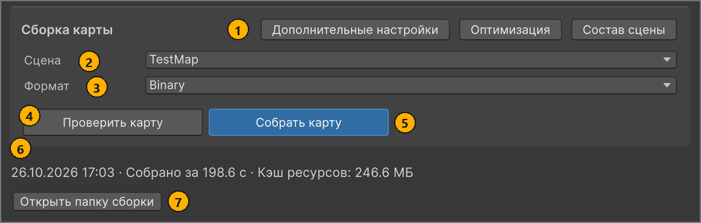
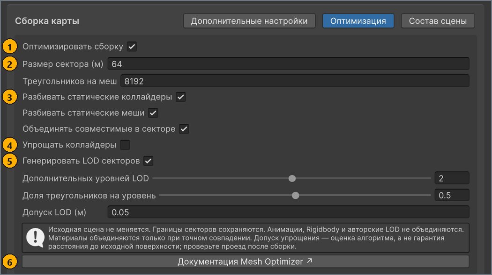

# Сборка карты

[English](../en/build.md) · **Русский**

Относится к: MapUploader `feature/2.0/3.0` · Unity 6000.3.19f1 · скриншоты 26.10.2026

На вкладке **Сборка** (Build) MapBuilder проверяет карту и превращает её сцену и настройки в файлы, которые загружает игра. Собирайте карту заново после каждого изменения сцены или настроек карты, перед экспортом или публикацией.

Чтобы проверить или собрать карту, входить в mod.io не нужно.

## Перед началом работы

- Карта, выбранная в списке **ЛОКАЛЬНЫЕ КАРТЫ** (LOCAL MAPS), с заполненными полями **Название** (Name) и **Иконка** (Icon) на вкладке **Карта** (Map). См. [Настройки карты (вкладка «Карта»)](map-settings.md).
- Сцена карты, включённая в списке сцен сборки Unity. Сцены из `Assets/MapResources` добавляются туда автоматически. См. [Создание папки и сцены карты](scene-setup.md#scene).
- Unity Editor для Windows x64. В другой системе сначала снимите флажок **Оптимизировать сборку** (Optimize build). См. [Оптимизация](#optimization).

## Вкладка «Сборка»

Чтобы открыть вкладку «Сборка»:

1. В окне **MapBuilder** (**Tools** > **MapBuilder**), в списке **ЛОКАЛЬНЫЕ КАРТЫ**, выберите карту.
1. Выберите вкладку **Сборка**.

На вкладке находится блок **Сборка карты** (Build map) с элементами управления сборкой. Вне блока вкладка показывает сводку последней сборки, сообщения о состоянии сборки и кнопку **Открыть папку сборки** (Open build folder). На скриншоте — вкладка для карты-примера `TestMap` после успешной сборки в формате Binary.



| # | Элемент | Назначение |
| --- | --- | --- |
| 1 | **Дополнительные настройки** (Advanced settings), **Оптимизация** (Optimization), **Состав сцены** (Scene contents) | Каждая кнопка открывает свою панель внутри блока. Чтобы закрыть панель, нажмите ту же кнопку ещё раз. Одновременно открыта только одна панель. |
| 2 | **Сцена** (Scene) | Сцена для сборки — одна из сцен, включённых в списке сцен сборки Unity. |
| 3 | **Формат** (Format) | **Binary** (по умолчанию) или **Wavefront**. |
| 4 | **Проверить карту** (Validate map) | Проверяет настройки карты и сцену, ничего не собирая, затем открывает окно **Map Validation**. |
| 5 | Кнопка **Собрать карту** (Build map) | Выполняет те же проверки, затем собирает части, выбранные в поле **Что пересобрать** (Rebuild targets). |
| 6 | Сводка последней сборки | Когда закончилась последняя сборка этой карты, сколько она длилась и какого размера её кэш сборки. |
| 7 | **Открыть папку сборки** | Показывает кэш сборки этой карты в Проводнике. См. [Куда записывается сборка](#cache). |

<a name="format"></a>
## Выбор сцены и формата

Чтобы выбрать, что собирать:

1. На вкладке **Сборка**, в списке **Сцена**, выберите сцену карты.
1. Необязательно: чтобы получить отдельные читаемые файлы вместо одного контейнера, в списке **Формат** выберите **Wavefront**.

Как работает список **Сцена**:

- В нём перечислены сцены, включённые в списке сцен сборки Unity, — по именам файлов. Если список **Сцена** пуст, в списке сцен сборки нет ни одной включённой сцены.
- Для карты, которую ещё ни разу не собирали, в списке **Сцена** изначально выбрана сцена, которая была активной, когда вы выбрали карту. После сборки выбрана сцена этой сборки. Если этой сцены нет в списке, выбрана первая сцена списка.
- Кнопки **Проверить карту** и **Собрать карту** открывают выбранную сцену, если активна другая сцена. Если в открытых сценах есть несохранённые изменения, Unity сначала спрашивает, сохранить ли их. Если отменить, сборка останавливается, а проверка охватывает только настройки карты.

Форматы различаются тем, что получает игра при экспорте или публикации карты:

| Формат | Что получает игра | Когда использовать |
| --- | --- | --- |
| **Binary** (по умолчанию) | Один сжатый файл `mod.cxmod` с компактной геометрией, типизированными данными сцены и подготовленными текстурами. Маркеры Material (варианты render core) действуют только в этом формате. | В большинстве случаев. |
| **Wavefront** | Отдельные файлы OBJ, MTL, PNG и JSON. Маркеры Material игнорируются, экспортируются исходные материалы. | Если нужно читать или сравнивать экспортированные файлы. |

- Кроме маркеров Material, оба формата экспортируют одно и то же содержимое сцены, и игра загружает любой из них из папки мода карты. Устройство файлов описано в разделе [Формат мода: Wavefront и Binary](advanced/mod-format.md).
- Часть проверок кнопки **Проверить карту** зависит от формата, поэтому проверяйте карту в том формате, в котором собираете.
- После смены формата собирайте **Map** и **Meta** вместе: сборка в другом формате отбрасывает обе части предыдущей сборки.
- Когда вы выбираете карту, в списке **Формат** снова выбирается формат последней сборки этой карты или **Binary**, если карту ещё не собирали.

## Проверка и сборка карты

Чтобы собрать карту:

1. На вкладке **Сборка** нажмите **Проверить карту**.
   Открывается окно **Map Validation** со списком проблем, найденных проверками.
1. Исправьте все ошибки из списка. Каждое сообщение и способ его исправления описаны на странице [Проверка карты](validation.md).
1. В окне **Map Validation** нажмите **Re-run**.
   Повторяйте шаги 2 и 3, пока в окне не останется ошибок. Предупреждения и заметки сборку не останавливают.
1. На вкладке **Сборка** нажмите кнопку **Собрать карту**.
   В нижней части окна появляется индикатор выполнения с текущим этапом: `Проверка настроек карты…`, `Проверка и сбор ресурсов сцены…`, `Сборка геометрии карты…`, затем `Сборка данных карты…`. <!-- src: Assets/Editor/MapBuilderEditorWindow.Workspace.cs:402-407 -->

Результат: строка сводки на вкладке **Сборка** и нижняя часть окна показывают `Собрано за <n> с · Кэш ресурсов: <n> МБ`, а строка карты в списке **ЛОКАЛЬНЫЕ КАРТЫ** — `Готова к экспорту`. <!-- src: Assets/Editor/MapBuilderEditorWindow.Workspace.cs:385-387 -->

Что ещё нужно знать о сборке:

- Кнопка **Собрать карту** выполняет те же проверки, что и **Проверить карту**, и ошибка останавливает сборку. Тогда строка сводки показывает `Сборка не завершена полностью. Проверьте результаты проверки и Console.` <!-- src: Assets/Editor/MapBuilderEditorWindow.Workspace.cs:387 -->
- После сборки окно **Map Validation** открывается, если проверки что-либо сообщили, даже только предупреждения или заметки. Если сообщений нет, окно закрывается.
- Некоторые проблемы, например нарушения правил для Rigidbody, проверка не ищет. Их находит сборка и останавливается, а сообщения о них появляются только в Console. См. [Решение проблем](troubleshooting.md). <!-- src: Assets/Plugins/CarX.Modding.Creator/Editor/RigidbodyExporter.cs:39 -->
- Чтобы остановить сборку, нажмите **Отмена** (Cancel) в нижней части окна. Части, которые собирались, отбрасываются, а в Console появляется `Build cancelled.` <!-- src: Assets/Editor/MapBuilder.cs:320 -->
- Сборка выполняется в главном потоке редактора, поэтому до её окончания редактор может медленно реагировать.
- Дата и время, `<dd.MM.yyyy HH:mm> ·`, появляются в начале строки сводки при следующем открытии окна **MapBuilder**. Сводка каждой карты хранится на этом компьютере между сеансами. <!-- src: Assets/Editor/MapBuilderEditorWindow.Workspace.cs:248-249,389 -->
- `Кэш ресурсов` — это размер всей папки кэша сборки карты, а не размер готового мода.

> [!IMPORTANT]
> MapBuilder не отслеживает правки сцены и пикселей иконки и превью. После такой правки соберите карту заново, даже если в её строке по-прежнему написано `Готова к экспорту`.

Пока сборка не завершена или не соответствует текущим настройкам, вкладка **Сборка** показывает одно из этих сообщений: <!-- src: Assets/Editor/MapBuilderEditorWindow.cs:819-833 -->

| Сообщение | Что оно означает |
| --- | --- |
| `Геометрия и метаданные карты ещё не собраны.` | Карту ещё ни разу не собирали, или ни одна часть её последней сборки не завершилась. |
| `Геометрия карты ещё не собрана.` | Собрана только часть **Meta**. Так бывает и после изменения настройки оптимизации. |
| `Метаданные карты ещё не собраны.` | Собрана только часть **Map**. Так бывает и после нажатия **Создать публикацию** (Create publication), потому что метаданные должны содержать ID новой публикации. |
| `Сборка устарела или её файлы недоступны. Соберите выбранную сцену в текущем формате.` | Выбранные **Сцена** или **Формат** отличаются от сборки, настройки карты изменились после сборки, или папка кэша сборки пропала. |

## Неактивные элементы управления

Элемент управления на вкладке **Сборка** неактивен в следующих случаях:

| Элемент | Неактивен, когда |
| --- | --- |
| **Проверить карту** | С mod.io загружаются миниатюры публикаций. |
| Кнопка **Собрать карту** | С mod.io загружаются миниатюры публикаций, или в поле **Что пересобрать** выбрано **Nothing**. |
| **Сцена** | Поле **Что пересобрать** не включает **Map**. Тогда сборка сохраняет сцену последней сборки. |
| **Открыть папку сборки** | У карты ещё нет папки кэша сборки. |
| Весь блок **Сборка карты** | Выполняется сборка, **Создать публикацию** или **Обновить публикацию** (Update publication). |

## Дополнительные настройки

Чтобы открыть дополнительные настройки:

- На вкладке **Сборка** нажмите **Дополнительные настройки**.

| Параметр | По умолчанию | Назначение | Когда менять |
| --- | --- | --- | --- |
| **Что пересобрать** | **Everything** | Выбирает части, которые собирает кнопка **Собрать карту**. **Map** — это сцена: геометрия, коллайдеры, материалы, маркеры, источники света, динамические объекты и вершинная анимация. **Meta** — это метаданные карты: название, описание, версия, авторы, ссылка, иконка, превью и мини-карта. При **Nothing** кнопка неактивна. Каждый раз, когда вы выбираете карту, параметр возвращается к **Everything**. <!-- src: Assets/Editor/MapBuilderEditorWindow.Workspace.cs:225 --> | Чтобы пересобрать только метаданные, снимите в поле **Что пересобрать** отметку **Map**, чтобы осталась выбрана только **Meta**, — например, после изменений только на вкладке **Карта** или только в мини-карте. Сборка **Meta** сцену не проверяет. В остальных случаях оставляйте **Everything**. |
| **Текстуры Binary** (Binary textures) | **BC7 (high quality)** | Как формат Binary хранит текстуры материалов. **BC7 (high quality)** занимает меньше места и использует качественное сжатие с потерями. **RGBA32 (lossless)** — без потерь, но больше. Оба варианта включают mip-уровни. Текстура, ширина или высота которой не кратна 4, всегда хранится как RGBA32. Показывается только для **Binary**. <!-- src: Assets/Plugins/CarX.Modding.Creator/Editor/BinaryTextureBaker.cs:41-47 --> | Выберите **RGBA32 (lossless)**, если в игре на текстуре видны артефакты сжатия. |

Выбор **Текстуры Binary** — настройка редактора на этом компьютере (ключ EditorPrefs `CarX.Modding.BinaryTextureEncoding`), а не настройка карты, поэтому он действует для всех карт. Он применяется при упаковке карты, то есть при экспорте или публикации, поэтому после его изменения пересобирать карту не нужно. <!-- src: Assets/Plugins/CarX.Modding.Creator/Editor/BinaryMapPacker.cs:14-20 -->

<a name="optimization"></a>
## Оптимизация

Во время сборки оптимизация нарезает статическую геометрию карты на секторы, объединяет совместимые части в каждом секторе и генерирует LOD для мешей секторов. Она включена по умолчанию и работает с обоими форматами. У каждой карты свои настройки оптимизации, они хранятся в ассете настроек карты.

Чтобы открыть настройки оптимизации:

- На вкладке **Сборка** нажмите **Оптимизация**.

На скриншоте — панель с настройками по умолчанию.



| # | Элемент | Назначение |
| --- | --- | --- |
| 1 | **Оптимизировать сборку** | Включает или выключает оптимизацию для этой карты. |
| 2 | **Размер сектора (м)** (Sector size (m)), **Треугольников на меш** (Max triangles per mesh) | Задают размер ячейки сетки секторов и предел треугольников в одном меше отрисовки сектора. |
| 3 | **Разбивать статические коллайдеры** (Partition static colliders), **Разбивать статические меши** (Partition static render meshes), **Объединять совместимые в секторе** (Merge compatible meshes in each sector) | Определяют, что нарезается на секторы и объединяются ли части внутри сектора. |
| 4 | **Упрощать коллайдеры** (Simplify colliders) | По умолчанию выключено. Если включены и этот флажок, и **Разбивать статические коллайдеры**, появляются **Доля треугольников коллизии** (Collider triangle ratio) и **Допуск коллизии (м)** (Collider error tolerance (m)). |
| 5 | **Генерировать LOD секторов** (Generate sector LODs) | Генерирует LOD для мешей отрисовки секторов. Ими управляют **Дополнительных уровней LOD** (Additional LOD levels), **Доля треугольников на уровень** (Triangle ratio per LOD level) и **Допуск LOD (м)** (LOD error tolerance (m)). |
| 6 | **Документация Mesh Optimizer ↗** (Mesh Optimizer documentation ↗) | Открывает документацию meshoptimizer в браузере. |

Параметры панели перечислены ниже в том же порядке. Оставляйте значения по умолчанию, если профилирование карты в игре не даёт причин их менять: нарезка мешей на секторы может увеличить общее число треугольников и draw calls. <!-- src: Assets/Plugins/CarX.Modding.Creator/Runtime/BuildOptimizationSettings.cs:9-32 -->

| Параметр | По умолчанию | Назначение | Когда менять |
| --- | --- | --- | --- |
| **Оптимизировать сборку** | Вкл. | Включает оптимизацию для этой карты. Если флажок снят, остальные параметры неактивны, панель показывает `Оптимизация выключена: …`, проверка добавляет предупреждение категории Geometry, а статические меши и коллайдеры экспортируются как есть. | Снимайте флажок только в Unity Editor не для Windows x64 — иначе там сборка останавливается. |
| **Размер сектора (м)** | 64 м | Длина ребра кубических ячеек сетки, на которые нарезаются статические меши отрисовки, от 1 до 1024 м. Треугольники, пересекающие границу ячейки, разрезаются. У коллайдеров своя сетка. <!-- src: Assets/Plugins/CarX.Modding.Creator/Runtime/BuildOptimizationSettings.cs:37 --> | Оставьте значение по умолчанию, если профилирование не даёт причин его менять. |
| **Треугольников на меш** | 8192 | Наибольшее число треугольников в одном меше отрисовки сектора, от 128 до 65 536. Сектор с большим числом треугольников делится на несколько мешей. <!-- src: Assets/Plugins/CarX.Modding.Creator/Runtime/BuildOptimizationSettings.cs:38 --> | Оставьте значение по умолчанию, если профилирование не даёт причин его менять. |
| **Разбивать статические коллайдеры** | Вкл. | Нарезает статические MeshCollider на секторы коллизии. MeshCollider нарезается, только если он единственный MeshCollider на своём объекте, включён, не является триггером, не выпуклый (convex) и у него есть меш. Box, Sphere и Capsule Collider экспортируются как есть. | Снимите флажок, чтобы экспортировать MeshCollider без изменений. |
| **Разбивать статические меши** | Вкл. | Нарезает статические меши отрисовки на секторы. Рендерер сохраняет собственный меш, если он выключен, использует прозрачный материал (очередь отрисовки 3000 или выше), имеет пустой слот материала, MaterialPropertyBlock или запечённый лайтмап, либо число его материалов не совпадает с числом сабмешей. Рендерер с мешем, который недоступен для чтения или состоит не из треугольников, тоже сохраняет собственный меш, как и MeshCollider с таким мешем; при этом в Console появляется `Optimization skipped '<name>': …`. <!-- src: Assets/Plugins/CarX.Modding.Creator/Editor/SceneExportOptimization.cs:158-162,188-195 --> | Снимите флажок, чтобы экспортировать меши отрисовки без изменений. Тогда перестают генерироваться и LOD секторов. |
| **Объединять совместимые в секторе** | Вкл. | Объединяет части в секторе в один меш с одним сабмешем на материал. Части отрисовки объединяются, если совпадают их слой и настройки рендерера. Части коллайдеров объединяются, если совпадают их слой, физический материал и параметры cooking. Части объекта с маркером Road объединяются только друг с другом и поэтому сохраняют свою поверхность. | Снимите флажок, чтобы части каждого объекта оставались отдельными. |
| **Упрощать коллайдеры** | Выкл. | Сокращает число треугольников в секторах коллизии с помощью meshoptimizer. Работает только вместе с **Разбивать статические коллайдеры**. | По умолчанию выключено, потому что упрощённая коллизия отходит от видимой поверхности и может давать бугры и щели на стыках дорог. Включайте только для тяжёлых мешей коллизии, а затем проедьте всю карту. |
| **Доля треугольников коллизии** | 0.5 | Доля треугольников коллизии, которая сохраняется, от 0.1 до 1. | Уменьшите для более лёгкой коллизии. Проезжайте карту после каждого изменения. |
| **Допуск коллизии (м)** | 0.01 м | Насколько упрощённая коллизия может отойти от исходной, от 0 до 1 м. Это оценка алгоритма, а не гарантированное расстояние. <!-- src: Assets/Plugins/CarX.Modding.Creator/Runtime/BuildOptimizationSettings.cs:43 --> | Проезжайте карту после каждого изменения. |
| **Генерировать LOD секторов** | Вкл. | Генерирует LOD отрисовки для каждого меша сектора. Работает только вместе с **Разбивать статические меши**. | Снимите флажок, чтобы экспортировать меши секторов без LOD. |
| **Дополнительных уровней LOD** | 2 | Число уровней после уровня полной детализации, от 1 до 3. | Уменьшите, чтобы мешей было меньше. |
| **Доля треугольников на уровень** | 0.5 | Уровень *n* стремится к доле треугольников полной детализации, равной этому значению в степени *n*: при значении по умолчанию — 50% для уровня 1 и 25% для уровня 2. От 0.1 до 0.9. | Чем меньше значение, тем грубее дальние уровни. |
| **Допуск LOD (м)** | 0.05 м | Допустимая ошибка упрощения уровня 1. Уровень *n* допускает значение в *n* раз больше. От 0 до 10 м. <!-- src: Assets/Plugins/CarX.Modding.Creator/Runtime/BuildOptimizationSettings.cs:46 --> | Чем больше значение, тем грубее допустимые уровни. |
| Сетка коллайдеров (нет в панели) | Ячейки 128 м, 32 768 треугольников | Размер ячейки и предел треугольников для секторов коллизии. <!-- src: Assets/Plugins/CarX.Modding.Creator/Runtime/BuildOptimizationSettings.cs:10-11 --> | В панели недоступно. |
| Слияние мелких частей (нет в панели) | 128 треугольников | Часть одного материала меньше этого размера переносится в соседний сектор, чтобы не становиться отдельным сабмешем или мешем. <!-- src: Assets/Plugins/CarX.Modding.Creator/Runtime/BuildOptimizationSettings.cs:12 --> | В панели недоступно. |

**Что оптимизация оставляет без изменений.** Эти объекты сохраняют исходные меши и коллайдеры: <!-- src: Assets/Plugins/CarX.Modding.Creator/Editor/SceneExportOptimization.cs:101-112 -->

- неактивные объекты;
- объекты с Rigidbody, Animator, Animation или LODGroup на самом объекте или на родителе: динамические объекты, анимированные объекты и ваши собственные группы LOD;
- объекты с маркером, отличным от Road и Material, на самом объекте или на родителе.

Объекты с тегом `Garbage` и их дочерние объекты вообще не экспортируются. См. [Организация сцены](scene-setup.md#garbage).

**LOD секторов.** Вершины на границах секторов остаются на месте, поэтому уровень может сохранить больше треугольников, чем его цель. Уровень, который не сокращает число треугольников, пропускается. Последний уровень виден на любом расстоянии, а LOD не добавляют коллайдеров.

**Ваша сцена не меняется.** Оптимизатор работает с копиями в сцене предпросмотра в памяти. Он никогда не редактирует и не сохраняет вашу сцену.

**После изменения настройки.** Пока установлен флажок **Оптимизировать сборку**, изменение любого параметра сбрасывает часть Map сборки. Установка или снятие флажка **Оптимизировать сборку** тоже её сбрасывает. Вкладка **Сборка** тогда показывает `Геометрия карты ещё не собрана.`, а строка карты — `Нужна пересборка`. Соберите карту заново. <!-- src: Assets/Editor/BuildOptimizationPanel.cs:63-81 -->

**Проверка результата.** После сборки с оптимизацией в Console есть строка, которая начинается с `Build optimization:`. В ней подсчитаны исходные рендереры и коллайдеры, а также меши и коллайдеры секторов, полученные из них. <!-- src: Assets/Plugins/CarX.Modding.Creator/Editor/SceneExportOptimization.cs:175-178 -->

**Предупреждения о бюджете сектора.** Проверка предупреждает о каждом статическом меше отрисовки и MeshCollider на объектах, которые может обработать оптимизация, если он больше значения **Размер сектора (м)** или содержит больше треугольников, чем **Треугольников на меш**, и оптимизация не разрежет его на секторы: `'<object>' (<mesh>): static <kind>, … Exceeds sector budget (<size> m / <n> triangles). …` Так бывает со всеми такими мешами, пока снят флажок **Оптимизировать сборку**, с MeshCollider, пока снят флажок **Разбивать статические коллайдеры**, и с мешами отрисовки, пока снят флажок **Разбивать статические меши**. При стандартных настройках проверка не выдаёт предупреждений о секторах. Коллайдеры сравниваются с теми же двумя значениями, а не с сеткой коллайдеров. Проверка не перечисляет рендерер или коллайдер, который оптимизация оставляет целым по другой причине (см. **Разбивать статические коллайдеры** и **Разбивать статические меши**); он сохраняет свой размер. <!-- src: Assets/Editor/Validation/SceneValidator.cs:853-883 -->

**Только Unity Editor для Windows x64.** Оптимизация использует meshoptimizer v1.2. Его нативная библиотека поставляется только для Unity Editor под Windows x64 и работает только в редакторе, во время сборки. В любом другом редакторе сборка останавливается с сообщением `meshoptimizer is unavailable for this Editor platform. Install its native Editor library or disable build optimization.` Чтобы собирать там карту, снимите флажок **Оптимизировать сборку**. Исходный код и лицензия библиотеки находятся в `Assets/Plugins/CarX.Modding.Creator/ThirdParty~/meshoptimizer`. <!-- src: Assets/Plugins/CarX.Modding.Creator/Editor/SceneExportOptimization.cs:128-130 -->

## Состав сцены

Чтобы посмотреть, что насчитала последняя сборка:

- На вкладке **Сборка** нажмите **Состав сцены**.

Панель показывает каждый поддерживаемый тип компонента в сцене — по строке на тип — с его количеством и допустимым диапазоном: `<Type> : <n> count (<min> min - <max> max)`. Типы с количеством 0 не показываются. <!-- src: Assets/Scripts/ValidItemData.cs:95-98 -->

- Панель заполняет только сборка, включающая **Map**; кнопка **Проверить карту** её не обновляет. До такой сборки панель показывает `Соберите карту, чтобы увидеть состав сцены.` <!-- src: Assets/Editor/MapBuilderEditorWindow.cs:811 -->
- Количества берутся из вашей сцены до оптимизации. В них входят неактивные объекты и выключенные компоненты, а объекты с тегом `Garbage` и их дочерние объекты не учитываются.
- Количество вне диапазона — это ошибка категории Budget, которая останавливает сборку. Все диапазоны приведены в разделе [Поддерживаемые компоненты и лимиты](reference.md#budgets).

Например, после сборки примера `TestMap` панель показывает следующее. SphereCollider в списке нет, потому что в примере их нет.

```
Transform : 852 count (1 min - 20000 max)
MeshCollider : 104 count (0 min - 10000 max)
BoxCollider : 46 count (0 min - 10000 max)
CapsuleCollider : 16 count (0 min - 1000 max)
Rigidbody : 2 count (0 min - 1000 max)
MeshRenderer : 537 count (0 min - 10000 max)
MeshFilter : 537 count (0 min - 10000 max)
Light : 5 count (0 min - 500 max)
HDAdditionalLightData : 5 count (0 min - 500 max)
LODGroup : 151 count (0 min - 10000 max)
GameMarkerData : 163 count (1 min - 10000 max)
Minimap : 1 count (1 min - 1 max)
```

<a name="cache"></a>
## Куда записывается сборка

Сборка записывается в кэш сборки — промежуточную папку каждой карты за пределами проекта: <!-- src: Assets/Editor/MapBuilder.Storage.cs:11-14,64-83 -->

```
<temp>/DefaultCompany/ModeMap/StandaloneTemporary<id>/
  MapTemp/     часть Map: геометрия, коллизия, материалы, маркеры, источники света
  MetaTemp/    часть Meta: метаданные, иконка, превью, мини-карта
```

- `<temp>/DefaultCompany/ModeMap` — это `Application.temporaryCachePath` Unity для этого проекта. В Windows `<temp>` обычно `%USERPROFILE%\AppData\Local\Temp`. <!-- src: ProjectSettings/ProjectSettings.asset:15-16 -->
- `<id>` — GUID ассета настроек карты, поэтому у каждой карты свой кэш сборки.
- Чтобы открыть папку, нажмите **Открыть папку сборки**.
- Сборка очищает и перезаписывает только те части, которые собирает.
- В кэше сборки лежат промежуточные файлы, а не пакет для игры. Сборка Binary получает свой `mod.cxmod` только при экспорте или публикации карты. См. [Экспорт карты в папку игры](test-in-game.md#export) и [Публикация на mod.io](publish.md).
- Ограничения размера mod.io относятся к этим двум папкам и проверяются только при нажатии **Создать публикацию** или **Обновить публикацию**: `MapTemp` — до 4096 МБ, `MetaTemp` — до 24 МБ. <!-- src: Assets/Resources/CarX.Modding/ModIoConfig.asset:25-26 -->
- Если Windows очистит свою временную папку, строка карты покажет `Нужна пересборка`. Соберите карту заново.

## Дальнейшие шаги

← [Настройки карты (вкладка «Карта»)](map-settings.md) · [Оглавление](README.md) · [Проверка карты](validation.md) →
