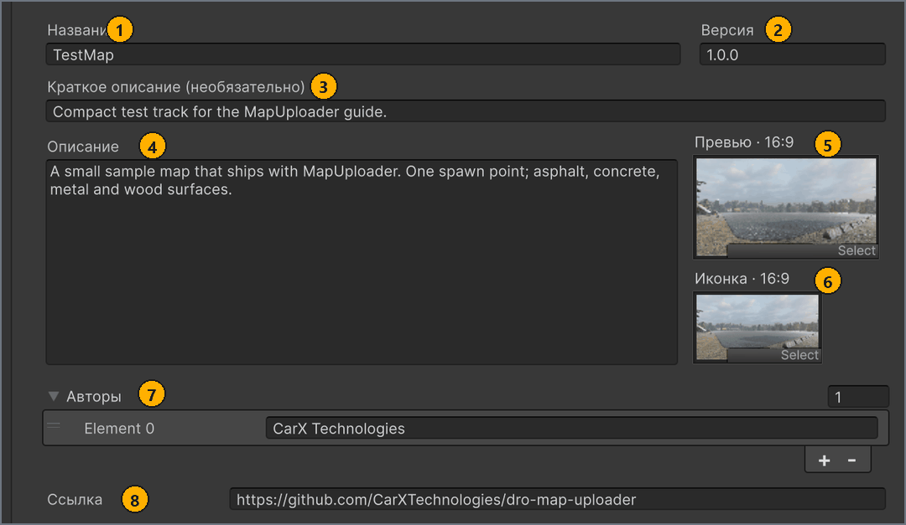

# Настройки карты (вкладка «Карта»)

[English](../en/map-settings.md) · **Русский**

У каждой карты есть настройки карты (map config) — ассет, в котором хранятся название карты, тексты, изображения и авторы. Создайте его кнопкой **+ Новая карта** (+ New map) и заполните на вкладке **Карта** (Map) до сборки: сборка копирует эти значения в метаданные карты, а публикация отправляет часть из них на mod.io.

Для всего, что описано на этой странице, входить в mod.io не нужно.

## Перед началом работы

- Сцена карты, сохранённая в `Assets/MapResources/<MapName>/`, где `<MapName>` — имя вашей карты. См. [Создание папки и сцены карты](scene-setup.md#scene).
- Изображение иконки и, при необходимости, изображение превью, которые отвечают [требованиям к изображениям](minimap-and-images.md#images).
- Окно **MapBuilder**, открытое через **Tools** > **MapBuilder**. См. [Открытие MapBuilder](getting-started.md#window).

## Создание или выбор карты

Кнопка **+ Новая карта** создаёт настройки карты — ассет MapMetaConfig. Сцену она не создаёт: сцену вы выбираете позже, в списке **Сцена** (Scene) на вкладке **Сборка** (Build).

Чтобы создать настройки карты:

1. В окне **MapBuilder**, в списке **ЛОКАЛЬНЫЕ КАРТЫ** (LOCAL MAPS), нажмите **+ Новая карта**.
   Открывается диалог сохранения `Новая карта` с именем файла `NewMapConfig`. <!-- src: Assets/Editor/MapBuilderEditorWindow.Workspace.cs:235 -->
1. В диалоге перейдите в папку `Assets/MapResources/<MapName>/`, где лежит сцена карты.
1. В поле имени файла введите название карты, например `MyMap`, и нажмите **Save** (в русской Windows — **Сохранить**).
   MapBuilder создаёт `MyMap.asset`, выбирает новую карту и открывает вкладку **Карта**.

Результат: карта появляется в списке **ЛОКАЛЬНЫЕ КАРТЫ** с состоянием `Не собрана` (`Not built`) и строкой `mod.io: нет связанной публикации` (`mod.io: not linked`), а поле **Название** (Name) содержит имя файла, `MyMap`. <!-- src: Assets/Editor/MapBuilderEditorWindow.Workspace.cs:198,209,238 -->

Из имени файла берётся только первоначальное значение поля **Название**. Если позже переименовать ассет, **Название** не изменится, а изменение **Названия** не переименовывает ассет.

Чтобы выбрать существующую карту:

- В окне **MapBuilder**, в списке **ЛОКАЛЬНЫЕ КАРТЫ**, выберите строку карты.
  Нижняя часть окна показывает `Локальная карта: <название>` (`Local map: <name>`), и вкладки **Карта**, **Сборка** и **Публикация** (Publish) теперь работают с этой картой. <!-- src: Assets/Editor/MapBuilderEditorWindow.Workspace.cs:220 -->

Список показывает все настройки карт в проекте, где бы они ни были сохранены, отсортированные по названию. Чтобы отфильтровать список, введите часть названия карты в поле поиска. Чтобы узнать, где сохранены настройки карты, наведите указатель на название карты: всплывающая подсказка показывает путь к ассету.

Если карта не выбрана, например в проекте ещё нет ни одних настроек карты, заголовок карты в окне **MapBuilder** показывает `Выберите карту` (`Select a map`), а на вкладке **Карта** нет полей. Если список показывает `Карт не найдено.` (`No maps found.`), очистите поле поиска или создайте карту. Пока выполняется сборка или загрузка, выбрать другую карту нельзя. <!-- src: Assets/Editor/MapBuilderEditorWindow.Workspace.cs:203 -->

Каждая строка показывает иконку карты (или её превью, если иконки нет), её **Название** (или имя ассета, если **Название** пустое), состояние сборки и строку mod.io.

Состояние сборки показывает, есть ли у карты актуальная сборка. Сборка состоит из двух частей: Map, которая собирается из сцены, и Meta — метаданных карты: значений вкладки **Карта** и мини-карты.

| Состояние сборки | Что оно означает |
| --- | --- |
| `Готова к экспорту` (`Ready to export`) | Map и Meta собраны и соответствуют карте: значения вкладки **Карта** и настройки оптимизации не менялись после сборки, а папки кэша сборки на месте. Карту можно экспортировать или опубликовать. <!-- src: Assets/Editor/MapBuilderEditorWindow.Workspace.cs:179-183,198 --> |
| `Не собрана` (`Not built`) | Ни у одной части карты нет пригодной сборки: вы её ещё не собирали, или последняя сборка обеих частей остановилась с ошибкой. Соберите карту на вкладке **Сборка**. <!-- src: Assets/Editor/MapBuilderEditorWindow.Workspace.cs:198 --> |
| `Нужна пересборка` (`Rebuild needed`) | Сборка устарела или неполна: вы изменили вкладку **Карта** или настройки оптимизации, собрана только одна часть, кэш сборки удалён, или вы создали публикацию из этой сборки. Соберите карту заново. <!-- src: Assets/Editor/MapBuilderEditorWindow.Publish.cs:210-230 --> |

Строка mod.io показывает публикацию, связанную с этой картой.

| Строка mod.io | Что она означает |
| --- | --- |
| `mod.io: нет связанной публикации` (`mod.io: not linked`) | С этой картой не связана ни одна публикация. **Создать публикацию** (Create publication) связывает с картой новую публикацию; как связать существующую, см. [Обновление публикации](publish.md#update). <!-- src: Assets/Editor/MapBuilderEditorWindow.Workspace.cs:209 --> |
| `mod.io: версия не загружена` (`mod.io: version not loaded`) | Публикация связана, но MapBuilder её не загрузил: вы не вошли в mod.io, или публикации нет в вашем списке публикаций. <!-- src: Assets/Editor/MapBuilderEditorWindow.Workspace.cs:211 --> |
| `mod.io: нет активного файла` (`mod.io: no active file`) | У связанной публикации нет загруженного файла. <!-- src: Assets/Editor/MapBuilderEditorWindow.Workspace.cs:212 --> |
| `mod.io: <версия>` (`mod.io: <version>`) | Версия текущего файла связанной публикации, например `mod.io: 1.0.0`. Она берётся из поля **Версия** (Version) на момент загрузки. <!-- src: Assets/Editor/MapBuilderEditorWindow.Workspace.cs:213 --> |
| `mod.io: версия не указана` (`mod.io: version not set`) | У текущего файла связанной публикации нет версии. <!-- src: Assets/Editor/MapBuilderEditorWindow.Workspace.cs:213 --> |

## Заполнение вкладки «Карта»

Вкладка **Карта** — это форма выбранных настроек карты. MapBuilder не проверяет поля во время ввода: их проверяют кнопки **Проверить карту** (Validate map) и **Собрать карту** (Build map).

Чтобы заполнить настройки карты:

1. В окне **MapBuilder**, в списке **ЛОКАЛЬНЫЕ КАРТЫ**, выберите карту.
1. Выберите вкладку **Карта**.
1. В поле **Название** введите название, которое видят игроки.
1. Необязательно: в поле **Версия** введите версию выпуска, например `1.0.0`.
   Если **Версия** пустая, сборка и mod.io используют `1.0.0`. <!-- src: Assets/Editor/MapBuilder.cs:170 -->
1. Необязательно: в поле **Краткое описание (необязательно)** (Summary (optional)) введите одну строку о карте.
1. Необязательно: в поле **Описание** (Description) введите полный текст о карте.
1. Необязательно: перетащите PNG превью из окна **Project** в поле **Превью · 16:9** (Preview · 16:9).
1. Перетащите PNG иконки из окна **Project** в поле **Иконка · 16:9** (Icon · 16:9).
1. Необязательно: чтобы указать авторов, разверните **Авторы** (Authors) и нажмите **+** по одному разу для каждого автора.
1. Необязательно: в каждой новой записи **Авторы** введите имя одного автора.
1. Необязательно: в поле **Ссылка** (URL) введите ссылку на страницу карты, например на тему форума.

Результат: строка карты в списке **ЛОКАЛЬНЫЕ КАРТЫ** показывает новое название и иконку.

На скриншоте — вкладка **Карта** для примера `TestMap`. Номера соответствуют таблице после него.

| # | Поле | Что вводить | Ограничения | Где отображается |
| --- | --- | --- | --- | --- |
| 1 | **Название** | Название карты, которое видят игроки. | Обязательно. До 50 символов: буквы любого алфавита, цифры, пробелы и `- _ ' . , : ! ? ( ) & + /`, без пробела в начале и в конце. | В игре: экран **Моды** (Mods) и онлайн-комнаты (если поле пустое — `Модовая трасса`, в английской версии игры `Modded Track`). На mod.io: заголовок публикации; его отправляет **Создать публикацию**, а также **Обновить публикацию** (Update publication) с включённым **Обновить название** (Update title). <!-- src: Assets/Resources/CarX.Modding/ModIoConfig.asset:28 --> |
| 2 | **Версия** | Ваша метка выпуска, например `1.0.0`. Это не версия формата мода. Увеличьте её перед тем, как [обновить публикацию](publish.md#update). | Нет. Пустое значение означает `1.0.0`. | На mod.io: версия каждого загружаемого файла, которую затем показывает строка mod.io карты. В метаданных карты; игра её не показывает. <!-- src: Assets/Editor/MapBuilder.Publishing.cs:298-301 --> |
| 3 | **Краткое описание (необязательно)** | Одна строка о карте. Если поле пустое, MapBuilder берёт первую строку **Описания**, а если пусто и **Описание** — `<Name> track.` | До 250 символов, в том числе когда текст взят из **Описания**. Используется только первая строка. | На mod.io: краткое описание публикации; его отправляет **Создать публикацию**, а также **Обновить публикацию** с включённым **Обновить описание** (Update description). В метаданных карты не хранится. <!-- src: Assets/Resources/CarX.Modding/ModIoConfig.asset:29 --> |
| 4 | **Описание** | Полный текст о карте. | До 50 000 символов. | На mod.io: описание публикации; его отправляет **Создать публикацию**, если оно не пустое, а также **Обновить публикацию** с включённым **Обновить описание**. В метаданных карты; игра его не показывает. <!-- src: Assets/Resources/CarX.Modding/ModIoConfig.asset:30 --> |
| 5 | **Превью · 16:9** | Крупное изображение карты 16:9, например 1920 × 1080. | Необязательно. См. [Требования к изображениям](minimap-and-images.md#images). | В игре: экран загрузки и картинка карты при создании онлайн-комнаты. На mod.io не отправляется. |
| 6 | **Иконка · 16:9** | Иконка карты, изображение 16:9, например 636 × 358. | Обязательно. См. [Требования к изображениям](minimap-and-images.md#images). | На mod.io: логотип публикации; его отправляет **Создать публикацию**, а также **Обновить публикацию** с включённым **Обновить превью** (Update preview). В игре: карточка карты на экране **Выбор трека** (Track Selection) и в списке онлайн-комнат. При создании комнаты заменяет отсутствующее превью. |
| 7 | **Авторы** | По одной записи на каждого автора. Пустые записи игнорируются. | Нет. | В игре: строка `by <авторы>` под названием карты на экране **Моды** — до 5 имён через `, `, а если авторов больше, затем `...`. Если авторы не указаны, карта, установленная с mod.io, показывает своего создателя на mod.io. На mod.io не отправляется. <!-- src: game --> |
| 8 | **Ссылка** | Ссылка на страницу карты, например на тему форума. | Нет. | Только в метаданных карты. Игра её не показывает, и на mod.io она не отправляется. |

Если изменить **Название** после публикации, заголовок публикации не изменится, пока вы не обновите её с включённым **Обновить название**. См. [Публикация на mod.io](publish.md).

Местами игра обрезает иконку и превью; какая часть остаётся видна, см. в разделе [Требования к изображениям](minimap-and-images.md#images). Как снять изображения в Unity, см. [Съёмка изображений с помощью CaptureCamera](minimap-and-images.md#capture).

**Проверить карту** сообщает о проблемах с этими полями в категории `Meta` окна **Map Validation**. См. [Проверка карты](validation.md#catalogue). Пустое **Название** даёт сообщение `The track has no name. Fill in Name on the Map tab.` <!-- src: Assets/Editor/Validation/MapMetaValidator.cs:48 -->

> [!IMPORTANT]
> **Создать публикацию** отправляет **Описание** на mod.io только один раз. Чтобы позже изменить описание на mod.io, обновите публикацию с включённым **Обновить описание**, как описано в разделе [Обновление публикации](publish.md#update).

## Как сохраняются изменения

Кнопки «Сохранить» нет. MapBuilder записывает каждое изменение в настройки карты сразу, как только вы его вносите.

Сборка хранит копию этих значений. Если изменить поле после сборки, строка карты показывает `Нужна пересборка`, а вкладка **Сборка** — `Сборка устарела или её файлы недоступны. Соберите выбранную сцену в текущем формате.` Пока вы не соберёте карту заново, экспортировать её или загрузить на mod.io нельзя. См. [Сборка карты](build.md). <!-- src: Assets/Editor/MapBuilderEditorWindow.cs:822 -->

Пока выполняется сборка или загрузка, поля на вкладке **Карта** неактивны, и изменить их нельзя.

> [!TIP]
> Чтобы после изменений на вкладке **Карта** пересобрать у собранной карты только метаданные, на вкладке **Сборка** нажмите **Дополнительные настройки** (Advanced settings), оставьте в поле **Что пересобрать** (Rebuild targets) выбранной только **Meta** и нажмите кнопку **Собрать карту**. Каждый раз, когда вы выбираете карту, **Что пересобрать** возвращается к **Everything**.

Если выбрать настройки карты в окне **Project**, окно **Inspector** показывает сокращённую форму с полями `Mod Name (max 50 characters)`, `Summary (optional, max 250 - first description line when empty)`, `Mod Description` и `Preview, Icon (16:9)`, но без версии, авторов и ссылки, поэтому пользуйтесь вкладкой **Карта**. Пока сборка не содержит текущих значений, **Inspector** также показывает `Meta is changed. Please rebuild meta in "Tools > MapBuilder"`. <!-- src: Assets/Editor/MapMetaConfigDrawer.cs:70 -->

В настройках карты также хранятся настройки оптимизации сборки. См. [Оптимизация](build.md#optimization).

## Дальнейшие шаги

Соберите карту на вкладке **Сборка**: выберите сцену и формат, проверьте карту и соберите её.

← [Мини-карта, иконка и превью](minimap-and-images.md) · [Оглавление](README.md) · [Сборка карты](build.md) →
