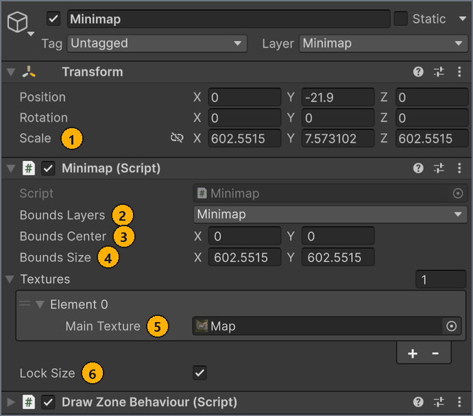
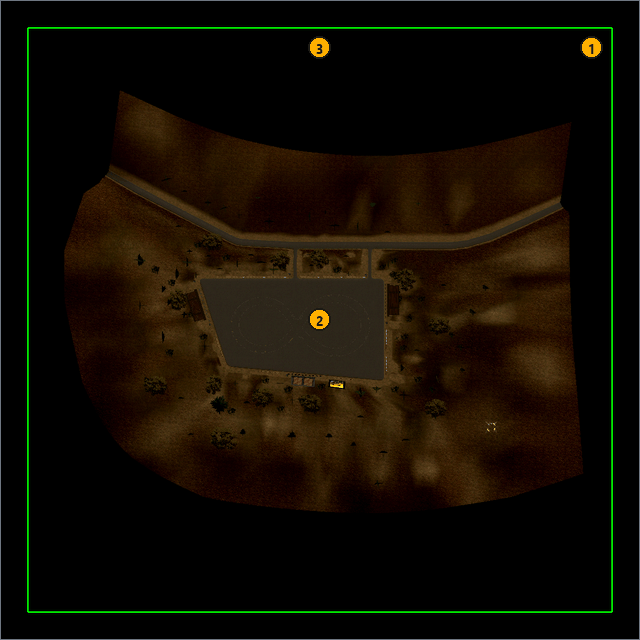
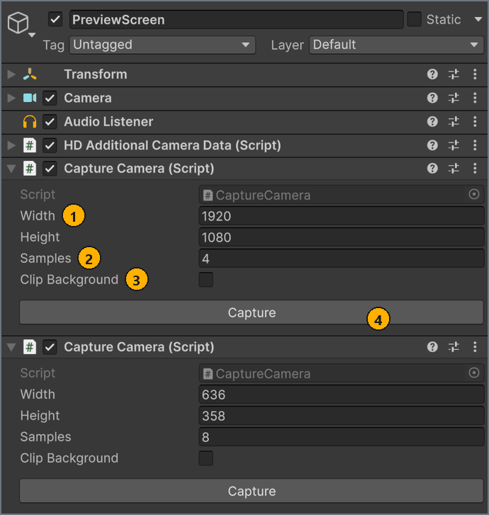

# Мини-карта, иконка и превью

[English](../en/minimap-and-images.md) · **Русский**

Каждой карте нужны мини-карта и иконка, а желательно ещё и превью. Добавьте в сцену компонент Minimap, снимите изображения с помощью CaptureCamera или подготовьте их в любом графическом редакторе и перед сборкой сверьте их с требованиями к изображениям.

## Перед началом работы

- Сцена карты в `Assets/MapResources/<MapName>/` с моделями и коллайдерами. См. [Подготовка сцены](scene-setup.md).
- Для камер съёмки — корневой объект с тегом `Garbage`. См. [Организация сцены](scene-setup.md#garbage).

<a name="minimap"></a>
## Добавление мини-карты

Мини-карта — это изображение карты сверху, которое игра накладывает на прямоугольную область мира. Игра показывает его как мини-карту на экране во время езды, как карту в меню паузы, где ваши точки появления служат [точками быстрого перемещения](markers.md#spawn), а также как превью карты на экране **Выбор трека** (Track Selection), на экране **Моды** (Mods) и в онлайн-комнатах.

На карте должен быть ровно один компонент Minimap, на активном объекте вне любого объекта `Garbage`. <!-- src: Assets/Editor/MapSceneRules.cs:24 -->

Добавляйте мини-карту в таком порядке: создайте объект Minimap и обозначьте область, которую покрывает изображение, снимите эту область сверху, а затем назначьте изображение компоненту Minimap.

<a name="frame-area"></a>
### Создание мини-карты и обозначение её области

Прямоугольник мини-карты всегда выровнен по мировым осям X и Z. Рамка, которую рисует DrawZoneBehaviour, показывает этот прямоугольник в окне **Scene**, а **Lock Size** копирует размер рамки в **Bounds Size**. Так устроен пример TestMap.

Чтобы создать мини-карту и обозначить её область:

1. Выберите **GameObject** > **Create Empty**.
1. В окне **Hierarchy** переименуйте новый GameObject в `Minimap`.
   Оставьте его активным и вне любого объекта `Garbage`, а его **Rotation** — равным 0, 0, 0.
1. В окне **Inspector** нажмите **Add Component**, введите `Minimap` и выберите **Minimap**.
1. Нажмите **Add Component**, введите `Draw Zone Behaviour` и выберите **Draw Zone Behaviour**.
1. В поле **Form** выберите **Box**.
1. Установите флажок **Is Empty**.
   Окно **Scene** рисует зелёную каркасную рамку размером с масштаб объекта.
1. В компоненте Minimap установите флажок **Lock Size**.
1. В окне **Scene**, глядя сверху, масштабируйте объект по X и Z, пока рамка не охватит карту.
1. В компоненте Minimap снимите флажок **Lock Size** и установите его снова.
   **Bounds Size** принимает новый масштаб объекта по X и Z.
1. В поле **Bounds Center** введите в **X** значение X из поля **Position** объекта, а в **Y** — его значение Z.

Результат: зелёная рамка показывает область, которую покрывает изображение мини-карты, **Bounds Size** совпадает с рамкой, а **Bounds Center** — её центр.

Если вы точно знаете границы карты, рамка не нужна. Снимите флажок **Lock Size** и введите в **Bounds Center** мировые координаты X и Z центра области, а в **Bounds Size** — её размер в метрах по мировым осям X и Z.

DrawZoneBehaviour не экспортируется, и проверка его не учитывает. Если установлен флажок **Cast To Floor**, компонент опускает объект на первый коллайдер под ним, пока окно **Scene** рисует гизмо; мини-карта высоту не учитывает.

### Съёмка изображения мини-карты

Чтобы снять изображение мини-карты:

- Снимите обозначенную область сверху, как описано в разделе [Съёмка изображений с помощью CaptureCamera](#capture), а камеру настройте по **Bounds Center** и **Bounds Size**, как описано в разделе [Настройка камеры мини-карты](#minimap-camera).

Результат: PNG мини-карты лежит в папке карты в окне **Project**.

Изображение можно подготовить и в графическом редакторе. Задайте ему те же пропорции, что у **Bounds Size** X : Y.

<a name="assign-minimap"></a>
### Назначение изображения мини-карты

Чтобы назначить изображение мини-карты:

1. В окне **Hierarchy** выберите объект `Minimap`.
1. В компоненте Minimap, в списке **Textures**, нажмите **+**.
   Появится элемент **Element 0**.
1. Перетащите изображение мини-карты из окна **Project** в поле **Element 0** > **Main Texture**.

Результат: в поле **Main Texture** назначено ваше изображение. Если нажать **Проверить карту** (Validate map) на вкладке **Сборка** (Build) окна **MapBuilder**, окно **Map Validation** не покажет ни ошибок категории Minimap, ни ошибки категории Budget `'Minimap': the map has …`.

Объект `Minimap` из примера TestMap показывает готовую настройку, в которой **Bounds Size** берётся из масштаба объекта:



| # | Элемент | Назначение |
| --- | --- | --- |
| 1 | **Scale** X и Z компонента Transform | Копируются в **Bounds Size**, пока установлен флажок **Lock Size**. В TestMap оба значения равны 602.5515. |
| 2 | **Bounds Layers** | Не используется ни сборкой, ни игрой. Оставьте как есть. |
| 3 | **Bounds Center** | Мировые координаты центра изображения: **X** — мировая X, **Y** — мировая Z. Поле не следует за положением объекта, поэтому введите значения сами. |
| 4 | **Bounds Size** | Область мира, которую покрывает изображение, в метрах: **X** — вдоль мировой оси X, **Y** — вдоль мировой оси Z. Ни одно из значений не может быть равно 0. |
| 5 | **Textures** > **Element 0** > **Main Texture** | Изображение мини-карты. Игра показывает только элемент 0; остальные элементы экспортируются, но не используются. |
| 6 | **Lock Size** | Берёт **Bounds Size** из мирового масштаба объекта по X и Z и заменяет значения, введённые там вручную. Копирование происходит, когда вы меняете поле компонента Minimap, а не когда масштабируете объект. |

Мини-карта входит в метаданные карты, поэтому изменения подхватывает любая сборка, у которой в поле **Что пересобрать** (Rebuild targets) выбрано **Meta**. Сборка, в которой выбрано только **Meta**, не проверяет сцену, поэтому перед ней нажмите **Проверить карту**. См. [Сборка карты](build.md).

> [!IMPORTANT]
> Строка карты в списке **ЛОКАЛЬНЫЕ КАРТЫ** (LOCAL MAPS) окна **MapBuilder** не замечает изменений в сцене и в файлах изображений. После правки мини-карты или сохранения нового изображения поверх старого файла соберите карту заново, даже если в строке написано `Готова к экспорту` (`Ready to export`).

### Как игра размещает изображение

Игра рисует изображение как плоский прямоугольник с центром в **Bounds Center**, растянутый до размера **Bounds Size**. Верхний край изображения обращён к мировой оси +Z, а его ширина идёт вдоль мировой оси +X. Прозрачные пиксели остаются прозрачными.

Этот прямоугольник виден на виде TestMap сверху в окне **Scene**:



| # | Элемент | Назначение |
| --- | --- | --- |
| 1 | Внешняя зелёная рамка | Область **Bounds Size**, X на Z. DrawZoneBehaviour рисует её по масштабу объекта, который **Lock Size** копирует в **Bounds Size**. |
| 2 | Центр рамки | **Bounds Center**, здесь (0, 0). |
| 3 | Верхний край рамки | Мировая ось +Z: верхний край изображения мини-карты. |

Задайте изображению те же пропорции, что у **Bounds Size** X : Y, потому что игра растягивает его на весь прямоугольник. Карте не обязательно стоять в начале координат мира, потому что изображение размещает **Bounds Center**. Если поставить центр карты в (0, 0), как в TestMap, числа получаются проще.

### Что проверяется

**Проверить карту** сообщает о следующих ошибках мини-карты. Первые две относятся к категории Budget, остальные — к категории Minimap. <!-- src: Assets/Editor/Validation/SceneValidator.cs:901-950 -->

```text
'Minimap': the map has 0, at least 1 is required.
'Minimap': the map has <n>, at most 1 is allowed.
'<name>': Bounds Size is <size>. Set it to the size of the map in world units, or the minimap collapses to a point in game.
'<name>': no textures assigned. Add at least one entry with a Main Texture.
'<name>': Textures element <i> has no Main Texture assigned.
'<name>': Textures element <i> is a <Type>. Only Texture2D can be exported.
```

Причину и способ исправления каждого сообщения см. в записях о мини-карте в разделе [Решение проблем](troubleshooting.md#msg-bounds-size).

Компонент Minimap внутри объекта `Garbage` не учитывается, поэтому проверка сообщает, что мини-карты нет. Компонент Minimap на неактивном объекте проходит проверку, но сборка экспортирует мини-карту только с активного объекта, поэтому оставляйте его активным.

<a name="capture"></a>
## Съёмка изображений с помощью CaptureCamera

CaptureCamera сохраняет вид камеры в PNG-файл в вашем проекте. Используйте его для мини-карты, иконки и превью.

Чтобы снять изображение:

1. Выберите **GameObject** > **Camera**.
1. В окне **Hierarchy** перетащите новую камеру на объект `Garbage`.
   Проверка и экспорт пропускают всё, что находится внутри объекта `Garbage`, поэтому камера не попадёт в карту.
1. Направьте камеру на то, что должно быть на изображении.
   Для мини-карты используйте параметры из раздела [Настройка камеры мини-карты](#minimap-camera).
1. В окне **Inspector** нажмите **Add Component**, введите `Capture Camera` и выберите **Capture Camera**.
1. В полях **Width** и **Height** введите размер изображения в пикселях. По умолчанию — 1024 × 1024. <!-- src: Assets/Scripts/CaptureCamera.cs:6-7 -->
1. Необязательно: чтобы изображение было более гладким, введите в поле **Samples** коэффициент суперсэмплинга, например `4`. По умолчанию — 1. <!-- src: Assets/Scripts/CaptureCamera.cs:9 -->
1. Необязательно: чтобы фон был прозрачным, установите флажок **Clip Background**.
1. Нажмите **Capture**.
   Unity рендерит изображение и открывает диалог `Save Capture` в папке `Assets` проекта. <!-- src: Assets/Editor/CaptureCameraEditor.cs:86 -->
1. В диалоге откройте папку внутри `Assets`, например `Assets/MapResources/<MapName>/`, введите имя файла и нажмите **Save**.
   Если отменить диалог, ничего не сохранится.

Результат: PNG появляется в окне **Project** с включённым **Read/Write** и значением **None** в поле **Non-Power of 2**. Он проходит проверку Read/Write для иконки и превью, и Unity не меняет его размер, даже если стороны не являются степенями двойки, как у 1920 × 1080. С **Clip Background** включается и **Alpha Is Transparency**. Размер файла по-прежнему должен укладываться в ограничения из раздела [Требования к изображениям](#images). <!-- src: Assets/Editor/CaptureCameraEditor.cs:111-114 -->

Чтобы использовать изображение в карте, сохраняйте его внутри `Assets`. Если сохранить PNG в другое место, файл запишется без этих параметров импорта, а в окне Console появится `Capture saved outside the project: <path>. Copy it into Assets to use it as an icon, preview or minimap.` Копия, которую вы потом положите в `Assets`, получит стандартные параметры импорта Unity, поэтому задайте их, как описано в разделе [Настройка параметров импорта](#import-settings). <!-- src: Assets/Editor/CaptureCameraEditor.cs:120 -->

У каждого компонента CaptureCamera своя кнопка **Capture**, поэтому одна камера может давать несколько изображений. На камере `Screen/PreviewScreen` в TestMap два компонента: один для превью, другой для иконки:



| # | Элемент | Назначение |
| --- | --- | --- |
| 1 | **Width** и **Height** | Размер сохраняемого PNG в пикселях. |
| 2 | **Samples** | Коэффициент суперсэмплинга. Capture рендерит изображение размером **Width** × **Samples** на **Height** × **Samples**, а затем уменьшает его. |
| 3 | **Clip Background** | Сохраняет PNG с прозрачным фоном. |
| 4 | **Capture** | Рендерит изображение и открывает диалог `Save Capture`. |

### Параметры для каждого изображения

Эти размеры взяты из примера TestMap:

| Изображение | Width × Height | Samples | Камера в TestMap |
| --- | --- | --- | --- |
| Превью | 1920 × 1080 | 4 | `Screen/PreviewScreen`, перспективная |
| Иконка | 636 × 358 | 8 | `Screen/PreviewScreen`, перспективная |
| Мини-карта | 1024 × 1024 | 8 | `Screen/MinimapScreen`, ортографическая, вид сверху |

Иконка становится логотипом публикации на mod.io, и mod.io делает из неё миниатюры размером до 1280 × 720, поэтому иконка 16:9 большего размера, например 1280 × 720, выглядит там чётче. <!-- src: Assets/Plugins/Modio/Modio/API/Generated/Definitions/RequestObjects/EditModRequest.cs:31 -->

Чем выше значение **Samples**, тем больше памяти GPU требуется: изображение 1920 × 1080 при **Samples** 4 рендерится в разрешении 7680 × 4320, прежде чем уменьшиться.

<a name="minimap-camera"></a>
### Настройка камеры мини-карты

Ортографическая камера, которая смотрит сверху вниз, даёт изображение, точно совпадающее с прямоугольником мини-карты. Настройте её по значениям **Bounds Center** и **Bounds Size**:

| Параметр | Значение | TestMap |
| --- | --- | --- |
| **Position** компонента Transform (мировые координаты) | X = **Bounds Center** X, Z = **Bounds Center** Y; Y выше самой высокой точки карты | 0, 52, 0 |
| **Rotation** компонента Transform | 90, 0, 0, чтобы камера смотрела вниз, а мировая ось +Z была у верхнего края изображения | 90, 0, 0 |
| **Projection** камеры | **Orthographic** | Orthographic |
| **Size** камеры | **Bounds Size** Y ÷ 2 | 300 |
| **Clipping Planes** > **Far** камеры | Больше расстояния от камеры до самой низкой точки карты | 125 |
| **Culling Mask** камеры | Слои, которые должны попасть на мини-карту | `Default` |
| **Width** : **Height** компонента CaptureCamera | Те же пропорции, что у **Bounds Size** X : Y | 1024 × 1024 |
| **Clip Background** компонента CaptureCamera | Включён, чтобы область за пределами карты была прозрачной | Выключен |

Transform показывает мировые значения, только если родитель камеры стоит в начале координат. Держите объект `Garbage` в позиции 0, 0, 0 с поворотом 0, 0, 0 и масштабом 1. Объект `Screen` в TestMap стоит не в начале координат, поэтому у его камеры `MinimapScreen` показаны локальные значения.

Сняв изображение, назначьте его в поле **Main Texture** компонента Minimap. См. [Назначение изображения мини-карты](#assign-minimap).

### Как Capture рендерит изображение

- Без **Clip Background** Capture рендерит вид камеры так, как она настроена. Камера, у которой для **Background Type** выбрано **Sky**, снимает небо.
- С **Clip Background** Capture рендерит вид дважды, на чёрном и на белом фоне, и вычисляет прозрачность по разнице. В этих двух рендерах выключены постобработка, например тональная компрессия и bloom, и сглаживание, поэтому изображение может немного отличаться от окна **Game**.
- На время рендера Capture выключает у камеры **Occlusion Culling**. После съёмки он восстанавливает **Occlusion Culling** и остальные параметры камеры, которые меняет.

<a name="images"></a>
## Требования к изображениям

Проверка охватывает иконку и превью, которые вы назначаете на вкладке **Карта** (Map), и изображение мини-карты в компоненте Minimap. Как назначить иконку и превью, см. в разделе [Заполнение вкладки «Карта»](map-settings.md#map-tab).

| Требование | Иконка | Превью | Мини-карта |
| --- | --- | --- | --- |
| Где назначается | Вкладка **Карта**, **Иконка · 16:9** (Icon · 16:9) | Вкладка **Карта**, **Превью · 16:9** (Preview · 16:9) | Компонент Minimap, **Element 0** > **Main Texture** |
| Обязательно | Да; если её нет, это ошибка | Нет; если его нет, это предупреждение | Да; если её нет, это ошибка |
| Формат файла | PNG. JPG даёт предупреждение, любой другой формат — ошибку. | PNG. JPG даёт предупреждение, любой другой формат — ошибку. | Любое изображение, которое Unity импортирует как Texture2D |
| **Read/Write** | Должен быть включён | Должен быть включён | Не нужен |
| Размер файла | Не больше 8 МБ | Не больше 10 МБ | Собственного ограничения нет <!-- src: Assets/Resources/CarX.Modding/ModIoConfig.asset:27; Assets/Editor/Validation/MapMetaValidator.cs:14 --> |
| Размер в пикселях | Не проверяется. mod.io требует не меньше 512 × 288; рекомендуется 16:9. | Не проверяется; рекомендуется 16:9 | Не проверяется; те же пропорции, что у **Bounds Size** X : Y <!-- src: Assets/Plugins/Modio/Modio/API/Generated/Definitions/RequestObjects/EditModRequest.cs:31 --> |
| Где отображается | На mod.io: логотип публикации. В игре: карточка карты на экране **Выбор трека** и в списке онлайн-комнат, а также картинка трассы при создании комнаты на карте без превью. | В игре: экран загрузки и картинка трассы при создании онлайн-комнаты. | В игре: мини-карта на экране, карта в меню паузы и превью карты на экране **Выбор трека**, на экране **Моды** и в онлайн-комнатах. |

- MapBuilder не проверяет ни размер в пикселях, ни пропорции; `16:9` в подписях полей — только рекомендация.
- На экране **Выбор трека** и в онлайн-комнатах игра не растягивает иконку или превью, а обрезает их по рамке, которая шире 16:9. В онлайн-комнатах остаётся полоса по центру — около 40% высоты изображения 16:9. Карточка на экране **Выбор трека** сохраняет нижнюю часть иконки и отрезает примерно верхнюю шестую часть. Держите главное в средней полосе изображения, подальше от верхнего края. <!-- src: game -->
- mod.io получает файл иконки как есть и делает из него миниатюры 320 × 180, 640 × 360 и 1280 × 720. Игра получает каждое изображение в том виде, в каком его импортирует Unity, пересохранённым в PNG, поэтому его размер определяют параметры импорта.
- Превью не относится к изображениям mod.io: оно передаётся только внутри файлов карты. Флажок **Обновить превью** (Update preview) на вкладке **Публикация** (Publish) загружает на mod.io иконку. См. [Обновление публикации](publish.md#update).
- Иконка, превью и изображение мини-карты входят в метаданные карты, которые MapBuilder ограничивает 24 МБ для mod.io (папка `MetaTemp` в кэше сборки). Размер метаданных проверяется, только когда вы нажимаете **Создать публикацию** (Create publication) или **Обновить публикацию** (Update publication). <!-- src: Assets/Resources/CarX.Modding/ModIoConfig.asset:26 -->
- Оба формата сборки хранят эти три изображения как PNG-файлы. Параметр **Текстуры Binary** (Binary textures) на них не влияет.

<a name="import-settings"></a>
### Настройка параметров импорта

Для снимка, сохранённого внутри `Assets`, CaptureCamera сам задаёт **Read/Write** и **Non-Power of 2**. Для любого другого изображения задайте их вручную: для подготовленного в графическом редакторе или для снимка, который вы скопировали в `Assets` позже. <!-- src: Assets/Editor/CaptureCameraEditor.cs:114 -->

**Read/Write** нужен только иконке и превью, но параметры размера важны для всех трёх изображений. По умолчанию Unity меняет размер изображения, стороны которого не являются степенями двойки: например, 1920 × 1080 превращается в 2048 × 1024. Мини-карта всё равно растягивается на свой прямоугольник, а вот иконка или превью с изменённым размером отображаются в игре с неверными пропорциями.

Чтобы задать параметры импорта изображения:

1. В окне **Project** выберите изображение.
1. В окне **Inspector** разверните раздел **Advanced**.
1. Для иконки или превью установите флажок **Read/Write**.
1. Для иконки или превью в поле **Non-Power of 2** выберите **None**.
   Иконка и превью TestMap используют эту настройку.
1. Необязательно: чтобы изображение больше 2048 пикселей сохранило полный размер, выберите в поле **Max Size** значение не меньше его длинной стороны.
1. Нажмите **Apply**.

Результат: превью текстуры в окне **Inspector** показывает собственный размер изображения, например `1920x1080`, и **Проверить карту** не сообщает для него об ошибке Read/Write.

## Дальнейшие шаги

Назначьте иконку и превью и заполните остальные настройки карты на вкладке **Карта**.

← [Маркеры GameMarkerData](markers.md) · [Оглавление](README.md) · [Настройки карты (вкладка «Карта»)](map-settings.md) →
