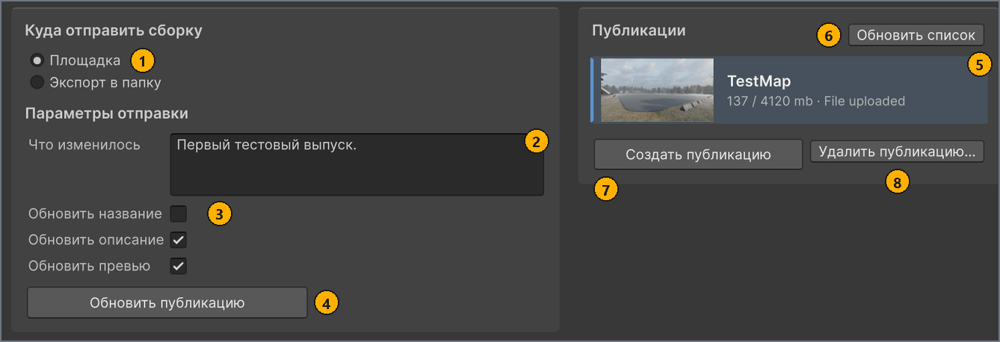

# Публикация на mod.io

[English](../en/publish.md) · **Русский**

Опубликуйте карту на mod.io, чтобы другие игроки могли установить её в CarX Drift Racing Online 2. Создайте публикацию один раз, для первого выпуска, и обновляйте её при каждой следующей версии карты.

## Перед началом работы

- Для новой публикации — актуальная сборка карты. Её строка в списке **ЛОКАЛЬНЫЕ КАРТЫ** (LOCAL MAPS) показывает `Готова к экспорту` (`Ready to export`), а поля **Сцена** (Scene) и **Формат** (Format) на вкладке **Сборка** (Build) по-прежнему совпадают с этой сборкой. См. [Сборка карты](build.md). Чтобы обновить публикацию, вы собираете карту уже после того, как свяжете её с публикацией, — это часть процедуры.
- Карта, которую вы экспортировали и проверили в игре. См. [Тест в игре](test-in-game.md).
- Аккаунт mod.io и доступ к почтовому ящику, на который он зарегистрирован. Вы входите с одноразовым кодом, который mod.io присылает на этот адрес.
- **Иконка** (Icon) размером не меньше 512 × 288 пикселей. mod.io отклоняет логотип меньшего размера, а MapBuilder размер в пикселях не проверяет. См. [Требования к изображениям](minimap-and-images.md#images). <!-- src: Assets/Plugins/Modio/Modio/API/Generated/Definitions/RequestObjects/EditModRequest.cs:31 -->

## Вкладка «Публикация»

На вкладке **Публикация** (Publish) окна **MapBuilder** вы отправляете текущую сборку на mod.io или экспортируете её в папку. На следующем скриншоте вкладка показана после входа: в разделе **Куда отправить сборку** (Build destination) выбран вариант **Площадка** (Platform), а в списке **Публикации** (Publications) выбрана связанная публикация.



| # | Элемент | Что делает |
| --- | --- | --- |
| 1 | Вариант **Площадка** в разделе **Куда отправить сборку** | Показывает элементы mod.io: поле **Что изменилось** (Changelog), три флажка обновления, кнопку **Обновить публикацию** (Update publication) и колонку **Публикации**. Другой вариант, **Экспорт в папку** (Export to folder), копирует сборку в папку для [тестирования в игре](test-in-game.md#export). <!-- src: Assets/Editor/MapBuilderEditorWindow.cs:917-922 --> |
| 2 | **Что изменилось** | Что изменилось в этом выпуске. mod.io показывает этот текст игрокам на странице мода. MapBuilder отправляет его при каждом создании и обновлении и хранит отдельно для каждой карты. |
| 3 | **Обновить название** (Update title), **Обновить описание** (Update description), **Обновить превью** (Update preview) | Определяют, какие части страницы mod.io перезаписывает **Обновить публикацию**. По умолчанию флажки сняты. <!-- src: Assets/Editor/MapManagerConfig.cs:30-32 --> |
| 4 | **Обновить публикацию** | Загружает текущую сборку в выбранную публикацию как новый файл. Кнопка доступна, только когда вы вошли, выбрана связанная публикация и сборка актуальна. |
| 5 | Строка связанной публикации | Выбранная публикация, выделенная цветом. Она связана с картой, выбранной в списке **ЛОКАЛЬНЫЕ КАРТЫ**, и **Обновить публикацию** загружает файл в неё. Строка показывает логотип, название, а также размер и состояние файла публикации. |
| 6 | **Обновить список** (Refresh list) | Заново загружает ваши публикации с mod.io. |
| 7 | **Создать публикацию** (Create publication) | Создаёт на mod.io новую скрытую публикацию и загружает в неё текущую сборку. Кнопка доступна, только когда вы вошли и сборка актуальна. |
| 8 | **Удалить публикацию** (Delete publication) | После подтверждения удаляет выбранную публикацию с mod.io. Если публикация не выбрана, запрашивает её id. |

До входа вкладка показывает сообщение `Not signed in to https://mod.io/g/carx-dro2.`, список **Публикации** показывает `В mod.io пока нет публикаций.` (`No publications on mod.io yet.`) (сразу после запуска Unity вместо `mod.io` там может стоять `the vendor`), а кнопки **Создать публикацию** и **Обновить публикацию** недоступны. Чтобы проверить, собрать или экспортировать карту, входить не нужно. <!-- src: Assets/Plugins/CarX.Modding.Creator/Publishing/ModIo/ModIoAuthProvider.cs:154 -->

Пока не выбрана связанная публикация, информационное сообщение в разделе **Куда отправить сборку** напоминает, что нужно создать публикацию или выбрать существующую.

Колонка **Публикации** видна, только пока выбран вариант **Площадка**. Если ширина окна меньше 1120 px, две колонки вкладки располагаются одна под другой. <!-- src: Assets/Editor/MapBuilderEditorWindow.Workspace.cs:64 -->

Поле **Площадка** в заголовке окна всегда показывает mod.io, и изменить его нельзя.

<a name="sign-in"></a>
## Вход в mod.io

Вы входите с адресом электронной почты аккаунта mod.io и одноразовым кодом. Входить нужно, только чтобы просматривать, создавать, обновлять или удалять публикации.

Чтобы войти:

1. В заголовке окна **MapBuilder** нажмите **Войти** (Sign in).
   Открывается диалог `mod.io terms of use`. MapBuilder пропускает его, если вы уже приняли тот же текст условий. <!-- src: Assets/Plugins/CarX.Modding.Creator/Editor/Publishing/EditorModAuthPrompt.cs:60-64 -->
1. Если открылся диалог `mod.io terms of use`, прочитайте условия и нажмите **Accept**.
   Открывается диалог `Sign in to mod.io`. Если вы уже входили раньше, в поле **Email** подставлен адрес, который вы использовали в прошлый раз.
1. В поле **Email** введите адрес электронной почты аккаунта mod.io и нажмите **Continue**.
   mod.io отправляет на этот адрес код из 5 символов, и диалог запрашивает его. <!-- src: Assets/Plugins/CarX.Modding.Creator/Publishing/ModIo/ModIoAuthProvider.cs:140 -->
1. В поле **Code** введите код из письма и нажмите **Continue**.
   Код действует несколько минут. Если mod.io перестал его принимать, нажмите **Cancel** и войдите заново.

Результат: заголовок показывает `Аккаунт: <ваше имя в mod.io>` (`Account: <your mod.io name>`) и кнопку **Выйти** (Sign out), а в списке **Публикации** появляются ваши публикации. Пока загружаются их логотипы, кнопки **Проверить карту** (Validate map) и **Собрать карту** (Build map) ненадолго недоступны. <!-- src: Assets/Editor/MapBuilderEditorWindow.cs:539 -->

MapBuilder запоминает ваш адрес электронной почты и принятие условий для вашей учётной записи на этом компьютере. Плагин mod.io кэширует сеанс на диске, поэтому после перезапуска Unity вход сохраняется, пока сеанс не истечёт.

Заголовок показывает состояние входа:

| Заголовок показывает | Состояние |
| --- | --- |
| `Не выполнен вход` (`Not signed in`) и **Войти** | Вы не вошли. Проверка, сборка и экспорт в папку по-прежнему работают. |
| `Вход…` (`Signing in…`) | Выполняется вход. Кнопка **Войти** недоступна, пока он не завершится. |
| `Аккаунт: <имя>` и **Выйти** | Вы вошли в mod.io как `<имя>`. <!-- src: Assets/Editor/MapBuilderEditorWindow.cs:537-548 --> |
| `Недоступно` (`Unavailable`) | mod.io ещё не инициализирован или не смог запуститься. Причину называет информационное сообщение на вкладке **Публикация**. |

Чтобы выйти:

- В заголовке окна **MapBuilder** нажмите **Выйти**.
  MapBuilder сразу выполняет выход, без подтверждения, и заголовок показывает `Не выполнен вход`.

<a name="create"></a>
## Создание публикации

Создайте публикацию один раз, для первого выпуска карты. Сборка должна быть актуальной, потому что mod.io создаёт публикацию вместе с её файлом.

Первый файл собран до того, как появилась публикация, поэтому его метаданные содержат временный id вместо mod.io id публикации. После **Создать публикацию** карта показывает `Нужна пересборка` (`Rebuild needed`), а вкладка **Сборка** — `Метаданные карты ещё не собраны.` (`Map metadata has not been built yet.`), и процедура продолжается повторной сборкой и обновлением. <!-- src: Assets/Editor/MapBuilderEditorWindow.cs:832 -->

Чтобы создать публикацию:

1. В окне **MapBuilder**, в списке **ЛОКАЛЬНЫЕ КАРТЫ**, выберите карту.
1. На вкладке **Публикация**, в разделе **Куда отправить сборку**, выберите вариант **Площадка**.
1. Необязательно: в разделе **Параметры отправки** (Upload settings), в поле **Что изменилось**, введите заметку для игроков, например `Первый выпуск.`
1. В разделе **Публикации** нажмите **Создать публикацию**.
   В нижней части окна виден ход операции; см. [Ход отправки](#upload-progress). Когда там появится `Публикация создана.` (`Publication created.`), в списке **Публикации** будет новая публикация, выбранная и связанная с картой, а строка карты в списке **ЛОКАЛЬНЫЕ КАРТЫ** покажет `Нужна пересборка`. <!-- src: Assets/Editor/MapBuilderEditorWindow.Publish.cs:182-184 -->
1. Необязательно: чтобы сборка шла быстрее, на вкладке **Сборка** нажмите **Дополнительные настройки** (Advanced settings) и в поле **Что пересобрать** (Rebuild targets) оставьте выбранным только **Meta**.
   Заново собрать нужно только метаданные.
1. На вкладке **Публикация** убедитесь, что вы всё ещё вошли и что в списке **Публикации** выбрана строка новой публикации.
   Только тогда следующая сборка получит mod.io id публикации.
1. На вкладке **Сборка** нажмите кнопку **Собрать карту**.
   Когда сборка завершится, строка карты в списке **ЛОКАЛЬНЫЕ КАРТЫ** показывает `Готова к экспорту`.
1. На вкладке **Публикация** нажмите **Обновить публикацию**.

Результат: нижняя часть окна показывает `Публикация обновлена.` (`Publication updated.`), и список загружается заново. Теперь файл публикации на mod.io содержит mod.io id публикации. Публикация остаётся скрытой, пока вы [не сделаете её публичной](#make-public). <!-- src: Assets/Editor/MapBuilderEditorWindow.Publish.cs:105 -->

Если после **Создать публикацию** нижняя часть окна показывает `Публикация не завершена. Подробности в Console.` (`Publication did not complete. See the Console.`), причину называет окно Console. Если mod.io создаёт публикацию, но отклоняет её файл, MapBuilder сам удаляет только что созданную незавершённую публикацию.

Если карта или её метаданные не собраны, список **Публикации** показывает `Сначала соберите карту и её данные. Публикация создаётся вместе с файлами.` (`Build the map and its metadata first. A publication is created together with its files.`). <!-- src: Assets/Editor/MapBuilderEditorWindow.Publish.cs:281 -->

**Создать публикацию** отправляет на mod.io такие значения:

- название — из поля **Название** (Name);
- краткое описание — первую строку поля **Краткое описание (необязательно)** (Summary (optional)), а если оно пустое — первую строку поля **Описание** (Description), а если пусты оба — `<Name> track.`, где `<Name>` — название карты; <!-- src: Assets/Scripts/Rules/MapMetaRules.cs:47-60 -->
- логотип — файл **Иконка** как есть;
- описание — из поля **Описание**, если оно не пустое, обрезанное до 50 000 символов; <!-- src: Assets/Plugins/CarX.Modding.Creator/Publishing/ModIo/ModIoPublisher.cs:191-194 -->
- сборку — как файл для платформы Windows, со значениями полей **Версия** (Version) (`1.0.0`, если поле пустое) и **Что изменилось**. <!-- src: Assets/Plugins/CarX.Modding.Creator/Publishing/ModIo/ModIoPublisher.cs:185-206 -->

mod.io создаёт публикацию скрытой. **Описание**, **Превью** (Preview), **Авторы** (Authors) и **Ссылка** (URL) также передаются внутри сборки, в метаданных карты.

> [!IMPORTANT]
> Каждое нажатие **Создать публикацию** создаёт на mod.io ещё одну, отдельную публикацию, даже для карты, у которой публикация уже есть. Чтобы выпустить новую версию, [обновите публикацию](#update).

<a name="make-public"></a>
### Открытие публикации для игроков

MapBuilder никогда не меняет видимость публикации, поэтому она остаётся скрытой, пока вы не измените это на mod.io. На странице mod.io также виден статус проверки публикации, который MapBuilder прочитать не может.

Чтобы сделать публикацию публичной:

1. В браузере войдите на сайт mod.io и откройте публикацию из списка ваших модов.
1. На странице публикации сделайте её публичной.

Результат: другие игроки могут найти и установить карту в сборках игры с поддержкой mod.io. В такой сборке карта, установленная с mod.io, появляется на вкладке **Моды** (Mods) экрана **Выбор трека** (Track Selection), а на её карточке есть значок mod.io. <!-- src: DR3PC1:Assets/DR3/Scripts/Services/ModIo/ModIoService.cs:41-51 -->

Если на сайте публикацию найти не удаётся, откройте её страницу по адресу. В списке **Публикации** наведите указатель на размер файла в строке публикации: подсказка заканчивается текстом `Full status and visibility:` и адресом страницы публикации. <!-- src: Assets/Editor/MapBuilderEditorWindow.Items.cs:246 -->

Текст подсказки скопировать нельзя, поэтому введите адрес в браузере вручную. Он имеет вид `https://mod.io/g/carx-dro2/m/<id>`, где `<id>` — числовой id публикации. <!-- src: Assets/Plugins/CarX.Modding.Creator/Publishing/ModIo/ModIoPublisher.cs:355-363 -->

Сразу удалите локальную тестовую копию из папки `Mods` игры, иначе игра покажет карту дважды. См. [Удаление локальной копии после публикации](test-in-game.md#after-publish).

<a name="update"></a>
## Обновление публикации

Обновляйте публикацию каждый раз, когда выпускаете новую версию карты. Каждое обновление заново загружает всю сборку как новый файл. Карту, установленную с mod.io, игра опознаёт по id публикации и id файла: `<modIoId>_<modfileId>`. <!-- src: DR3PC1:Assets/DR3/Scripts/States/Controllers/Mods/ModRoomsHelper.cs:123-137 -->

Чтобы обновить публикацию:

1. В окне **MapBuilder**, в списке **ЛОКАЛЬНЫЕ КАРТЫ**, выберите карту.
1. На вкладке **Карта** (Map), в поле **Версия**, введите новую версию, например `1.1.0`.
   Строка карты в списке **ЛОКАЛЬНЫЕ КАРТЫ** показывает `Нужна пересборка`.
1. На вкладке **Публикация**, в разделе **Куда отправить сборку**, выберите вариант **Площадка**.
1. В разделе **Публикации** проверьте название и выберите строку публикации, если она ещё не выбрана.
   Строка с пометкой `Выбрать для этой карты` (`Select for this map`) ещё не связана: выбор такой строки сразу связывает публикацию с выбранной картой. Команды, которая убирает связь, в MapBuilder нет. <!-- src: Assets/Editor/MapBuilderEditorWindow.Items.cs:227 -->
1. На вкладке **Сборка** нажмите кнопку **Собрать карту**.
   Когда сборка завершится, строка карты в списке **ЛОКАЛЬНЫЕ КАРТЫ** показывает `Готова к экспорту`.
1. На вкладке **Публикация**, в разделе **Параметры отправки**, в поле **Что изменилось**, введите, что изменилось в этой версии.
   MapBuilder хранит этот текст для каждой карты и не очищает его после публикации, поэтому замените предыдущий текст.
1. Установите или снимите флажки **Обновить название**, **Обновить описание** и **Обновить превью**, как описано в таблице после этой процедуры.
1. Нажмите **Обновить публикацию**.

Результат: нижняя часть окна показывает `Публикация обновлена.`, и список загружается заново. Когда mod.io обработает новый файл, строка mod.io под картой в списке **ЛОКАЛЬНЫЕ КАРТЫ** покажет его версию, например `mod.io: 1.1.0`; если там всё ещё старая версия, нажмите **Обновить список** позже. Если нижняя часть окна показывает `Обновление не завершено. Подробности в Console.` (`Update did not complete. See the Console.`), причину называет окно Console. <!-- src: Assets/Editor/MapBuilderEditorWindow.Publish.cs:101-105 -->

> [!IMPORTANT]
> Собирайте карту после того, как свяжете публикацию, пока вы вошли и её строка выбрана: только тогда сборка содержит mod.io id публикации. **Обновить публикацию** этот id не проверяет, а игра по нему синхронизирует [динамические объекты](scene-setup.md#dynamic) между игроками в онлайн-комнатах.

Три флажка определяют, какие части страницы mod.io перезаписывает обновление. По умолчанию они сняты, действуют для всех карт проекта, и MapBuilder сохраняет их между сеансами. <!-- src: Assets/Editor/MapManagerConfig.cs:30-32 -->

| Флажок | Что перезаписывает на mod.io | Откуда берётся |
| --- | --- | --- |
| **Обновить название** | Название публикации | **Название** |
| **Обновить описание** | Краткое описание и описание | **Краткое описание (необязательно)** или значение, которое его заменяет, и **Описание**. Если **Описание** пустое, описание на mod.io остаётся прежним. |
| **Обновить превью** | Логотип | Файл **Иконка**, а не **Превью** <!-- src: Assets/Plugins/CarX.Modding.Creator/Publishing/ModIo/ModIoPublisher.cs:294-297 --> |

Если все три флажка сняты, обновление отправляет только новый файл со значениями полей **Версия** и **Что изменилось**. Обновление никогда не меняет видимость публикации.

Игра читает название, авторов и иконку карты из метаданных внутри файла, поэтому игроки видят их изменения, когда получат новую версию, независимо от флажков. Флажки меняют только страницу mod.io.

<a name="upload-progress"></a>
## Ход отправки

Пока MapBuilder создаёт или обновляет публикацию, индикатор выполнения в нижней части окна показывает текущий этап и прошедшее время. Для сборки Binary перед отправкой появляется отдельный индикатор выполнения `Упаковка карты`, пока MapBuilder упаковывает сборку в `mod.cxmod`. <!-- src: Assets/Editor/MapBuilder.Storage.cs:17-18 -->

| Нижняя часть окна показывает | Что происходит |
| --- | --- |
| `Создание публикации…`, `Подключение к mod.io…` (`Connecting to mod.io…`), `Подготовка файлов публикации…` (`Preparing publication files…`), `Отправка файлов / ожидание mod.io…` (`Sending files / waiting for mod.io…`) | Только **Создать публикацию**: MapBuilder подключается к mod.io и подготавливает сборку. <!-- src: Assets/Editor/MapBuilderEditorWindow.Workspace.cs:408-411 --> |
| `Подготовка…` (`Preparing…`) | MapBuilder и плагин mod.io подготавливают отправку. |
| `Упаковка файлов… <n>% · <готово> / <всего> МБ` (`Packing files…`) | Плагин mod.io сжимает сборку в один файл. |
| `Отправка… <n>% · <отправлено> / <всего> МБ` (`Uploading…`) | Файл отправляется на mod.io. |
| `Обработка на mod.io…` (`Processing on mod.io…`) | mod.io обрабатывает загруженный файл. <!-- src: Assets/Editor/UploadProgressText.cs:33-40 --> |

Каждая строка заканчивается прошедшим временем, например `Отправка… 63% · 120 / 190 МБ · 1:05`.

Кнопка **Отмена** (Cancel) в нижней части окна останавливает операцию, только пока MapBuilder не начал отправку на mod.io. После этого **Отмена** недоступна, а её подсказка гласит `Отправку на площадку уже нельзя прервать` (`Sending to the platform cannot be cancelled once started`). <!-- src: Assets/Editor/MapBuilderEditorWindow.cs:1056 -->

## Список «Публикации»

После входа список **Публикации** показывает публикации, которые вы создали для CarX Drift Racing Online 2 на mod.io. Публикация, связанная с другой локальной картой, в списке не показывается; чтобы увидеть её, выберите эту карту в списке **ЛОКАЛЬНЫЕ КАРТЫ**.

Каждая строка содержит следующие элементы:

| Элемент строки | Значение |
| --- | --- |
| Логотип | Логотип публикации на mod.io. |
| Название | Название публикации на mod.io или `Blank <n>`, если названия нет. <!-- src: Assets/Editor/MapBuilderEditorWindow.Items.cs:199 --> |
| `<MB> / 4120 mb · File uploaded` или `<MB> / 4120 mb · No file uploaded` | Размер текущего файла публикации в мегабайтах и наличие у публикации файла. 4120 МБ — это сумма лимита для карты (4096 МБ) и лимита для её метаданных (24 МБ). Подсказка этой строки заканчивается адресом страницы публикации. <!-- src: Assets/Editor/MapBuilderEditorWindow.Items.cs:205-214 --> |
| `Выбрать для этой карты` | Публикация не связана ни с одной локальной картой. Выберите строку, чтобы связать публикацию с картой, выбранной в списке **ЛОКАЛЬНЫЕ КАРТЫ**. <!-- src: Assets/Editor/MapBuilderEditorWindow.Items.cs:227 --> |
| `Old version!` | Публикацию выложила более ранняя версия загрузчика: у публикации есть тег `Map` той версии. <!-- src: Assets/Editor/MapBuilder.Publishing.cs:17-22 --> |

Выбранная строка выделена цветом. Если список пуст, он показывает `В mod.io пока нет публикаций.` и `Соберите карту и нажмите «Создать публикацию».` (`Build the map and click Create publication.`) До входа список показывает то же самое, потому что ещё ничего не загружено; сразу после запуска Unity в первой строке вместо `mod.io` может стоять `the vendor`. После выхода загруженные ранее строки остаются в списке до следующего входа. <!-- src: Assets/Editor/MapBuilderEditorWindow.Items.cs:27-32,157-159 -->

**Обновить список** загружает список заново. Список также загружается заново при открытии окна, при входе, после каждого обновления и после каждого успешного создания или удаления. <!-- src: Assets/Editor/MapBuilderEditorWindow.Publish.cs:188,239-254 --> Каждый раз, когда загружается список хотя бы с одной публикацией, MapBuilder удаляет связи с публикациями, которых больше нет в вашем аккаунте.

MapBuilder хранит связи, тексты **Что изменилось** и три флажка в `Assets/Resources/MapManagerConfig.asset`. Сохраните этот файл, когда переносите проект на другой компьютер; без него свяжите каждую публикацию заново, выбрав её строку. <!-- src: Assets/Editor/MapManagerConfig.cs:24-32 -->

Значение строки mod.io под каждой картой в списке **ЛОКАЛЬНЫЕ КАРТЫ** описано в разделе [Создание или выбор карты](map-settings.md#new-map).

## Удаление публикации

Удалите публикацию, когда она больше не нужна вам на mod.io. Для этого нужно войти. Локальная карта, её настройки и сборка остаются в проекте.

> [!CAUTION]
> Удаление стирает с mod.io публикацию и все опубликованные в ней файлы. Отменить его нельзя.

Чтобы удалить публикацию:

1. На вкладке **Публикация**, в разделе **Куда отправить сборку**, выберите вариант **Площадка**.
1. В разделе **Публикации** выберите строку публикации.
   Если в строке есть пометка `Выбрать для этой карты`, выбор строки связывает публикацию с выбранной картой. Успешное удаление снова убирает эту связь; если вы отмените удаление или оно не удастся, публикация останется связанной с выбранной картой. Чтобы удалить несвязанную публикацию, не связывая её, удалите её по id, как описано в блоке [Удаление публикации, которую не показывает список](#delete-by-id).
1. Нажмите **Удалить публикацию**.
   Открывается диалог `Delete from mod.io` с названием и id публикации. <!-- src: Assets/Plugins/CarX.Modding.Creator/Editor/Publishing/ModPublisherSession.cs:167-168 -->
1. Проверьте название и id и нажмите **Delete**.

Результат: окно Console показывает `Deleted mod <id>.`, список загружается заново уже без публикации, а строка mod.io под картой в списке **ЛОКАЛЬНЫЕ КАРТЫ** показывает `mod.io: нет связанной публикации` (`mod.io: not linked`). <!-- src: Assets/Plugins/CarX.Modding.Creator/Publishing/ModIo/ModIoPublisher.cs:352 -->

<a name="delete-by-id"></a>
<details>
<summary>Удаление публикации, которую не показывает список</summary>

Если выбрать публикацию нельзя, например потому что список не загружается, удалите её по id. Когда ни одна строка не выбрана, **Удалить публикацию** запрашивает id.

Чтобы удалить публикацию по id:

1. Если в списке **Публикации** выбрана строка, выберите в списке **ЛОКАЛЬНЫЕ КАРТЫ** карту, которая показывает `mod.io: нет связанной публикации`.
   Для карты без связанной публикации ни одна строка не выбрана.
1. Нажмите **Удалить публикацию**.
   Диалог `Delete from mod.io` запрашивает **Item id** и подсказывает, где mod.io показывает id. <!-- src: Assets/Plugins/CarX.Modding.Creator/Editor/Publishing/ModPublisherSession.cs:148-153 -->
1. В поле **Item id** введите числовой id публикации и нажмите **Continue**.
1. В диалоге подтверждения проверьте id и нажмите **Delete**.

Результат: окно Console показывает `Deleted mod <id>.`

Локальная карта, которая была связана с удалённой публикацией, сохраняет связь, пока список в следующий раз не загрузится хотя бы с одной публикацией из вашего аккаунта. До этого строка mod.io под картой показывает `mod.io: версия не загружена` (`mod.io: version not loaded`). <!-- src: Assets/Editor/MapManagerConfig.cs:139-142 -->

</details>

## Переименование карты

Игра показывает название, сохранённое в метаданных карты, поэтому игроки видят новое название, когда получат файл с ним. Страница mod.io сохраняет старое название до обновления с установленным флажком **Обновить название**. <!-- src: DR3PC1:Assets/DR3/Scripts/States/Controllers/Mods/ModRoomsHelper.cs:57-61 -->

Чтобы переименовать опубликованную карту:

1. На вкладке **Карта**, в поле **Название**, введите новое название.
   Строка карты в списке **ЛОКАЛЬНЫЕ КАРТЫ** показывает новое название и `Нужна пересборка`. Правила для названий см. в разделе [Заполнение вкладки «Карта»](map-settings.md#map-tab).
1. Обновите публикацию, как описано в разделе [Обновление публикации](#update), с установленным флажком **Обновить название**.

Результат: публикация на mod.io показывает новое название, а игроки видят его в игре, когда получат новую версию.

<a name="size-limits"></a>
## Ограничения размера при отправке

MapBuilder проверяет размер сборки, только когда вы нажимаете **Создать публикацию** или **Обновить публикацию**. Кнопки **Проверить карту** и **Экспортировать в папку** (Export to folder) его не проверяют. Проверка измеряет папки [кэша сборки](build.md#cache), а не упакованный `mod.cxmod`:

| Папка кэша сборки | Что содержит | Лимит |
| --- | --- | --- |
| `MapTemp` | Карту: геометрию, материалы и текстуры | 4096 МБ |
| `MetaTemp` | Метаданные карты, включая иконку, превью и изображения мини-карты | 24 МБ <!-- src: Assets/Resources/CarX.Modding/ModIoConfig.asset:25-26 --> |

Если папка превышает лимит, MapBuilder ничего не загружает, нижняя часть окна показывает `Публикация не завершена. Подробности в Console.` или `Обновление не завершено. Подробности в Console.`, а окно Console — одну из следующих ошибок, где `<scene>` — имя сцены: <!-- src: Assets/Editor/MapBuilder.Storage.cs:167-178 -->

```text
'<scene>': the map is <X> mb and this vendor accepts 4096 mb.
'<scene>': the meta is <X> mb and this vendor accepts 24 mb.
```

Чтобы уложить метаданные в лимит, используйте изображения меньшего размера в полях **Иконка** и **Превью** и для мини-карты. Это лимиты только для отправки: очень большая карта всё равно может не загрузиться в игре.

## Дальнейшие шаги

Сообщения об ошибках и способы их исправить описаны на следующей странице.

← [Тест в игре](test-in-game.md) · [Оглавление](README.md) · [Решение проблем](troubleshooting.md) →
