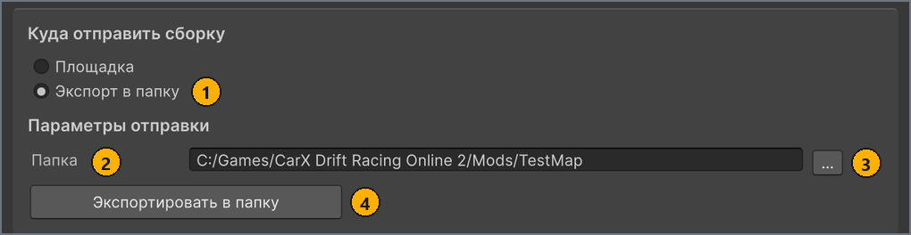

# Тест в игре

[English](../en/test-in-game.md) · **Русский**

Скопируйте карту в папку `Mods` игры и прокатитесь по ней до публикации. Для локального теста не нужны ни аккаунт mod.io, ни вход в него.

## Перед началом работы

- Актуальная сборка карты: её строка в списке **ЛОКАЛЬНЫЕ КАРТЫ** (LOCAL MAPS) показывает `Готова к экспорту` (`Ready to export`), а значения **Сцена** (Scene) и **Формат** (Format) на вкладке **Сборка** (Build) по-прежнему совпадают с этой сборкой. См. [Сборка карты](build.md). <!-- src: Assets/Editor/MapBuilderEditorWindow.Workspace.cs:198 -->
- CarX Drift Racing Online 2 версии 0.21.4 или новее на ПК с Windows, в копии, которая загружает локальные карты. Как это проверить, описано в разделе [Проверка загрузки локальных карт в игре](#check-game).

<a name="export"></a>
## Экспорт карты в папку игры

Экспорт копирует текущую сборку в выбранную вами папку. Для локального теста это папка карты внутри папки `Mods` игры. На этой странице `<game folder>` — папка, в которой находится исполняемый файл игры, а `<MapName>` — имя папки карты, например `TestMap`.

Чтобы экспортировать карту:

1. В окне **MapBuilder** в списке **ЛОКАЛЬНЫЕ КАРТЫ** выберите свою карту.
1. Выберите вкладку **Публикация** (Publish).
1. В разделе **Куда отправить сборку** (Build destination) выберите вариант **Экспорт в папку** (Export to folder).
   Вместо элементов управления публикацией появятся поле **Папка** (Folder) и кнопка **Экспортировать в папку** (Export to folder).
1. В поле **Папка** введите абсолютный путь `<game folder>/Mods/<MapName>`, например `C:/Games/CarX Drift Racing Online 2/Mods/TestMap`.
   Папки не обязательно должны существовать: экспорт создаст их сам.

   

   | # | Элемент | Что делает |
   | --- | --- | --- |
   | 1 | Вариант **Экспорт в папку** в разделе **Куда отправить сборку** | Переключает вкладку в режим экспорта. Элементы управления публикацией и столбец **Публикации** (Publications) скрываются. |
   | 2 | **Папка** | Абсолютный путь к папке карты. |
   | 3 | **…** | Открывает диалог выбора папки `External path`, в котором можно выбрать или создать папку карты. Диалог открывается не в папке игры, поэтому сначала перейдите в `<game folder>/Mods`. |
   | 4 | Кнопка **Экспортировать в папку** | Копирует текущую сборку в папку из поля **Папка**. Кнопка неактивна, пока сборка не станет актуальной, а в поле **Папка** не будет абсолютного пути. |

1. Нажмите кнопку **Экспортировать в папку**.
   Для сборки Binary, пока MapBuilder упаковывает сборку в `mod.cxmod`, отображается индикатор выполнения `Упаковка карты`. <!-- src: Assets/Editor/MapBuilder.Storage.cs:17-18 -->

Результат: на вкладке **Публикация** и в строке состояния окна появится `Экспортировано в <папка>` (`Exported to <Folder>`), а в папке карты окажется карта. <!-- src: Assets/Editor/MapBuilderEditorWindow.Publish.cs:140 -->

Содержимое папки карты зависит от формата сборки. Игра загружает оба формата; см. [Выбор сцены и формата](build.md#format).

- **Binary** записывает один файл — `mod.cxmod`. Отдельные файлы от прежнего экспорта Wavefront остаются в папке, и игра их игнорирует.
- **Wavefront** копирует карту в виде отдельных файлов JSON, OBJ, MTL и PNG в нескольких подпапках. Старый `mod.cxmod` он удаляет из папки, потому что иначе игра прочитала бы именно этот файл.

Если кнопка **Экспортировать в папку** неактивна, строка подсказки на вкладке **Публикация** сообщает, чего не хватает: `Для экспорта сначала соберите карту и её данные во вкладке «Сборка».` или `Выберите папку для экспорта.` Кнопка также остаётся неактивной, если путь не абсолютный, например `Mods/TestMap`. <!-- src: Assets/Editor/MapBuilderEditorWindow.Workspace.cs:370-372 -->

Если на вкладке появилось `Нечего экспортировать — подробности в Console.`, в окне **Console** указано, какой части сборки не хватает. Соберите карту заново, затем экспортируйте её. <!-- src: Assets/Editor/MapBuilderEditorWindow.Publish.cs:141 -->

Для экспорта вход в mod.io не нужен, поэтому не обращайте внимания на сообщение `Not signed in to https://mod.io/g/carx-dro2.`, если оно отображается. В этом режиме на вкладке также остаётся заголовок **Параметры отправки** (Upload settings); к экспорту относятся только поле **Папка**, кнопка **…** и кнопка **Экспортировать в папку**. <!-- src: Assets/Plugins/CarX.Modding.Creator/Publishing/ModIo/ModIoAuthProvider.cs:154 -->

> [!WARNING]
> Поле **Папка** хранит один и тот же путь для всех карт, поэтому перед экспортом другой карты измените его: если экспортировать вторую карту в папку первой, её `mod.cxmod` перезапишется или файлы двух карт перемешаются. Экспорт не очищает папку из поля **Папка** заранее, поэтому перед экспортом Wavefront очистите её, иначе игра может прочитать старый файл метаданных, оставшийся от прежнего экспорта. <!-- src: Assets/Editor/MapBuilderEditorWindow.cs:47 -->

<a name="local-maps"></a>
## Где игра ищет локальные карты

На ПК игра загружает локальные карты из папки `Mods` рядом со своим исполняемым файлом. Если ваша копия игры их никогда не показывает, см. раздел [Проверка загрузки локальных карт в игре](#check-game). <!-- src: game -->

```text
<game folder>/            папка с исполняемым файлом игры
├── <game executable>
└── Mods/
    └── <MapName>/        одна папка на карту; её имя — ID мода карты
        └── mod.cxmod     экспорт Binary; экспорт Wavefront кладёт сюда вместо него свои файлы
```

- Каждая папка непосредственно внутри `Mods` — это одна карта, а имя папки — ID мода карты. Игроки не видят ID мода: игра показывает **Название** (Name) карты из настроек карты или `Модовая трасса` (`Modded Track`), если **Название** не заполнено. <!-- src: game -->
- Кладите файлы карты прямо в папку карты: не в саму папку `Mods` и не во вложенную папку внутри папки карты.
- Игра пропускает папки, имена которых начинаются с `.`, а экран **Выбор трека** (Track Selection) не показывает пустые папки.
- Если в папке карты есть `mod.cxmod`, игра читает только этот файл и игнорирует отдельные файлы рядом с ним.
- Не давайте папке карты имя вида `<цифры>_<цифры>`, например `12345_67890`. Такие имена игра считает картами, установленными с mod.io. <!-- src: game -->
- Игра заново читает папку `Mods` каждый раз, когда вы открываете экран **Выбор трека**, поэтому после экспорта перезапускать игру не нужно. Карта, экспортированная, пока экран **Выбор трека** открыт, появится, когда вы закроете этот экран и откроете его снова. <!-- src: game -->

> [!TIP]
> Чтобы открыть папку игры из Steam, щёлкните игру в библиотеке правой кнопкой мыши и выберите **Управление** > **Просмотреть локальные файлы**.

<a name="in-game"></a>
## Загрузка карты в игре

Локальные карты доступны во фрирайде, на вкладке **Моды** (Mods) экрана **Выбор трека**.

Чтобы прокатиться по карте:

1. Запустите CarX Drift Racing Online 2.
1. В главном меню выберите **Играть** (Play).
   Откроется экран **Выбор режима** (Mode Selection).
1. Выберите **Фрирайд** (Freeride).
   Откроется экран **Выбор трека**.
1. Выберите вкладку **Моды**.
   Вкладка появляется, только если игра нашла в `Mods` хотя бы одну карту или есть карта с mod.io.
1. Выберите карточку с иконкой вашей карты.
   Откроется экран **Моды**. На нём показаны **Название** карты и, если заполнено поле **Авторы** (Authors), строка `by <авторы>` со списком авторов. <!-- src: game -->
1. Необязательно: чтобы проверить освещение, на экране **Моды** выберите время суток **00:00**.
   Экран предлагает **08:00**, **14:00**, **19:00** и **00:00**; ночь — только **00:00**. Погоду на этом экране выбрать нельзя. <!-- src: game -->
1. Нажмите **Продолжить** (Continue).

Результат: игра загружает карту и ставит вашу машину в первую точку появления. См. [Добавление точек появления](markers.md#spawn).

Если вкладки **Моды** или карточки вашей карты нет, сверьте папку с разделом [Где игра ищет локальные карты](#local-maps). Если с папкой всё в порядке, [проверьте, загружает ли игра локальные карты](#check-game). Если карта не загружается, игра показывает `Не удалось загрузить модификацию трассы. Попробуйте ещё раз.` и возвращает вас на экран **Выбор трека**. Очень большие карты могут не загрузиться. См. [`Не удалось загрузить модификацию трассы.` в разделе «Решение проблем»](troubleshooting.md#msg-load-failed). <!-- src: game -->

Чтобы проверить изменение, выйдите из заезда через меню паузы, снова соберите и экспортируйте карту и снова выберите её карточку. Закрывать или перезапускать игру не нужно: она читает карту с диска при каждом запуске карты и не держит файлы карты открытыми после загрузки. Чтобы увидеть на карточке новую иконку или мини-карту либо только что экспортированную карту, закройте экран **Выбор трека** и откройте его снова. <!-- src: game -->

<a name="check-game"></a>
## Проверка загрузки локальных карт в игре

CarX Drift Racing Online 2 читает папку `Mods` начиная с версии 0.21.4. Чтобы узнать, читает ли папку ваша копия, загрузите пример TestMap: он входит в проект и проходит проверку. Если TestMap загружается, а ваша карта — нет, проблема в вашей карте. <!-- src: game -->

Чтобы проверить игру:

1. В окне **MapBuilder** в списке **ЛОКАЛЬНЫЕ КАРТЫ** выберите `TestMap`.
1. На вкладке **Сборка** в списке **Сцена** выберите `TestMap`.
1. Нажмите кнопку **Собрать карту** (Build map).
   Когда сборка завершится, строка `TestMap` покажет `Готова к экспорту`.
1. Экспортируйте сборку в `<game folder>/Mods/TestMap`, как описано в разделе [Экспорт карты в папку игры](#export).
1. В игре, в главном меню, выберите **Играть**, затем **Фрирайд**.
   Откроется экран **Выбор трека**.

Результат: на экране **Выбор трека** есть вкладка **Моды**, и на ней видна карточка `TestMap`. Ваша копия игры загружает локальные карты.

Если нет вкладки **Моды** или карточки `TestMap`, сверьте папку с разделом [Где игра ищет локальные карты](#local-maps). Если файлы TestMap лежат прямо в `<game folder>/Mods/TestMap`, а карточки по-прежнему нет, эта копия игры локальные карты не загружает.

Когда закончите, удалите папку `<game folder>/Mods/TestMap`, чтобы на вкладке **Моды** остались только ваши карты.

## Игра с другими игроками

Чтобы кататься по локальной карте с друзьями, создайте на ней онлайн-комнату. Игрок может войти в комнату, только если в его собственной папке `Mods` есть ваша карта под тем же именем папки, поэтому передайте ему копию папки карты.

Чтобы создать комнату на своей карте:

1. В главном меню выберите **Играть**.
1. На экране **Выбор режима** выберите **Онлайн комнаты** (Online Rooms).
1. Нажмите **Создать комнату** (Create room).
   Откроются настройки комнаты.
1. В настройках комнаты выберите свою карту.
   Карта указана в списке под значением поля **Название** или как `Модовая трасса`, если **Название** не заполнено. Если поле **Название** не заполнено у нескольких карт, они пронумерованы: `Модовая трасса 1`, `Модовая трасса 2`. Заполните **Название**, чтобы найти свою карту. <!-- src: game -->
1. Нажмите **Создать комнату**.

Результат: игра загружает вашу карту в новой комнате. Игроки, у которых нет папки вашей карты, не видят эту комнату в списке комнат, а при попытке войти в неё по коду видят сообщение `Для входа в комнату установите модификацию трассы.` <!-- src: game -->

Комнаты на карте, опубликованной на mod.io, работают иначе. В сборках игры с поддержкой mod.io игрок, у которого нет этой карты, при входе видит вопрос `Скачать модификацию трассы?`. См. [Публикация на mod.io](publish.md). <!-- src: game -->

## Чек-лист перед публикацией

Пройдите этот список с экспортированной картой до того, как создавать публикацию.

- [ ] Проверка кнопкой **Проверить карту** (Validate map) не находит ошибок. См. [Проверка карты](validation.md).
- [ ] На экране **Выбор трека** карточка вашей карты показывает вашу иконку, а пока карточка выделена, экран показывает превью вашей мини-карты.
- [ ] Экран **Моды** правильно показывает **Название** и авторов.
- [ ] Машина стартует в точке появления, которая стоит первой в окне **Hierarchy**.
- [ ] Все точки появления работают: в меню паузы на вкладке **Карта** (Map) выберите каждую точку и подтвердите `Переместиться на <имя>?`. Каждая точка указана в списке под именем своего GameObject. <!-- src: game -->
- [ ] На вкладке **Карта** маркер вашей машины находится там же, где машина на изображении мини-карты. См. [Добавление мини-карты](minimap-and-images.md#minimap).
- [ ] Вы проезжаете полный круг на скорости и не проваливаетесь сквозь землю, а края карты останавливают машину.
- [ ] Сцепление на каждой дорожной поверхности соответствует её маркеру Road.
- [ ] Динамические объекты двигаются и сталкиваются так, как ожидается. См. [Добавление динамических объектов (Rigidbody)](scene-setup.md#dynamic).
- [ ] В **00:00** ваши источники света Point и Spot включены, а излучающие материалы выглядят правильно. Экспортированные источники света включены только с 20:00 до 06:00, поэтому в **14:00** они выключены. См. [Настройка освещения](scene-setup.md#lighting). <!-- src: game -->

<a name="after-publish"></a>
## Удаление локальной копии после публикации

Когда карта опубликована на mod.io и вы установили её в игре, игра показывает карту дважды, потому что у двух копий разные ID мода: `<MapName>` у локальной папки и `<modIoId>_<modfileId>` у копии с mod.io. На карточке копии с mod.io есть значок mod.io. <!-- src: game -->

Чтобы оставить только опубликованную карту:

- Удалите папку `<game folder>/Mods/<MapName>`.

Результат: при следующем открытии экрана **Выбор трека** вкладка **Моды** показывает только копию с mod.io.

Чтобы проверить новую версию до обновления публикации, снова экспортируйте её в папку карты, а когда закончите, удалите эту папку.

## Дальнейшие шаги

Когда все пункты чек-листа выполнены, опубликуйте карту.

← [Проверка карты](validation.md) · [Оглавление](README.md) · [Публикация на mod.io](publish.md) →
