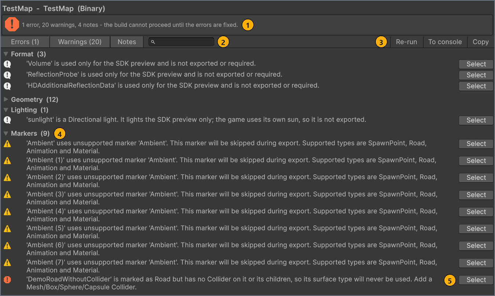

# Проверка карты

[English](../en/validation.md) · **Русский**

Проверка сверяет настройки карты и сцену с правилами игры и mod.io, ничего не собирая. Запускайте её перед каждой сборкой и исправляйте все найденные ошибки; предупреждения и заметки никогда не останавливают сборку.

## Перед началом работы

- Карта, выбранная в окне **MapBuilder**. См. [Создание или выбор карты](map-settings.md#new-map).
- Сцена карты, сохранённая и включённая в списке сцен сборки Unity, чтобы она была в списке **Сцена** (Scene) на вкладке **Сборка** (Build). Сцены из `Assets/MapResources` добавляются автоматически. См. [Создание папки и сцены карты](scene-setup.md#scene).

<a name="run"></a>
## Запуск проверки

Кнопка **Проверить карту** (Validate map) проверяет настройки карты и сцену за один проход. Она ничего не собирает, не изменяет сцену и не требует входа в mod.io, поэтому запускайте её так часто, как нужно.

Чтобы проверить карту:

1. В окне **MapBuilder** выберите вкладку **Сборка**.
1. Чтобы проверить нужную сцену, в списке **Сцена** выберите сцену карты.
   Если список **Сцена** неактивен, нажмите **Дополнительные настройки** (Advanced settings) и добавьте **Map** в **Что пересобрать** (Rebuild targets).
1. Некоторые проверки относятся только к одному формату, поэтому в списке **Формат** (Format) выберите формат, в котором будете собирать карту.
1. Нажмите **Проверить карту**.
   Если сцена из списка **Сцена** не активна, MapBuilder сначала открывает её. Если в открытых сценах есть несохранённые изменения, Unity предлагает их сохранить; если отменить, проверяются только настройки карты.

Результат: открывается окно **Map Validation**, даже если ничего не найдено, а в нижней панели окна **MapBuilder** появляется строка `Проверка завершена. Результаты — в окне проверки карты.` (`Validation finished. See the map validation window for results.`). <!-- src: Assets/Editor/MapBuilderEditorWindow.cs:967 -->

Кроме того, в Console выводится одна итоговая строка. Это предупреждение, если в отчёте есть ошибки или предупреждения; уровень с количеством 0 в строку не попадает: <!-- src: Assets/Editor/Validation/MapValidationReport.cs:145-165 -->

```text
Map validation - <map name> (<scene>): <n> errors, <n> warnings, <n> notes. The Map Validation window has the list.
Map validation - <map name> (<scene>): no problems found.
```

Кнопка **Проверить карту** неактивна, пока идёт сборка или операция публикации, а также пока из mod.io загружаются миниатюры публикаций.

### Проверка во время сборки

Кнопка **Собрать карту** (Build map) выполняет те же проверки, прежде чем что-либо собрать:

- Сначала она проверяет настройки карты; в это время в нижней панели видна строка `Проверка настроек карты…` (`Checking map settings…`). Если в настройках есть ошибка, сборка на этом останавливается, а сцена не проверяется. <!-- src: Assets/Editor/MapBuilderEditorWindow.Workspace.cs:404 -->
- Затем, как и **Проверить карту**, она открывает сцену из списка **Сцена**, если та не активна, даже когда **Что пересобрать** не включает **Map**. Если отменить предложение Unity сохранить открытые сцены, сборка останавливается без замечания проверки, а итоговая строка на вкладке **Сборка** — `Сборка не завершена полностью. Проверьте результаты проверки и Console.` (`Build incomplete. Check validation results and the Console.`). <!-- src: Assets/Editor/MapBuilder.cs:295 -->
- Затем она проверяет сцену; в это время в нижней панели видна строка `Проверка и сбор ресурсов сцены…` (`Validating and collecting scene resources…`). Этот шаг выполняется, только если **Что пересобрать** в разделе **Дополнительные настройки** включает **Map**. Любая ошибка останавливает сборку. <!-- src: Assets/Editor/MapBuilderEditorWindow.Workspace.cs:405 -->
- Предупреждения и заметки никогда не останавливают сборку.

После сборки окно **Map Validation** открывается, только если в отчёте есть хотя бы одно замечание, и кнопки **Re-run** в нём нет; если сообщать не о чем, окно закрывается. Если сборку остановила ошибка, итоговая строка на вкладке **Сборка** — `Сборка не завершена полностью. Проверьте результаты проверки и Console.` <!-- src: Assets/Editor/MapBuilderEditorWindow.Workspace.cs:387 -->

> [!IMPORTANT]
> Сборка проверяет сцену только после того, как настройки карты прошли проверку, поэтому после исправления настроек могут появиться новые ошибки. Чтобы увидеть проблемы настроек и сцены вместе, нажмите **Проверить карту**.

<a name="results"></a>
## Чтение результатов

Окно **Map Validation** перечисляет все замечания одного запуска, сгруппированные по категориям. В первой строке указаны карта, сцена и формат в виде `<map name>  -  <scene>  (<format>)`. Окно и его сообщения на английском при любом языке интерфейса. <!-- src: Assets/Editor/Validation/MapValidationWindow.cs:63 -->

На следующем скриншоте показано окно для примера TestMap с одним добавленным объектом с маркером Road, `DemoRoadWithoutCollider`, у которого нет коллайдера. Остальные замечания относятся к самой TestMap и не останавливают сборку: предупреждения о её 8 неподдерживаемых маркерах `Ambient` и, в свёрнутой категории **Geometry**, о 12 LODGroup без рендереров, а также заметки о солнце для предпросмотра и о каждом компоненте только для предпросмотра.



| # | Элемент | Что делает |
| --- | --- | --- |
| 1 | Итоговый заголовок | Показывает количество перечисленных ошибок, предупреждений и заметок. Пока есть ошибки, он заканчивается на `- the build cannot proceed until the errors are fixed.` Если замечаний нет, в нём написано `No problems found. The map is ready to build.` |
| 2 | **Errors (n)**, **Warnings (n)**, **Notes** и поле поиска | Показывают или скрывают замечания каждого уровня; в только что открытом окне включены все три фильтра. Поиск оставляет только замечания, у которых сообщение, категория или путь объекта содержит введённый текст. Пока окно открыто, фильтры и текст поиска сохраняются для следующего запуска. |
| 3 | **Re-run**, **To console**, **Copy** | **Re-run** запускает проверку снова с той же картой и тем же форматом; кнопка есть только в окне, открытом кнопкой **Проверить карту**. **To console** выводит каждое замечание в Console в виде `[Map validation] <category>: <message>` со ссылкой на его объект. **Copy** копирует отчёт в буфер обмена простым текстом. |
| 4 | Раскрывающаяся группа категории, `<category>  (<n>)` | Объединяет замечания одной категории. Нажмите заголовок, чтобы свернуть или развернуть группу. Свёрнутая категория остаётся свёрнутой в следующих запусках, пока Unity не перекомпилирует скрипты. Категории отсортированы по алфавиту. |
| 5 | **Select** | Выделяет объект или ассет, к которому относится замечание, и подсвечивает его в окне **Hierarchy** или **Project**. Для объекта сцены всплывающая подсказка кнопки показывает путь объекта. |

Чтобы разобрать результаты:

1. В окне **Map Validation** выключите фильтры **Warnings (n)** и **Notes**.
   В списке остаются только ошибки.
1. В строке следующей ошибки нажмите **Select**.
   Unity выделяет объект и подсвечивает его.
1. Исправьте объект так, как сказано в сообщении.
   Причины и способы исправления частых сообщений см. в разделе [Решение проблем](troubleshooting.md#validation-messages).
1. Повторите шаги 2 и 3 для каждой строки с ошибкой, сверху вниз.
   Список не меняется, пока вы не запустите проверку снова.
1. Нажмите **Re-run**.
   Список обновляется.
1. Чтобы просмотреть предупреждения и заметки, включите фильтры **Warnings (n)** и **Notes**.
   Снова видны все замечания.

Результат: в заголовке нет ошибок, или в нём написано `No problems found. The map is ready to build.` Теперь можно нажать кнопку **Собрать карту**.

У замечаний, которые не относятся к одному объекту, например об отсутствии точки появления, кнопки **Select** нет. Если объекта больше нет в открытой сцене, **Select** показывает `'<object path>' is not in the open scene`. <!-- src: Assets/Editor/Validation/MapValidationWindow.cs:184 -->

**Re-run** повторяет проверку для карты и формата первого запуска. Если вы сменили **Формат** или окно открыла сборка, нажмите **Проверить карту** в окне **MapBuilder**. После перекомпиляции скриптов окно показывает `Nothing has been validated yet.`, пока вы снова не запустите проверку. <!-- src: Assets/Editor/Validation/MapValidationWindow.cs:49 -->

**Copy** записывает отчёт простым текстом, который можно вставить в issue или сообщение. Замечания идут в том порядке, в каком их нашла проверка: сначала настройки карты, затем сцена. Заметки записываются как `INFO`, а каждая строка об объекте сцены заканчивается его путём: <!-- src: Assets/Editor/Validation/MapValidationReport.cs:189-212 -->

```text
Map validation - <map name> (<scene>, <format>)
<n> errors, <n> warnings, <n> notes

INFO [Format] 'Volume' is used only for the SDK preview and is not exported or required.  <- <object path>
ERROR [Markers] '<object>' is marked as Road but has no Collider on it or its children, so its surface type will never be used. Add a Mesh/Box/Sphere/Capsule Collider.  <- <object path>
WARNING [Lighting] The map has <n> Directional Lights. These affect the SDK preview only; the game supplies its own environment lighting.  <- <object path>
```

<a name="severities"></a>
## Уровни важности

У каждого замечания один из трёх уровней. Сборку останавливают только ошибки.

| Уровень | В окне | Останавливает сборку | Что означает |
| --- | --- | --- | --- |
| Ошибка | Значок ошибки; учитывается в **Errors (n)** | Да | Карту нельзя собрать, или она не будет работать в игре. Исправьте все ошибки. |
| Предупреждение | Значок предупреждения; учитывается в **Warnings (n)** | Нет | Что-то пропускается или будет выглядеть либо работать в игре неправильно. Просмотрите каждое предупреждение. |
| Заметка | Значок информации; видна при включённом фильтре **Notes**; `INFO` в скопированном тексте | Нет | Информация, например о компоненте, который экспорт пропускает или который освещает только предпросмотр в редакторе. |

Проверка просматривает все объекты выбранной сцены, включая неактивные объекты и выключенные компоненты. Она пропускает объекты с тегом `Garbage` вместе с их дочерними объектами, а также объекты, которые редактор скрывает или не сохраняет со сценой. См. [Организация сцены](scene-setup.md#garbage).

Если правило, которое проверяет отдельные объекты, находит больше 25 объектов, окно перечисляет первые 25 и добавляет одну заметку в категорию `Summary`: `<rule>: <n> more of the same, not listed individually.` Здесь `<rule>` — внутреннее имя правила, например `unsupported-AudioSource` или `sector-render mesh`. <!-- src: Assets/Editor/Validation/MapValidationReport.cs:89-115 -->

> [!NOTE]
> Количество в заголовке и на **Errors (n)** и **Warnings (n)** учитывает только перечисленные замечания, а не те, что свёрнуты в `Summary`.

<a name="catalogue"></a>
## Что проверяется

Сначала проверяются настройки карты, затем сцена. Окно сортирует категории по алфавиту, и в этой таблице они идут в том же порядке.

| Категория | Что проверяет | Уровни |
| --- | --- | --- |
| Budget | Сколько в сцене компонентов каждого поддерживаемого типа | Ошибки |
| Components | Компоненты, которые экспорт пропускает: неподдерживаемые типы, отсутствующие скрипты, анимация без маркера | Заметки |
| Format | Компоненты, которые освещают только предпросмотр в редакторе, и формат сборки | Заметки, ошибка |
| Geometry | Меши, слоты материалов, коллайдеры MeshCollider, группы LOD, оптимизация сборки и бюджет сектора | Предупреждения, ошибка |
| Lighting | Источники света, которые не попадают в игру | Предупреждения, заметка |
| Markers | GameMarkerData: типы маркеров, точки появления, коллайдеры для Road, маркеры Animation и Material | Ошибки, предупреждения, заметка |
| Meta | Настройки карты: имя сцены, **Название** (Name), краткое описание, **Описание** (Description), иконка и превью | Ошибки, предупреждения, заметка |
| Minimap | Размер и текстуры Minimap | Ошибки |
| Physics | Коллайдеры MeshCollider на движущихся Rigidbody | Ошибка |
| Scene | Удалось ли кнопке **Проверить карту** открыть выбранную сцену | Заметка |
| Summary | Замечания одного правила сверх первых 25 | Заметки |

В следующих разделах каждое сообщение приведено дословно и в том же порядке. Текст в угловых скобках обозначает значение из вашей карты, например `<object>` — имя GameObject. Если для сообщения есть запись на странице [Решение проблем](troubleshooting.md), строка ссылается на неё.

<details>
<summary><b>Budget</b>: количество компонентов</summary>

Сцена должна укладываться в количества компонентов из раздела [Поддерживаемые компоненты и лимиты](reference.md#budgets).

| Уровень | Сообщение | Что сделать |
| --- | --- | --- |
| Ошибка | `'<type>': the map has <n>, at least <min> is required.` | Добавьте недостающий компонент. Обычно это `'Minimap'` или `'GameMarkerData'`. См. [Решение проблем](troubleshooting.md#msg-budget-count). |
| Ошибка | `'<type>': the map has <n>, at most <max> is allowed.` | Удалите компоненты этого типа или назначьте тег `Garbage` объектам, которые не нужны игре. См. [Решение проблем](troubleshooting.md#msg-budget-count). |

</details>

<details>
<summary><b>Components</b>: компоненты, которые экспорт пропускает</summary>

Проверка принимает типы компонентов из [таблицы лимитов](reference.md#budgets). Animator и SkinnedMeshRenderer тоже принимаются, но только под тем Animator, который использует маркер Animation. Для любого другого компонента проверка добавляет заметку, а экспорт его пропускает. <!-- src: Assets/Editor/Validation/SceneValidator.cs:136-177 -->

| Уровень | Сообщение | Что сделать |
| --- | --- | --- |
| Заметка | `'<object>' has a missing script in component slot <i>. This slot is skipped during export.` | Удалите отсутствующий скрипт с объекта или оставьте его: экспорт его пропустит. |
| Заметка | `'<type>' on '<object>' requires a GameMarkerData Animation marker on the Animator root. This component is skipped; add the marker to export baked vertex animation.` | `<type>` — Animator или SkinnedMeshRenderer. Чтобы экспортировать анимацию, добавьте маркер Animation на объект с Animator. См. [Вершинная анимация объектов](markers.md#animation). См. [Решение проблем](troubleshooting.md#msg-animator-no-marker). |
| Заметка | `'<type>' on '<object>' is not a supported component and will not be exported. It is skipped automatically; supported components on this object are still exported.` | Ничего делать не нужно. Unity Terrain попадает сюда как `Terrain` и `TerrainCollider` и не экспортируется: преобразуйте его в меш с MeshCollider. Чтобы заметка больше не появлялась, назначьте объекту тег `Garbage`, если ничего на нём не должно экспортироваться, или выполните шаги из раздела [Скрытие заметок для типа компонента](#skip-types). См. [Решение проблем](troubleshooting.md#msg-unsupported-component). |

</details>

<details>
<summary><b>Format</b>: компоненты только для предпросмотра и формат сборки</summary>

Эти замечания относятся к компонентам, которые использует только предпросмотр в редакторе, и к выбранному формату. <!-- src: Assets/Editor/Validation/SceneValidator.cs:153-157 -->

| Уровень | Сообщение | Что сделать |
| --- | --- | --- |
| Заметка | `'<type>' is used only for the SDK preview and is not exported or required.` | Ничего делать не нужно. `<type>` — Volume, ReflectionProbe или HDAdditionalReflectionData; они освещают только предпросмотр в редакторе. |
| Ошибка | `Unsupported map format. Select Wavefront or Binary and rebuild Map and Meta.` | В списке **Формат** выберите **Binary** или **Wavefront**, затем соберите карту снова. Сообщение появляется, только если сохранённое значение формата недопустимо. |

</details>

<details>
<summary><b>Geometry</b>: меши, группы LOD и бюджет сектора</summary>

Эти проверки охватывают меши, слоты материалов, коллайдеры MeshCollider, группы LOD и оптимизацию сборки. См. [Оптимизация](build.md#optimization). <!-- src: Assets/Editor/Validation/SceneValidator.cs:762-828,853-883 -->

| Уровень | Сообщение | Что сделать |
| --- | --- | --- |
| Предупреждение | `'<object>' has a MeshRenderer but no MeshFilter, so it has no geometry to export.` | Добавьте MeshFilter с мешем или удалите MeshRenderer. |
| Предупреждение | `'<object>' has a MeshFilter with no mesh assigned.` | Назначьте меш или удалите MeshFilter. |
| Предупреждение | `'<object>' has an empty material slot; it will render as magenta in game.` | Назначьте материал в каждый слот MeshRenderer. См. [Решение проблем](troubleshooting.md#msg-empty-material-slot). |
| Предупреждение | `'<object>' has a MeshCollider with no mesh assigned, so it collides with nothing.` | Назначьте меш в MeshCollider или удалите его. |
| Ошибка | `'<object>' has <n> LOD levels; at most 8 are supported and the whole group is skipped on export. Merge or remove levels.` | Сократите LODGroup до 8 уровней или меньше. См. [Решение проблем](troubleshooting.md#msg-lod-levels). |
| Предупреждение | `'<object>' has a LODGroup with no renderers assigned to any level.` | Назначьте рендереры уровням LOD или удалите LODGroup. |
| Предупреждение | `Build optimization is off: static meshes and colliders are exported as-is, without sector chunking, collider simplification or LODs. Large maps get more draw calls, heavier physics and longer loading. Enable it in Build > Optimization.` | На вкладке **Сборка** нажмите **Оптимизация** (Optimization), затем установите флажок **Оптимизировать сборку** (Optimize build). Кнопка **Select** в этой строке выделяет ассет настроек карты. См. [Решение проблем](troubleshooting.md#msg-optimization-off). |
| Предупреждение | `'<object>' (<mesh>): static <kind>, <n> triangles, world bounds <x> x <y> x <z> m. Exceeds sector budget (<size> m / <n> triangles). Review Build > Optimization; size alone does not prove a performance issue.` | `<kind>` — `collider` или `render mesh`. Меш экспортируется целиком, потому что снят флажок **Оптимизировать сборку** либо флажок **Разбивать статические коллайдеры** (Partition static colliders) для коллайдера или **Разбивать статические меши** (Partition static render meshes) для меша рендеринга. Установите флажок или разделите меш в своём 3D-редакторе. После сборки прокатитесь по карте, чтобы проверить результат. См. [Решение проблем](troubleshooting.md#msg-sector-budget). |

Какие меши охватывает проверка секторов, см. в разделе [Бюджет сектора](reference.md#sector-budget).

</details>

<details>
<summary><b>Lighting</b>: источники света, которые не попадают в игру</summary>

Экспортируются только источники света Point и Spot. См. [Настройка освещения](scene-setup.md#lighting). <!-- src: Assets/Editor/Validation/SceneValidator.cs:713-760 -->

| Уровень | Сообщение | Что сделать |
| --- | --- | --- |
| Заметка | `'<object>' is a Directional light. It lights the SDK preview only; the game uses its own sun, so it is not exported.` | Ничего делать не нужно: солнце для предпросмотра ожидаемо, а игра освещает карту сама. Заметка появляется для каждого включённого источника Directional. Чтобы убрать её, назначьте источнику тег `Garbage`; он по-прежнему будет освещать предпросмотр в редакторе. См. [Решение проблем](troubleshooting.md#msg-directional-light). |
| Предупреждение | `'<object>' is a <type> light. Wavefront/Binary exports Point and Spot lights only, so this one will not reach the mod.` | Предупреждение появляется для каждого включённого источника света, кроме Point, Spot и Directional, например для Area. Смените тип источника на Point или Spot или назначьте ему тег `Garbage`, если он должен освещать только предпросмотр в редакторе. См. [Решение проблем](troubleshooting.md#msg-light-type). |
| Предупреждение | `The map has <n> Directional Lights. These affect the SDK preview only; the game supplies its own environment lighting.` | Оставьте один Directional Light для предпросмотра или назначьте лишним тег `Garbage`. Выключенные Directional Light тоже учитываются. См. [Решение проблем](troubleshooting.md#msg-directional-light). |

</details>

<details>
<summary><b>Markers</b>: GameMarkerData</summary>

Эти проверки охватывают типы маркеров, точки появления, маркеры Road и маркеры Animation. См. [Маркеры GameMarkerData](markers.md). <!-- src: Assets/Editor/Validation/SceneValidator.cs:213-294 -->

| Уровень | Сообщение | Что сделать |
| --- | --- | --- |
| Ошибка | `'<object>' has a GameMarkerData with no type selected.` | Выберите тип в маркере или удалите компонент. |
| Предупреждение | `'<object>' uses unsupported marker '<head>'. This marker will be skipped during export. Supported types are SpawnPoint, Road, Animation and Material.` | Удалите компонент или выберите поддерживаемый тип. Сюда попадают старые типы `Ambient`, `TimeObjectActivator` и `NetworkObject`. См. [Решение проблем](troubleshooting.md#msg-unsupported-marker). |
| Ошибка | `Animation marker requires an Animator with animation clips.` | В маркере Animation назначьте **Animator** или поместите маркер на объект с Animator. У Animator должен быть контроллер хотя бы с одним клипом. См. [Решение проблем](troubleshooting.md#msg-animation-no-animator). |
| Ошибка | `'<object>' is marked as Road but has no Collider on it or its children, so its surface type will never be used. Add a Mesh/Box/Sphere/Capsule Collider.` | Добавьте Mesh, Box, Sphere или Capsule Collider на тот же GameObject, что и маркер. Проверка принимает и коллайдер на дочернем объекте, но экспорт не назначает такому коллайдеру поверхность. См. [Решение проблем](troubleshooting.md#msg-road-no-collider). |
| Ошибка | `The map has no GameMarkerData at all - at minimum it needs a spawn point.` | Добавьте маркер SpawnPoint. Сцена без маркеров получает также следующую ошибку и ошибку Budget. См. [Решение проблем](troubleshooting.md#msg-no-spawn). |
| Ошибка | `The map has no SpawnPoint marker, so there is nowhere for a car to appear. Add an empty object with GameMarkerData set to SpawnPoint.` | Создайте пустой GameObject, добавьте компонент GameMarkerData и выберите **SpawnPoint**. См. [Решение проблем](troubleshooting.md#msg-no-spawn). |
| Предупреждение | `<n> spawn points are all named '<name>'. Wavefront/Binary exports the object name as the spawn point's identity, so give each one a distinct, meaningful name.` | Переименуйте объекты точек появления. Карта мира в игре показывает каждую точку появления под её именем. См. [Решение проблем](troubleshooting.md#spawn-names). |

</details>

<details>
<summary><b>Markers</b>: маркеры Material</summary>

Маркеры Material заменяют материалы вариантами render core и действуют только в сборках Binary. Их замечания появляются в категории Markers. Две последние строки проверяются, только если в списке **Формат** выбрано **Binary**. См. [Замена материалов вариантами render core](markers.md#material). <!-- src: Assets/Editor/Validation/SceneValidator.cs:300-524,592-663 -->

| Уровень | Сообщение | Что сделать |
| --- | --- | --- |
| Предупреждение | `'<object>' has a Material marker, but render core materials are exported only in the Binary format. Wavefront ignores the marker and exports the original materials.` | В списке **Формат** выберите **Binary** или удалите маркер. Появляется, только если в списке **Формат** выбрано **Wavefront**. |
| Предупреждение | `'<object>' has a Material marker without materials. Press 'Add renderer materials' or remove the marker.` | В маркере нажмите **Add renderer materials** или удалите маркер. |
| Предупреждение | `'<object>' has a Material marker, but neither a MeshRenderer nor a LODGroup on the same object, so it changes nothing.` | Перенесите маркер на объект с MeshRenderer или LODGroup. |
| Предупреждение | `'<object>' is part of a baked vertex animation. Its Material marker is ignored: animated objects keep their own materials.` | Удалите маркер. Анимированные объекты сохраняют свои материалы. |
| Ошибка | `'<object>' has a Material marker entry without a source material. Assign it or remove the entry.` | В записи назначьте **Source material** или нажмите **Remove** в заголовке записи. |
| Ошибка | `'<object>': material '<material>' has no supported render core variant ('<variant>').` | В записи выберите **Render core variant**. |
| Ошибка | `'<object>': material '<material>' uses render core variant <variant>, which is unavailable in mods: <reason>. Choose another variant.` | В записи выберите другой **Render core variant**. |
| Предупреждение | `'<object>': material '<material>' is not used by the renderer, so its render core override is never applied.` | Удалите запись или назначьте материал рендереру. |
| Предупреждение | `'<object>': render core material '<material>' (<variant>) stores values that the variant does not have: <names>. They are not exported. Press 'Export from material' or 'Remove' next to 'Unused values' in the marker.` | В записи нажмите **Export from material** или нажмите **Remove** рядом с **Unused values**. |
| Предупреждение | `'<object>': render core material '<material>' (<variant>) was exported from material for revision <n>, but this SDK has revision <n> of the variant. The game uses the fallback material until you re-run Export from material on this entry.` | В записи нажмите **Export from material**. См. [Решение проблем](troubleshooting.md#msg-render-core-revision). |
| Предупреждение | `'<object>': render core material '<material>' (<variant>) has no diffuse texture and will render white. Press 'Export from material' or assign the texture.` | В записи нажмите **Export from material** или назначьте диффузную текстуру. См. [Решение проблем](troubleshooting.md#msg-render-core-no-diffuse). |
| Предупреждение | `'<renderer>': mesh '<mesh>' has no vertex colors, but <variant> blends its layers by them (RGB - layer mask, A - albedo tint). It is exported white, so only the fourth layer shows. Paint vertex colors in the mesh.` | Раскрасьте цвета вершин меша в своём 3D-редакторе, затем импортируйте его снова. |
| Предупреждение | `'<renderer>': mesh '<mesh>' mixes <variant> and <source> submeshes. The game keeps the layer blend vertex colors for the whole mesh, so the emission is multiplied by them. Move the emissive part to a separate object without layer blend materials: build optimization merges layer blend objects only with each other.` | Перенесите эмиссивную часть на отдельный объект. `<source>` — эмиссивный вариант или `emissive material '<material>'`. |
| Заметка | `'<object>': material '<material>' is double-sided and alpha-tested (vegetation?) and is mapped to <variant>. If it is vegetation, MAT_FOLIAGE_ALPHATEST (with a normal map) or MAT_FOLIAGE_SIMPLE_ALPHATEST (without) gives it foliage lighting; for a fence, grate or cable keep <variant>.` | Для растительности выберите `MAT_FOLIAGE_ALPHATEST` или `MAT_FOLIAGE_SIMPLE_ALPHATEST`. Для забора, решётки или кабеля оставьте вариант. Только Binary. |
| Предупреждение | `Material '<material>' is mapped to different render core variants by Material markers: <uses>. Objects with this material render differently (for example, one LOD loses foliage lighting). Use one variant for this material in all marker entries.` | Выберите один и тот же **Render core variant** для этого материала во всех записях маркеров. Только Binary. |

</details>

<details>
<summary><b>Meta</b>: настройки карты</summary>

Эти проверки читают вкладку **Карта** (Map) и значение **Сцена** на вкладке **Сборка**. См. [Заполнение вкладки «Карта»](map-settings.md#map-tab). <!-- src: Assets/Editor/Validation/MapMetaValidator.cs:16-25 -->

Лимиты берутся из конфигурации mod.io, которая поставляется с проектом; см. [Ограничения](reference.md#limits). <!-- src: Assets/Resources/CarX.Modding/ModIoConfig.asset:27-30 -->

В сообщениях об изображениях `<image>` — это `icon` или `preview`. В строках о назначенном изображении кнопка **Select** выделяет текстуру в окне **Project**.

| Уровень | Сообщение | Что сделать |
| --- | --- | --- |
| Ошибка | `No target scene is selected. Pick one in Build Settings.` | На вкладке **Сборка** в списке **Сцена** выберите сцену карты. Если список пуст, сохраните сцену и включите её в списке сцен сборки. См. [Решение проблем](troubleshooting.md#scene-empty). |
| Ошибка | `The scene name '<scene>' cannot be used for a build. Start with a letter and use only letters, digits and underscores.` | Переименуйте файл сцены, например в `MyMap_01.unity`. См. [Решение проблем](troubleshooting.md#msg-scene-name). |
| Ошибка | `The track has no name. Fill in Workshop Name on the map config.` | На вкладке **Карта** заполните поле **Название**. В сообщении это поле называется Workshop Name. См. [Решение проблем](troubleshooting.md#msg-track-name). |
| Ошибка | `The track name '<name>' contains characters that cannot be published. Use letters, digits, spaces and -_'.,:!?()&+/, with no leading or trailing spaces.` | Удалите из поля **Название** другие символы, а также пробелы в начале и в конце. См. [Решение проблем](troubleshooting.md#msg-track-name). |
| Ошибка | `The track name is <n> characters; this vendor allows <limit>.` | Сократите текст в поле **Название**. См. [Решение проблем](troubleshooting.md#msg-track-name). |
| Ошибка | `The description is <n> characters; this vendor allows <limit>.` | Сократите текст в поле **Описание**. См. [Решение проблем](troubleshooting.md#msg-summary-length). |
| Ошибка | `This vendor requires a summary and there is nothing to build one from. Fill in Summary, or the first line of the description.` | Заполните поле **Название**. Эта ошибка появляется, только если поля **Название**, **Краткое описание (необязательно)** (Summary (optional)) и **Описание** все пусты: вместо пустого краткого описания берётся первая строка поля **Описание**, а затем текст `<Name> track.` |
| Ошибка | `The summary is <n> characters; this vendor allows <limit>. It is taken from the first line of the description - add a shorter Summary instead.` | Заполните поле **Краткое описание (необязательно)** коротким текстом или сократите первую строку поля **Описание**. См. [Решение проблем](troubleshooting.md#msg-summary-length). |
| Ошибка | `The summary is <n> characters; this vendor allows <limit>. Shorten the Summary field.` | Сократите первую строку поля **Краткое описание (необязательно)**. Используется только она. См. [Решение проблем](troubleshooting.md#msg-summary-length). |
| Ошибка | `No Icon is assigned. It is the image shown for the map in game and on the mod page, and both vendors need one before an entry can be created.` | На вкладке **Карта** назначьте изображение в **Иконка · 16:9** (Icon · 16:9). См. [Решение проблем](troubleshooting.md#msg-no-icon). |
| Ошибка | `The icon '<texture>' has Read/Write disabled. Enable it in the texture import settings.` | Выберите текстуру. В окне **Inspector** разверните **Advanced**, установите флажок **Read/Write** и нажмите **Apply**. См. [Решение проблем](troubleshooting.md#msg-icon-read-write). |
| Предупреждение | `No Preview is assigned. The map will have no large image on the mod page or on the loading screen.` | Необязательно: на вкладке **Карта** назначьте изображение в **Превью · 16:9** (Preview · 16:9). См. [Решение проблем](troubleshooting.md#msg-no-icon). |
| Ошибка | `The preview '<texture>' has Read/Write disabled. Enable it in the texture import settings.` | Включите **Read/Write** для текстуры так же, как для иконки. См. [Решение проблем](troubleshooting.md#msg-icon-read-write). |
| Предупреждение | `The <image> is a <extension> file. The uploader uploads the source file as is and the documented format is PNG.` | `<extension>` — `.jpg` или `.jpeg`. Сохраните изображение в PNG и назначьте его снова. См. [Решение проблем](troubleshooting.md#msg-icon-format). |
| Ошибка | `The <image> is a <extension> file, which is uploaded as is and is not an image a vendor accepts. Save it as PNG.` | Сохраните изображение в PNG и назначьте его снова. См. [Решение проблем](troubleshooting.md#msg-icon-format). |
| Ошибка | `The <image> is <size> mb; the limit is <limit> mb.` | Уменьшите файл, чтобы он не превышал `<limit>`. См. [Решение проблем](troubleshooting.md#msg-icon-format). |
| Заметка | `The scene itself was not validated - fix the configuration first, then build again.` | Исправьте ошибки этой категории. Заметка добавляется всякий раз, когда в настройках карты или в формате сборки есть ошибки. Сборка останавливается до проверки сцены, а **Проверить карту** всё равно проверяет сцену и тоже перечисляет её замечания. См. [Решение проблем](troubleshooting.md#msg-scene-not-validated). |

</details>

<details>
<summary><b>Minimap</b>: размер и текстуры</summary>

В сцене должен быть ровно один Minimap; их количество проверяет категория Budget. Держите объект Minimap активным: проверка учитывает и неактивный Minimap, но сборка экспортирует только активный. См. [Добавление мини-карты](minimap-and-images.md#minimap). <!-- src: Assets/Editor/Validation/SceneValidator.cs:885-934 -->

| Уровень | Сообщение | Что сделать |
| --- | --- | --- |
| Ошибка | `'<object>': Bound Size is <size>. Set it to the size of the map in world units, or the minimap collapses to a point in game.` | В компоненте Minimap задайте в **Bounds Size** размер карты в мировых единицах. В сообщении это поле называется Bound Size. См. [Решение проблем](troubleshooting.md#msg-bounds-size). |
| Ошибка | `'<object>': no textures assigned. Add at least one entry with a Main Texture.` | В **Textures** добавьте элемент и назначьте его **Main Texture**. См. [Решение проблем](troubleshooting.md#msg-no-textures). |
| Ошибка | `'<object>': Textures element <i> has no Main Texture assigned.` | Назначьте **Main Texture** в этом элементе или удалите элемент. См. [Решение проблем](troubleshooting.md#msg-no-textures). |
| Ошибка | `'<object>': Textures element <i> is a <type>. Only Texture2D can be exported.` | Назначьте импортированное изображение (Texture2D), а не Render Texture или текстуру другого типа. См. [Решение проблем](troubleshooting.md#msg-no-textures). |

</details>

<details>
<summary><b>Physics</b>: MeshCollider на движущихся Rigidbody</summary>

Rigidbody, который не является кинематическим, требует выпуклых (convex) коллайдеров MeshCollider. Rigidbody может находиться на объекте коллайдера или на родительском объекте. <!-- src: Assets/Editor/Validation/SceneValidator.cs:830-851 -->

| Уровень | Сообщение | Что сделать |
| --- | --- | --- |
| Ошибка | `'<object>' has a non-convex MeshCollider driven by a non-kinematic Rigidbody, which the physics engine no longer supports. Tick Convex, or make the Rigidbody kinematic.` | На MeshCollider установите флажок **Convex** или на Rigidbody установите флажок **Is Kinematic**. См. [Решение проблем](troubleshooting.md#msg-non-convex-dynamic). |

</details>

<details>
<summary><b>Scene</b> и <b>Summary</b></summary>

Заметку Scene добавляет сама кнопка **Проверить карту**, а заметку Summary — ограничение в 25 перечисленных замечаний на правило. <!-- src: Assets/Editor/MapBuilder.cs:389-390 -->

| Уровень | Сообщение | Что сделать |
| --- | --- | --- |
| Заметка | `'<scene>' was not opened, so only the configuration was checked.` | Появляется, если вы отменили предложение сохранить открытые сцены или если сцена не выбрана; во втором случае `<scene>` пусто. Нажмите **Проверить карту** ещё раз и, когда Unity спросит, сохраните или отмените изменения. См. [Решение проблем](troubleshooting.md#msg-scene-not-opened). |
| Заметка | `<rule>: <n> more of the same, not listed individually.` | Исправьте перечисленные замечания этого правила, затем запустите проверку снова, чтобы увидеть остальные. |

</details>

<a name="skip-types"></a>
### Скрытие заметок для типа компонента

Неподдерживаемые компоненты дают заметки и никогда не останавливают сборку. Если компонент какого-то типа находится в сцене намеренно, например источники звука, которые вы оставили для справки, можно сделать так, чтобы проверка его не перечисляла.

Чтобы скрыть заметки для типа компонента:

1. В окне **Project** выберите `Assets/Resources/MapSkipComponentConfig.asset`. <!-- src: Assets/Resources/MapSkipComponentConfig.asset:15-16 -->
1. В окне **Inspector**, в списке **Valid**, нажмите **+**.
1. В новом элементе введите имя типа компонента точно так, как его показывает заметка, например `AudioSource`.

Результат: следующая проверка больше не выводит заметки `'AudioSource' on '<object>' is not a supported component…`. Компонент по-прежнему не экспортируется.

- Что скрывает запись и какая запись есть в списке изначально, см. в разделе [MapSkipComponentConfig](reference.md#skip-components).
- Редактируйте этот ассет, а не создавайте новый. Если в папках `Resources` есть два ассета MapSkipComponentConfig, проверка останавливается с сообщением `(Singleton) Multiple config for : MapSkipComponentConfig` в Console. <!-- src: Assets/Scripts/SingletonScriptableObject.cs:26 -->

<a name="elsewhere"></a>
## Что проверяется в других местах

Некоторые проблемы никогда не появляются в окне **Map Validation**. Проверяйте их отдельно.

**Размер сборки.** MapBuilder проверяет размер карты и её метаданных только непосредственно перед действием кнопки **Создать публикацию** (Create publication) или **Обновить публикацию** (Update publication), и слишком большая сборка останавливает загрузку с ошибкой в Console. Лимиты см. в разделе [Размер сборки](reference.md#limits-size), а исправление — на странице [Решение проблем](troubleshooting.md#msg-map-size). <!-- src: Assets/Editor/MapBuilder.Storage.cs:158-182 -->

**Ошибки экспорта.** Некоторые проблемы обнаруживаются только тогда, когда сборка экспортирует сцену. Они останавливают сборку и появляются в Console в виде исключения, обычно `InvalidOperationException`, а итоговая строка на вкладке **Сборка** — `Сборка не завершена полностью. Проверьте результаты проверки и Console.` Экспорт также может выводить предупреждения, которые не останавливают сборку. Все ошибки и предупреждения экспорта с причинами и способами исправления см. в разделе [Ошибки сборки в Console](troubleshooting.md#build-errors). <!-- src: Assets/Editor/MapBuilder.cs:323-327 -->

**Размер изображений в пикселях.** Проверка контролирует формат, Read/Write и размер файла иконки и превью, но не их размер в пикселях и не соотношение сторон. См. [Требования к изображениям](minimap-and-images.md#images).

## Дальнейшие шаги

Когда **Проверить карту** не показывает ошибок, нажмите кнопку **Собрать карту**, затем экспортируйте карту и прокатитесь по ней в игре.

← [Сборка карты](build.md) · [Оглавление](README.md) · [Тест в игре](test-in-game.md) →
